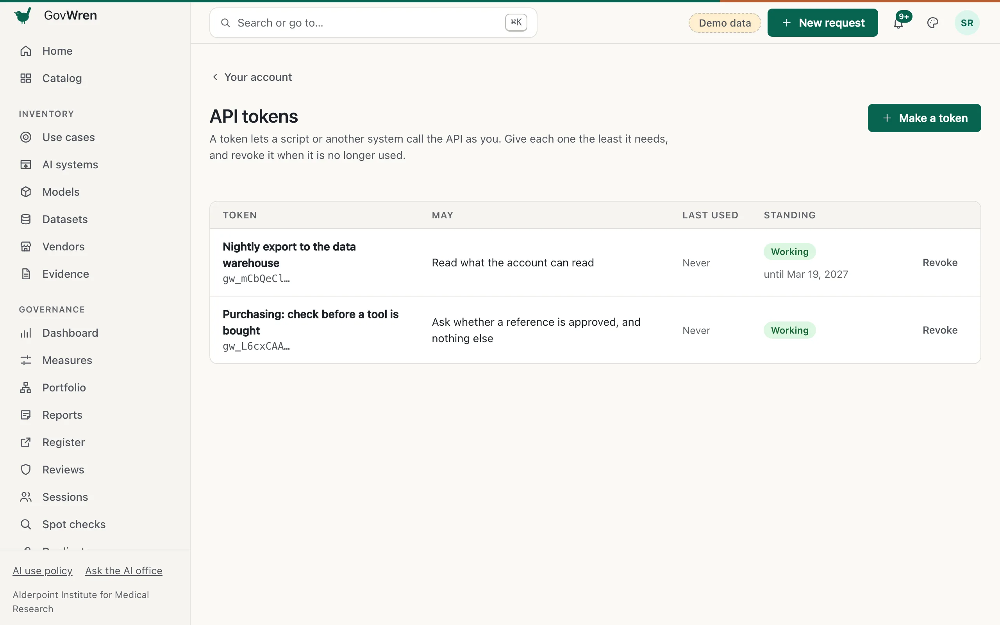
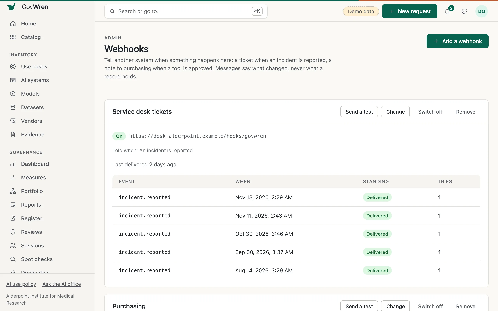

# API

Everything the web app does, it does through GovWren's JSON API. You can use the same API to connect another system. This guide covers the conventions and the main routes. The exact shape of every request and response is in the OpenAPI document.

## The basics

| | |
|---|---|
| Base path | `/api/v1` |
| Format | JSON in, JSON out |
| Sign-in | An API token in the `Authorization` header, or a session cookie set by `POST /api/v1/session` |
| Changes | Need the `X-CSRF-Token` header |
| Success | `{"data": …, "meta": …}` |
| Errors | A problem document, `application/problem+json` |
| OpenAPI | [`docs/openapi.json`](openapi.json) in the repository, and `/api/openapi.json` on a running server |

The API is not cached: every API response carries `Cache-Control: no-store`. The server does not serve interactive API documentation pages. Load the OpenAPI document into a viewer of your choice.

A script or another system should use an [API token](#use-a-token-from-a-script). A token acts as the account it belongs to, cut down to its scope, and needs no session and no CSRF token. Signing in with a password, as shown next, is what the web app does.

## Sign in

Send an email address and password. The answer sets the session cookie, `govwren_session`, and returns who you are, your roles, and a CSRF token.

```bash
curl -s -c cookies.txt \
  -H 'Content-Type: application/json' \
  -d '{"email": "you@example.org", "password": "your password"}' \
  http://127.0.0.1:8000/api/v1/session
```

```json
{
  "data": {
    "account": {"id": 1, "name": "Your Name", "email": "you@example.org"},
    "roles": ["governance", "member"],
    "permissions": {"admin": false, "govern": true, "configure": true, "read_all": true,
                    "edit_all": true, "review": true, "steward": false},
    "steward_units": [],
    "member_units": [],
    "has_password": true,
    "csrf_token": "…"
  },
  "meta": {}
}
```

- The cookie is `HttpOnly` and `SameSite=Strict`, and `Secure` when the request arrived over HTTPS.
- A session ends after 12 hours without activity and after 7 days in any case, unless [configured](configuration.md#server) otherwise.
- A wrong email address or password answers 401. After five failures in fifteen minutes, sign-in answers 429 for a while.
- `GET /api/v1/session` returns the same document for the current session, or 401 if nobody is signed in. Use it to fetch the CSRF token again.
- `DELETE /api/v1/session` signs out. It needs no CSRF token.

## Send the CSRF token with every change

Every request that is not a `GET`, `HEAD`, or `OPTIONS` must carry the session's CSRF token in the `X-CSRF-Token` header. Without it the answer is 403. Signing in and signing out are the exceptions.

```bash
curl -s -b cookies.txt \
  -H 'Content-Type: application/json' \
  -H 'X-CSRF-Token: THE_TOKEN' \
  -d '{"name": "Brightfen Labs"}' \
  http://127.0.0.1:8000/api/v1/vendors
```

GovWren also refuses changes that come from another site in a browser: a request whose `Origin` header does not match the host it was sent to, or that the browser marks as cross-site, answers 403. A command-line client sends no `Origin` header and is not affected.

## Use a token from a script

A token lets a script call the API without a password or a session.

1. Sign in to GovWren, open **Your account**, and choose **Manage your tokens**.
2. Choose **Make a token**. Say what it is for, choose what it may do, and give it an end date if you can.
3. Copy the token. It is shown once. GovWren keeps only its SHA-256 and cannot show it again.



Send it with each request:

```bash
curl -s -H "Authorization: Bearer $GOVWREN_TOKEN" \
  http://127.0.0.1:8000/api/v1/checkpoint/UC-0042
```

| Scope | The token may |
|---|---|
| `checkpoint` | Call the [checkpoint](#the-checkpoint) and nothing else |
| `signal` | Push results onto records with `POST /api/v1/signals`, and nothing else. See [Connecting other systems](connecting.md#recipe-results-from-an-evaluation-or-a-monitor) |
| `read` | Read whatever its account can read |
| `write` | Read and change whatever its account can |

What to know:

- A token is its account. It never does more than the account's roles allow, and it stops working when the account is disabled.
- A request with a token needs no CSRF token.
- A token cannot make, list, or revoke tokens. A person does that, signed in.
- **Revoke** stops a token at once. An administrator sees everyone's tokens with `GET /api/v1/admin/tokens` and can revoke any of them.
- Making and revoking a token are in the history. Using one is not.
- Keep tokens out of code and out of files that are shared. Put them in the environment or in a secret store.

For a system that should not be tied to a person, make an account for it, give that account the least it needs, and make its token signed in as that account.

## The checkpoint

The checkpoint answers one question for another system: is this reference approved, for what data, and until when?

A purchasing form, an ethics application, or a data access request asks for a GovWren reference. The system that receives it asks the checkpoint before it proceeds.

```bash
curl -s -H "Authorization: Bearer $GOVWREN_TOKEN" \
  "http://127.0.0.1:8000/api/v1/checkpoint/UC-0042?data_class=protected"
```

```json
{
  "data": {
    "ref": "UC-0042",
    "type": "use_case",
    "name": "Summarizing clinic letters",
    "checked_on": "2026-11-19",
    "status": "approved_with_conditions",
    "approved": true,
    "approved_until": "2027-05-01",
    "tier": 3,
    "data_class": "protected",
    "data_class_label": "Protected",
    "asked_data_class": "protected",
    "allowed": true
  },
  "meta": {}
}
```

| Field | Means |
|---|---|
| `approved` | For a use case: an approval is in force today. For an AI system or model: it is approved in the catalog. For a vendor: it is active |
| `approved_until` | The day a use case's approval ends |
| `data_class` | The most sensitive class of data the record covers |
| `allowed` | Present when you send `data_class`: the record is approved and covers data that sensitive |

Proceed only when `allowed` is true, or `approved` is true if you did not ask about a data class. A reference that does not exist answers 404.

The checkpoint gives a record's standing and nothing about its content, so any signed-in person and any token may ask about any reference. A token with the `checkpoint` scope can do nothing else, which makes it safe to hand to another team.

## Webhooks

A webhook tells another system when something happens, so that it need not keep asking. An administrator sets them up under **Admin → Webhooks**.



| Event | Sent when | `data` holds |
|---|---|---|
| `use_case.status_changed` | A use case is submitted, approved, declined, lapses, is suspended, or is retired | `ref`, `name`, `from`, `to`, `tier`, `approved_until` |
| `decision.made` | A review is decided | `review`, `ref`, `outcome`, `approved_until`, `by_rule` |
| `catalog.changed` | An AI system's or model's catalog standing changes | `ref`, `type`, `from`, `to` |
| `incident.reported` | An incident is reported | `ref`, `category` |

A message says what changed and never what a record holds. Call the API with the reference if you need more.

```json
{"at": "2026-11-19T15:04:11.000000Z", "data": {"from": "in_review", "name": "Summarizing clinic letters",
 "ref": "UC-0042", "tier": 3, "to": "approved_with_conditions", "approved_until": "2027-05-01"},
 "event": 18211, "topic": "use_case.status_changed"}
```

### Check the signature

When you add a webhook, GovWren shows its signing secret once. Every delivery carries these headers:

| Header | Holds |
|---|---|
| `X-GovWren-Topic` | The event, such as `decision.made` |
| `X-GovWren-Delivery` | A number for this delivery. A delivery that is sent again keeps its number |
| `X-GovWren-Timestamp` | When it was sent, in seconds since 1970 |
| `X-GovWren-Signature` | `sha256=` and the HMAC-SHA256 of the timestamp, a dot, and the body, keyed with the secret |

Recompute the signature over the body exactly as received, compare in constant time, and refuse a timestamp more than a few minutes old:

```python
import hashlib, hmac, time


def genuine(secret: str, headers: dict, body: bytes) -> bool:
    stamp = headers["X-GovWren-Timestamp"]
    expected = (
        "sha256="
        + hmac.new(secret.encode(), stamp.encode() + b"." + body, hashlib.sha256).hexdigest()
    )
    fresh = abs(time.time() - int(stamp)) < 300
    return fresh and hmac.compare_digest(expected, headers["X-GovWren-Signature"])
```

### How delivery works

- Answer with any 2xx status within ten seconds. Do the real work afterwards.
- A delivery that fails is tried again after 2, 4, 8, 16, and 32 minutes, six tries in all, and then given up on.
- The same event may arrive twice. Use `X-GovWren-Delivery` to ignore one you have already handled.
- After twenty failures in a row a webhook is paused, and the page says why. **Switch on** starts it again.
- **Send a test** sends a message with the topic `test` at once and says how it went.
- A webhook is told of what happens after it is added. Nothing from before is sent.
- The address must be `https`. Deliveries are made by the scheduled job **Webhooks**, once a minute.

## Responses

Every successful answer is an envelope with two keys:

```json
{"data": {"ref": "VND-0041", "name": "Brightfen Labs", "status": "prospective", "version": 1},
 "meta": {}}
```

`data` is the thing you asked for: an object or a list. `meta` holds facts about the answer, such as paging. It is an empty object when there is nothing to say. The example is shortened; a real record has more fields.

A route that creates a record answers 201. Records are named by their permanent reference, such as `UC-0142`, `SYS-0007`, `VND-0041`, or `RV-0087`, not by a numeric id. People and units are named by numeric id.

## Errors

Every error is a problem document with the media type `application/problem+json`.

```json
{
  "type": "about:blank",
  "title": "Forbidden",
  "status": 403,
  "detail": "The request is missing its CSRF token. Reload the page.",
  "instance": "/api/v1/vendors"
}
```

When particular fields are at fault, an `errors` list says which:

```json
{
  "type": "about:blank",
  "status": 422,
  "detail": "The decision was not recorded.",
  "instance": "/api/v1/reviews/RV-0087/decision",
  "errors": [
    {"location": ["rationale"], "message": "Give the reason for the decision. It is shown to the requester."}
  ]
}
```

(The `title` is left out of this example.) `detail` and `message` are written to be shown to a person.

| Status | Meaning |
|---|---|
| 400 | The request could not be carried out |
| 401 | Nobody is signed in, or the sign-in failed |
| 403 | Your role does not allow this; or the CSRF token is missing; or the request came from another site |
| 404 | There is no such record, or you may not see it |
| 409 | A conflict: someone else changed the record, or the action no longer applies, such as deciding a review that is already decided |
| 422 | The request is not valid. See `errors` |
| 429 | Too many failed sign-ins |
| 500 | An unexpected error |
| 503 | The database is unavailable |

A record you are not allowed to see answers 404, the same as one that does not exist.

## Lists: filter, sort, and page

The three inventory lists, `/use-cases`, `/systems`, and `/vendors`, share one set of conventions.

| Parameter | Meaning |
|---|---|
| `q` | Words to look for in the name, reference, and summary |
| `sort` | A field to sort by. Put `-` in front for descending. The default is `-updated_at` |
| `limit` | How many to return, from 1 to 200. The default is 50 |
| `cursor` | Where to continue from. Use the value a previous answer gave you |

| List | Filters | Sort fields |
|---|---|---|
| `/use-cases` | `unit`, `status`, `tier`, `domain`, `stage`, `data_class`, `owner`, `mine` | `updated_at`, `name`, `ref`, `tier`, `status`, `stage` |
| `/systems` | `unit`, `status`, `kind`, `catalog_status`, `vendor`, `owner`, `mine` | `updated_at`, `name`, `ref`, `catalog_status`, `kind` |
| `/vendors` | `status` | `updated_at`, `name`, `ref`, `status` |

- `unit` and `owner` take numeric ids. `unit` includes every unit beneath the one named.
- `vendor` takes a vendor's reference. `tier` takes a level from 1 to 4.
- `mine=true` keeps the records you own.
- On `/use-cases`, `status=live` means approved, with or without conditions.
- Other values are the keys of the vocabularies, from `GET /api/v1/vocabularies`.

The answer's `meta` describes the page:

```json
{"data": [ … ],
 "meta": {"total": 300, "offset": 0, "limit": 50, "next_cursor": "eyJvZmZzZXQiOjUwfQ", "prev_cursor": null}}
```

Pass `next_cursor` back as `cursor` to get the next page. It is `null` on the last page. Treat a cursor as opaque.

A list shows only what you may see. Someone who sees only a summary of a use case gets fewer fields for it, and a `sight` of `summary`.

Other lists are short and are returned whole: `/catalog` (takes `q`), `/accounts` (takes `q` and `status`), `/units`, and `/reviews` (takes `scope=open` or `scope=all`).

## Change a record safely

To change a use case, AI system, or vendor, send a `PATCH` with only the fields that change and the `version` you were looking at.

```bash
curl -s -b cookies.txt -X PATCH \
  -H 'Content-Type: application/json' \
  -H 'X-CSRF-Token: THE_TOKEN' \
  -d '{"version": 1, "website": "https://brightfen.example"}' \
  http://127.0.0.1:8000/api/v1/vendors/VND-0041
```

If someone else has saved the record since, the answer is 409 and nothing is changed. Fetch the record again, and repeat your change with the new `version`. Every change is written to the history against the account that made it.

## Routes

"Who" is the least a caller needs. Many routes check again against the record itself: its unit, its owners, and its visibility. The server checks every route against one policy table, and a route with no entry in it is refused.

### System and session

| Method | Path | Who | What it does |
|---|---|---|---|
| GET | `/health/live` | Anyone | Is the server process running? |
| GET | `/health/ready` | Anyone | Can the server do its work? 503 if not |
| GET | `/meta` | Anyone | The product's name, version, and branding |
| GET | `/session` | Anyone | Who is signed in, or 401 |
| POST | `/session` | Anyone | Sign in |
| DELETE | `/session` | Anyone | Sign out |
| POST | `/session/demo` | Anyone | Sign in as a sample person. Answers 404 unless this is a demo |
| POST | `/session/password` | Signed in | Change your own password |

### People and units

| Method | Path | Who | What it does |
|---|---|---|---|
| GET | `/accounts` | Signed in | Find people. Members get a short card for each: name, address, title, and status |
| POST | `/accounts` | Admin | Add a person |
| GET | `/accounts/{account_id}` | Signed in | One person |
| PATCH | `/accounts/{account_id}` | Signed in | Change your own details; an admin may change anyone's |
| PUT | `/accounts/{account_id}/roles` | Admin | Set a person's roles |
| PUT | `/accounts/{account_id}/units` | Admin | Set the units a person works in |
| POST | `/accounts/{account_id}/password` | Admin | Give a person a new password |
| GET | `/roles` | Signed in | The roles and what each allows |
| GET | `/units` | Signed in | The units, as a list and as a tree |
| POST | `/units` | Admin | Add a unit |
| GET | `/units/{unit_id}` | Signed in | One unit, with the units above it |
| PATCH | `/units/{unit_id}` | Admin | Rename, move, or close a unit |
| POST | `/imports/units` | Admin | Import units from CSV |
| POST | `/imports/people` | Admin | Import people from CSV |

The import routes take the CSV file itself as the request body, not JSON. They run dry by default: add `?dry_run=false` to apply. The answer reports rows created, updated, and unchanged, and every problem by row.

### Inventory

| Method | Path | Who | What it does |
|---|---|---|---|
| GET | `/vocabularies` | Signed in | The lists of values records choose from |
| GET | `/use-cases`, `/systems`, `/vendors` | Signed in | Find records |
| POST | `/use-cases`, `/systems`, `/vendors` | Signed in | Add a record. A use case starts as a draft |
| GET | `/use-cases/{ref}`, `/systems/{ref}`, `/vendors/{ref}` | Signed in | One record |
| PATCH | `/use-cases/{ref}`, `/systems/{ref}`, `/vendors/{ref}` | Signed in | Change a record. Catalog and vendor standing need governance or an admin |
| PUT | `/use-cases/{ref}/owners`, `/systems/{ref}/owners` | Signed in | Set a record's owners |
| PUT | `/use-cases/{ref}/systems` | Signed in | Set the AI systems a use case uses |
| GET | `/use-cases/{ref}/history`, `/systems/{ref}/history`, `/vendors/{ref}/history` | Signed in | Everything that has happened to a record |
| GET | `/record-types` | Signed in | The fields of models, datasets, and agent profiles, and the links each kind of record may make |
| GET, POST | `/models`, `/datasets` | Signed in | Find or add models and datasets. Their fields are those `/record-types` lists |
| GET, PATCH | `/models/{ref}`, `/datasets/{ref}` | Signed in | One record, or a change to it |
| PUT | `/models/{ref}/owners`, `/datasets/{ref}/owners` | Signed in | Set a record's owners |
| GET | `/models/{ref}/history`, `/datasets/{ref}/history` | Signed in | Everything that has happened to a record |
| POST | `/links` | Signed in | Link one record to another: `{"source": "MDL-0048", "relation": "trained_on", "target": "DS-0050"}` |
| DELETE | `/links/{link_id}` | Signed in | Remove a link |
| GET | `/records/{ref}/graph` | Signed in | What a record relies on and what relies on it, out to `depth` steps (1 to 6, default 3) |
| PUT | `/records/{ref}/references` | Signed in | Set a record's pointers to other systems |
| POST | `/vendors/{ref}/agreements` | Signed in | Add an agreement to a vendor |
| PATCH, DELETE | `/agreements/{agreement_id}` | Signed in | Change or remove an agreement |
| GET | `/admin/inventory` | Governance or admin | How much of the inventory everyone can see |
| PUT | `/admin/inventory` | Governance or admin | Change it. Send `{"visibility": "open"}`, `"summary"`, or `"unit"` |

### Email

| Method | Path | Who | What it does |
|---|---|---|---|
| GET | `/mail` | Admin | How email is set up, and how many messages are waiting, sent, and given up on |
| POST | `/mail/test` | Admin | Send yourself a test message now. 502 if the mail server will not take it |

A person's own choice is `email_notices` on their account: `immediate`, `digest`, or `none`.

### The program

| Method | Path | Who | What it does |
|---|---|---|---|
| GET | `/program` | Governance or admin | The form, scoring model, routing rules, and vocabularies in force, with their versions |
| POST | `/program/check` | Governance or admin | Check a proposed program and preview what it would have done to past requests. Changes nothing |
| PUT | `/program` | Governance or admin | Publish. Send only the parts that change: `forms`, `scoring_model`, `review`, `vocabularies` |
| GET | `/catalog/requests` | Signed in | Tools people have asked to have evaluated: all for those who read everything, your own otherwise |
| POST | `/catalog/requests` | Signed in | Ask for a tool to be evaluated: `{"name": "…", "reason": "…"}` |

### Import and export

| Method | Path | Who | What it does |
|---|---|---|---|
| POST | `/imports/records/{kind}` | Governance | Import `systems`, `models`, `datasets`, or `vendors` from CSV sent as the body. `dry_run` defaults to true. `mapping` is JSON, `{column: field}`; without it GovWren guesses and returns its guess with the fields on offer |
| GET | `/exports/{kind}` | Signed in | Download `use-cases`, `systems`, `models`, `datasets`, or `vendors` as `format=csv` or `format=json`, with the same filters as the list |

### Finding and tidying

| Method | Path | Who | What it does |
|---|---|---|---|
| GET | `/search?q=…` | Signed in | Records of every kind that match, as far as you may see each |
| GET | `/views` | Signed in | Your saved views; `list` narrows to one list |
| POST | `/views` | Signed in | Save a view: `{"list": "model", "name": "…", "params": {…}}`. A name already used is replaced |
| DELETE | `/views/{view_id}` | Signed in | Remove one of your views |
| GET | `/duplicates?type=…` | Governance, auditors, admins | Likely duplicates among systems, models, datasets, or vendors |
| POST | `/records/{ref}/merge` | Governance | Fold this record into another of the same kind: `{"into": "SYS-0033"}` |

Every record's detail also carries `completeness` (a score and what is missing) and `merged_into`.

### Evidence

| Method | Path | Who | What it does |
|---|---|---|---|
| POST | `/evidence/files?name=…` | Signed in | Send a file as the request body. The answer carries a `file_id` |
| GET | `/evidence` | Signed in | Find evidence: `q`, `kind`, and `state` (`current`, `expiring`, `expired`, `withdrawn`). All of it for those who read everything; otherwise what you look after |
| POST | `/evidence` | Signed in | Add evidence. `supports` lists what it is attached to: record references, or `condition:7`, `review_task:3`, `agreement:5` |
| GET | `/evidence/{ref}` | Signed in | One piece of evidence, if you may see something it supports |
| PATCH | `/evidence/{ref}` | Its owner, governance, or an admin | Change it, or withdraw it with `{"status": "withdrawn"}` |
| GET | `/evidence/{ref}/file` | Signed in | Download the file |

### Catalog and requests

| Method | Path | Who | What it does |
|---|---|---|---|
| GET | `/catalog` | Signed in | The AI systems the organization has evaluated |
| POST | `/catalog/{ref}/register` | Signed in | Register a use. Approved at once if it fits; otherwise a request is begun |
| GET | `/intake` | Signed in | The request form, scoring model, and routing rules in force |
| POST | `/intake` | Signed in | Begin a request. Needs what it is for and which unit |
| GET | `/use-cases/{ref}/intake` | Signed in | A request's form and answers |
| PUT | `/use-cases/{ref}/intake` | Signed in | Save a draft's answers. Nothing needs to be complete |
| POST | `/use-cases/{ref}/submit` | Signed in | Submit a request, and work out its tier |
| GET | `/use-cases/{ref}/tier` | Signed in | Why a use case has the tier it has |
| POST | `/use-cases/{ref}/tier` | Reviewer or governance | Change a tier, with a reason |

`POST /catalog/{ref}/register` answers `{"registered": true, "ref": …}` when the use was approved, and `{"registered": false, "reason": …, "ref": …}` when a request was begun instead.

### Reviews, decisions, and conditions

| Method | Path | Who | What it does |
|---|---|---|---|
| GET | `/me/work` | Signed in | What is waiting on you |
| GET | `/notifications` | Signed in | Your notices |
| POST | `/notifications/read` | Signed in | Mark notices as read |
| GET | `/reviews` | Signed in | Reviews you have a part in |
| GET | `/reviews/{ref}` | Signed in | One review: the decision packet |
| GET | `/use-cases/{ref}/review` | Signed in | The latest review of a use case |
| POST | `/reviews/{ref}/triage` | Governance | Confirm or adjust the reviews required, and start them |
| POST | `/reviews/{ref}/tasks/{task_id}/claim` | Reviewer or governance | Take a review task |
| POST | `/reviews/{ref}/tasks/{task_id}/assign` | Governance | Give a review task to someone |
| POST | `/reviews/{ref}/tasks/{task_id}/complete` | Reviewer or governance | Record a finding: `no_concerns`, `conditions`, or `objection` |
| POST | `/reviews/{ref}/comments` | Signed in | Add to the discussion. `visibility` is `internal` or `requester` |
| POST | `/reviews/{ref}/decision` | Governance | Decide: `approved`, `declined`, or `returned`, with a `rationale` |
| POST | `/reviews/{ref}/withdraw` | Signed in | Take a request back. For the requester or governance |
| POST | `/conditions/{condition_id}/close` | Signed in | Mark a condition `met`, or waive it, with a `note` |

What a review returns depends on who asks. The requester never receives findings, reviewers' notes, or internal comments.

### Dashboard and branding

| Method | Path | Who | What it does |
|---|---|---|---|
| GET | `/dashboard` | Governance, auditor, or admin | Where the program stands |
| GET | `/admin/branding` | Admin | The branding, for editing |
| PUT | `/admin/branding` | Admin | Change the product name, palette, and accent |
| POST | `/admin/branding/check` | Admin | How an accent color would read, before saving it |
| POST | `/admin/branding/images/{kind}` | Admin | Upload a logo or tab icon. The image is the request body |
| DELETE | `/admin/branding/images/{kind}` | Admin | Remove a logo or tab icon |

`kind` is `logo-light`, `logo-dark`, or `favicon`.

## A worked example

This signs in, reads the catalog, and lists approved Critical-tier use cases. It uses `jq` to read the JSON.

```bash
BASE=http://127.0.0.1:8000/api/v1

# Sign in, keep the cookie, and take the CSRF token from the answer.
TOKEN=$(curl -s -c cookies.txt -H 'Content-Type: application/json' \
  -d '{"email": "you@example.org", "password": "your password"}' \
  "$BASE/session" | jq -r '.data.csrf_token')

# Read: which tools are approved, and for what data?
curl -s -b cookies.txt "$BASE/catalog" \
  | jq '.data[] | select(.usable) | {ref, name, edition, permitted_data_class}'

# Read a list with filters, sorting, and paging.
curl -s -b cookies.txt "$BASE/use-cases?status=live&tier=4&sort=name&limit=20" \
  | jq '{total: .meta.total, names: [.data[].name]}'

# Change: add a vendor. Changes need the token.
curl -s -b cookies.txt -H 'Content-Type: application/json' -H "X-CSRF-Token: $TOKEN" \
  -d '{"name": "Brightfen Labs", "website": "https://brightfen.example"}' \
  "$BASE/vendors" | jq '.data.ref'

# Sign out.
curl -s -b cookies.txt -X DELETE "$BASE/session"
```

To try this against the [demo organization](getting-started.md#explore-the-demo-organization), use port 8010 and sign in without a password, from the machine the demo runs on:

```bash
curl -s -c cookies.txt -H 'Content-Type: application/json' \
  -d '{"email": "SAMPLE_PERSON_EMAIL"}' \
  http://127.0.0.1:8010/api/v1/session/demo
```

The sample people and their addresses are listed under `demo.accounts` in `GET /api/v1/meta`.

## Stability

Everything under `/api/v1` is recorded in [`docs/api-contract.json`](api-contract.json): every route and the query parameters it accepts. A test in the repository fails if a route or a parameter in that record is removed or renamed.

- A release may add routes, parameters, and fields in a response. Write callers to ignore fields they do not know.
- Before 1.0, a release may still change or remove something. When it does, the contract is changed on purpose and the [changelog](../CHANGELOG.md) says so under **Breaking**.
- The checkpoint and the webhook messages are the parts meant for other systems, and are changed least readily.
