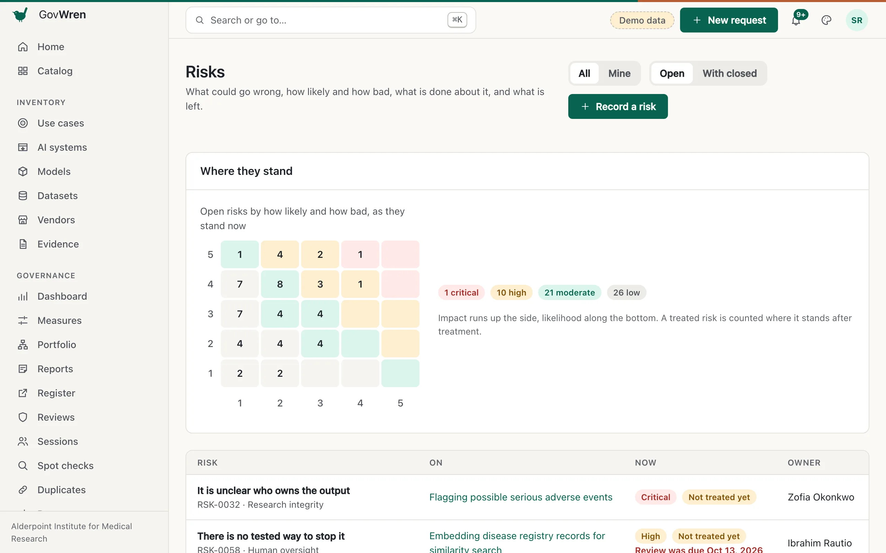
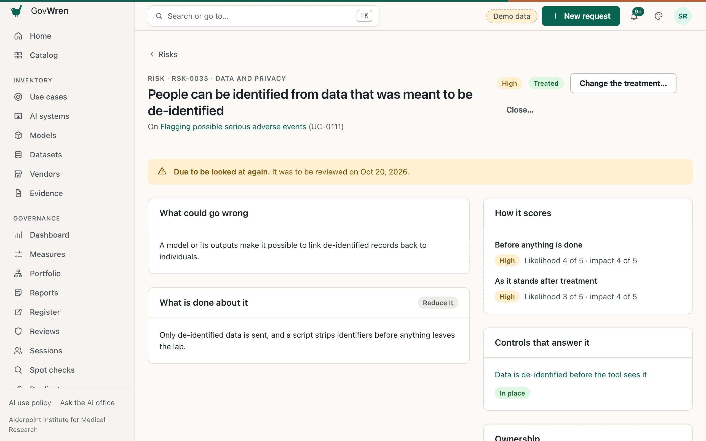
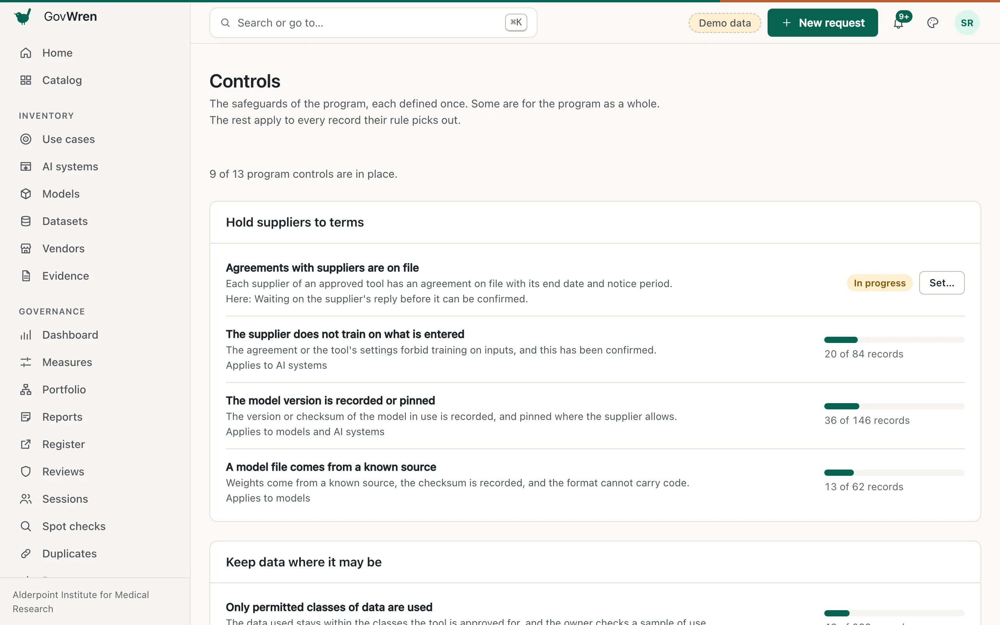
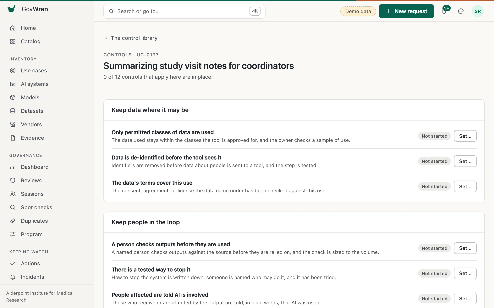
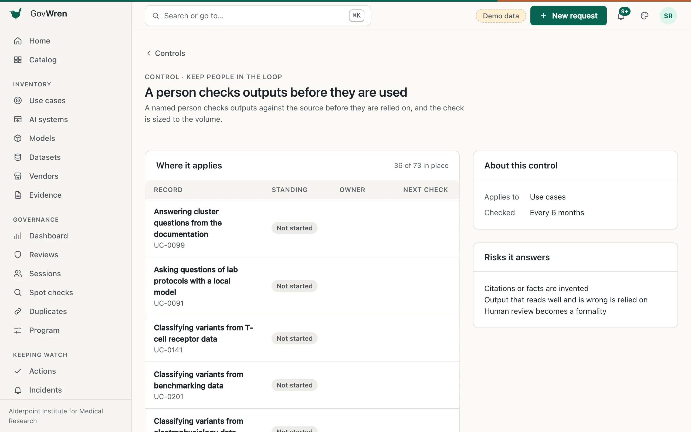
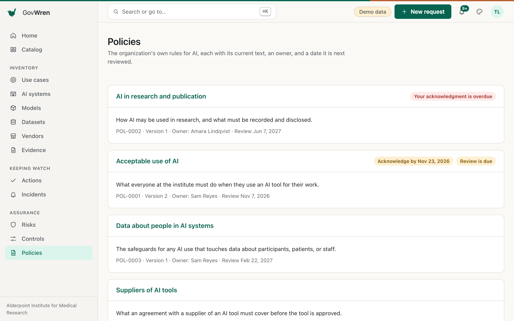
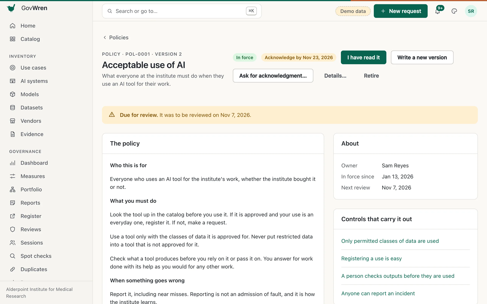
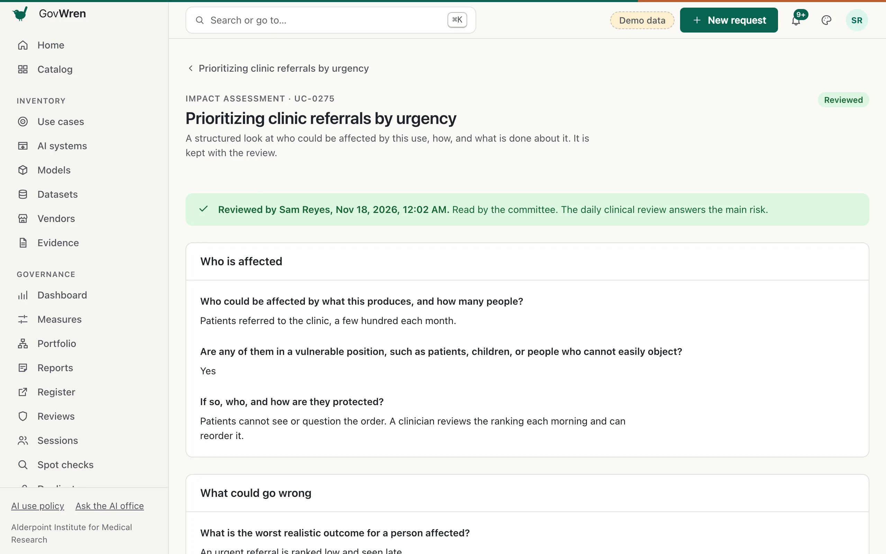
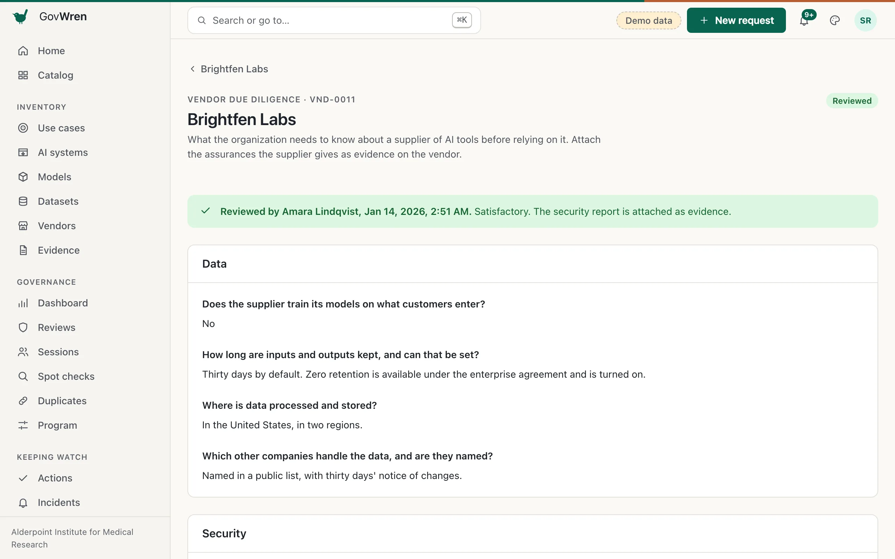

# Assurance

Deciding requests and keeping the inventory true is most of governance. Assurance is the part that lets you show it: the risks that are known, what is done about each, and what is left.

This guide grows with each release. It covers the risk register, the control library, keeping evidence fresh, policies, and assessments. Frameworks follow.

Who does what:

| Task | Who |
|---|---|
| Record a risk on a record | Whoever is responsible for the record: its owners, its unit's stewards, or governance |
| Record a risk from a review | A reviewer of that request |
| Record a risk to the organization | Governance |
| Say what is done about a risk, and rescore it | Its owner, whoever is responsible for the record, or governance |
| Accept a risk as it stands, or close one | Governance |
| Say how a program control stands | Governance |
| Say how a control stands for a record | Whoever is responsible for the record |
| Say that a control does not apply to a record | Governance |
| Write, publish, and retire a policy, and ask for acknowledgment | Governance |
| Acknowledge a policy | Whoever was asked |
| Fill in an impact assessment | The owners of the use |
| Fill in a vendor's due diligence | Governance, or whoever is responsible for the vendor |
| Review an assessment | Governance, but never the person who submitted it |

## The risk register

**Risks** lists every risk you may see, highest first. Beside the list, a grid counts open risks by how likely and how bad they are, as they stand now.

Who sees a risk: governance, auditors, and administrators see every risk. Anyone else sees the risks they own, and the risks on records they can see in full.

### How a risk is scored

A risk has two scores from 1 to 5: how likely it is, and how bad it would be. Their product gives the level.

| Likelihood times impact | Level |
|---|---|
| 1 to 4 | Low |
| 5 to 9 | Moderate |
| 10 to 16 | High |
| 17 to 25 | Critical |

A risk is scored twice. The first score is before anything is done about it. The second is as it stands after treatment. The register and the grid use the second once it is given.

### Record a risk

Choose **Record a risk**. To record one on a record, open the record and choose **Risks**, then **Add a risk**.

Draw the wording from the library, or write your own. Choose a category, then how likely it is and how bad it would be before anything is done.

The risk belongs to whoever records it until an owner is named.

### The risk library

GovWren ships about forty risk statements written for research and health settings, in eight categories:

- Data and privacy
- Accuracy and reliability
- Fairness and effects on people
- Human oversight
- Security and misuse
- Suppliers and dependence
- Research integrity
- Operations and accountability

Each statement says what could go wrong and what usually answers it. A risk drawn from the library keeps a note of which statement it came from. You can change its wording freely; the library is a starting point.

### Say what is done about it

Open the risk and choose **Say what is done about it…**. Choose the treatment:

| Treatment | Meaning |
|---|---|
| Reduce it | Something is done that makes it less likely or less bad |
| Pass it to someone else | Another party carries it, such as a supplier under an agreement |
| Stop doing what causes it | The activity that gives rise to it ends |
| Accept it as it stands | Nothing more is done. Only governance may choose this |

Say what is done and by whom, score the risk as it now stands, and set a date to look at it again.

On that date the owner is reminded. Setting a new date asks again when it comes.

### A risk from a review

A reviewer who finds something that will outlast the review can record it as a risk, from the review. It is attached to the use case and goes to the use's accountable owner, with the review it came from noted on it.

### Risks are findings

An open risk at the two highest levels is shown at the top of its record. Like an incident or an exception, it is also shown on everything that relies on that record, marked as inherited. See [Findings are inherited](keeping-watch.md#findings-are-inherited).

Treating a risk down to moderate or low removes it from there. It stays in the register.

### Close a risk

When a risk no longer applies, governance closes it with the reason. A closed risk keeps its history and is left out of the grid.

## Controls

A control is a safeguard: something the program does, or something that must be true of a use, a tool, or a model. GovWren ships a library of about thirty, written from what a governance program has to do. It stands on its own; no outside framework is needed to use it.

The library has eight groups:

- Know what is in use
- Name who answers for it
- Match review to risk
- Keep data where it may be
- Keep people in the loop
- Hold suppliers to terms
- Respond when something goes wrong
- Keep the record

### Two kinds of control

| Kind | Applies to | Who says how it stands |
|---|---|---|
| Program control | The program as a whole, once | Governance |
| Record control | Every record its rule picks out | Whoever is responsible for each record |

A control is defined once. A record control is not copied to each record: whether it applies is worked out from the record each time. A control that asks for a tested way to stop a system, for example, applies to use cases at the high tier and above. If a use rises to that tier, the control applies from then on.

### The controls of a record

On a record, choose **Controls**. You see the controls that apply to it, by group, each with how it stands there.

Choose **Set…** on one and say how it stands:

| Standing | Meaning |
|---|---|
| Not started | Nothing has been done yet. This is where every control begins |
| In progress | Partly done |
| In place | Done. Say how it is done here |
| Does not apply | The rule picked this record out, but the control makes no sense for it. Only governance may say so, with the reason |

### Checking that a control is still in place

Marking a control as in place sets the date of its next check, from the control's own cadence: three, six, or twelve months. On that date the owner is reminded, and the control shows **Check is due**.

To record a check, choose **Set…**, tick **I checked today that it is still in place**, and save. The next check moves on by the same cadence.

### Evidence for a control

Once a control has a standing on a record, choose **Attach** beside it to attach what shows it is in place: a signed procedure, a test report, a screenshot of a setting. Evidence can carry a date it is good until. See [Keep evidence](running-the-program.md#keep-evidence).

A control that is in place shows:

- **No evidence** when nothing is attached.
- **Evidence expired** when everything attached has passed its date.

### When evidence runs out

The owner of a piece of evidence is told sixty days before it expires, and again when it has. Both appear in their [action list](keeping-watch.md#actions), along with:

- Each control of theirs whose check is due.
- Each control in place whose evidence has all expired.

So a gap in assurance is something a named person has been asked to close, not something an auditor finds.

### One control across the inventory

Open a control from the library to see every record it applies to and how it stands on each, with those not started first.

### Controls and risks

Each control names the risks from the library that it answers. A risk drawn from the library shows those controls on its page, with how each stands for the record the risk is on. A risk that is scored high with none of its controls in place is the first place to look.

## Policies

A policy is one of the organization's own rules: acceptable use, AI in research, data about people. GovWren keeps each policy's text with its versions, its owner, the date it is next reviewed, and the controls that carry it out.

Everyone signed in can read the policies in force, under **Policies**.

### Write and publish a policy

Choose **Start a policy** and give it a name. It is a draft, and only governance, auditors, and administrators can see it.

Choose **Write a new version** and write the text. Leave a blank line between paragraphs, and start a line with `##` for a heading. Then choose **Publish**. The policy is in force from then on.

To change a policy, write a new version and say what changed. The version in force stays as it is until the new one is published. Published versions are never edited, and each stays on the record with its date.

### Owner, review date, and controls

Under **Details…**, set who owns the policy, the date it is next reviewed, and the controls that carry it out. On that date the owner is reminded, and the policy shows **Review is due**.

Linking controls answers the question an assurer asks of every policy: how do you know it is followed? The policy shows its controls, and each control shows how it stands.

### Ask people to acknowledge it

Choose **Ask for acknowledgment…**. Choose a unit, which includes the units beneath it, or everyone, and the date to acknowledge by.

Each person is told, and **Home** lists it. They open the policy, read it, and choose **I have read it**. They are reminded a week before the date and once after it.

The policy shows how many of those asked have acknowledged it, by unit, with the lowest first.

An acknowledgment is of one version. When a new version is published, nobody has acknowledged it yet; ask again if the change matters enough.

### Retire a policy

**Retire** takes a policy out of force. It stays on the record with its versions, and is no longer shown to everyone.

## Assessments

An assessment is a set of structured answers about one record. GovWren ships two.

| Assessment | About | When |
|---|---|---|
| Impact assessment | A use case | When the rules require it, or whenever its owner chooses |
| Vendor due diligence | A vendor | Before its tools are approved for anything sensitive |

Each is drafted, submitted, and then reviewed by governance. A submitted assessment can be corrected until it is reviewed. After that it is fixed, and answering again starts a new one.

### Impact assessment

An impact assessment asks who could be affected by a use, what the worst realistic outcome is, whether it could work less well for some groups, and what is done about each: who checks the output, how people are told, and how someone can ask for a person to look again.

By default the rules require one for every request at the critical tier. Such a request cannot be approved until its owner has submitted the assessment.

The owner opens it from the use case, with **Impact assessment**, or from the notice on the review. Reviewers and the committee read it from the decision packet.

The assessment is kept with the review it was made for and stays in the history of the use.

The rule is part of the assessment's template: `required_when` is a condition in the same language the routing rules use. An organization that wants an impact assessment from the high tier upward changes that one condition.

### Vendor due diligence

On a vendor, choose **Due diligence**. The questionnaire asks what a supplier does with what customers enter, how long it keeps it and where, what security assurance it holds, how it gives notice of changes to its models, and whether an agreement covers all of that.

Attach the assurances the supplier gives, such as a security report, as [evidence](running-the-program.md#keep-evidence) on the vendor.

Submitting the questionnaire marks the vendor's due diligence as in progress. When a second person in governance reviews it, the vendor's due diligence is complete.
