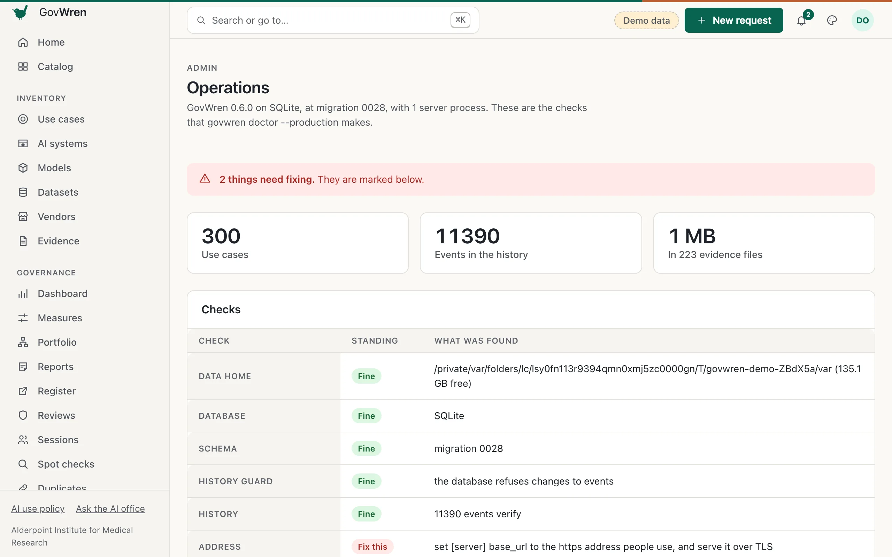

# Deployment

This guide is for whoever puts GovWren into production. It covers three ways to run it, the reverse proxy in front, and the checks to make before people depend on it.

Everything it refers to is in the [`deploy/`](https://github.com/robert-mcdermott/govwren/tree/main/deploy) directory of the repository.

| File | For |
|---|---|
| `Containerfile` | Building a container image |
| `compose.yaml`, `compose.env.example` | GovWren and PostgreSQL together, with docker compose or podman compose |
| `govwren.service` | Running as a systemd service, sandboxed |
| `Caddyfile`, `nginx.conf` | A reverse proxy with TLS in front |

## What production needs

Whichever way you run it, the shape is the same:

- **One address, over https.** A reverse proxy holds the certificate and passes requests to GovWren, which listens only where the proxy can reach it.
- **PostgreSQL,** unless the team is small and one server process is enough.
- **A data home that lasts.** Evidence files and brand images live there. In a container it is a volume.
- **Secrets in the environment,** never in `govwren.toml`. GovWren refuses a configuration file with a secret in it.
- **A backup on a schedule.** [Operations](operations.md#back-up) describes it.

## Run it in a container

Build the image from the repository root. Use `docker` in place of `podman` if that is what you have.

```bash
podman build -f deploy/Containerfile -t govwren .
```

The image runs as an unprivileged account, keeps everything that must last in the volume at `/data`, and reports its health. Each time it starts it creates whatever is missing, brings the database up to date, and serves on port 8000.

It is configured from the environment:

| Variable | Set it to |
|---|---|
| `GOVWREN_SERVER_BASE_URL` | The https address people use |
| `GOVWREN_DATABASE_URL` | `postgresql+psycopg://govwren@db-host:5432/govwren`. Leave it out to use SQLite in the volume |
| `PGPASSWORD` | The database password |
| `GOVWREN_SERVER_WORKERS` | Server processes. Leave at 1 with SQLite |
| `GOVWREN_ADMIN_EMAIL`, `GOVWREN_ADMIN_NAME`, `GOVWREN_ADMIN_PASSWORD` | The first administrator. Used on the first start only, and ignored once an administrator exists |

[Configuration](configuration.md#environment-overrides) lists the rest, including single sign-on and email.

To try the image by itself, with SQLite in a volume:

```bash
podman run -d --name govwren -p 127.0.0.1:8000:8000 -v govwren-data:/data \
  -e GOVWREN_SERVER_BASE_URL=https://ai.example.org \
  -e GOVWREN_ADMIN_EMAIL=you@example.org -e GOVWREN_ADMIN_NAME="Your Name" \
  -e GOVWREN_ADMIN_PASSWORD='a long password of your own' govwren
```

The server will not start until there is an administrator, because nobody could sign in. If you leave the administrator out, the container's log says how to add one.

Every `govwren` command runs inside the container with `podman exec`, for example `podman exec govwren govwren doctor --production`.

### With PostgreSQL, using compose

`deploy/compose.yaml` runs GovWren and PostgreSQL together.

1. Copy the example settings and fill them in:

   ```bash
   cp deploy/compose.env.example deploy/.env
   ```

   Set `GOVWREN_BASE_URL` to your https address, `POSTGRES_PASSWORD` to a long random password, and the three `GOVWREN_ADMIN` lines to the first administrator. Remove those three once you have signed in.

2. Start it:

   ```bash
   docker compose -f deploy/compose.yaml --env-file deploy/.env up -d --build
   ```

GovWren then listens on `127.0.0.1:8000` of the host, for your proxy. Its container has a read-only file system apart from the data volume, no Linux capabilities, and cannot gain privileges.

To update, pull the new code, run step 2 again, and the container upgrades the database as it starts. Make a [backup](operations.md#back-up) first:

```bash
docker compose -f deploy/compose.yaml exec govwren govwren backup --out /data/before-upgrade.tar.gz
```

## Run it as a systemd service

`deploy/govwren.service` runs GovWren under its own account with systemd's sandboxing switched on: a read-only system, a private `/tmp`, no new privileges, no capabilities, and write access only to its data home.

1. Put the code in `/opt/govwren` and install it there:

   ```bash
   cd /opt/govwren && uv sync --no-dev --extra postgres
   ```

2. Create the account and the data home:

   ```bash
   sudo useradd --system --home-dir /var/lib/govwren --shell /usr/sbin/nologin govwren
   sudo install -d -o govwren -g govwren -m 700 /var/lib/govwren
   ```

3. Write `/etc/govwren/govwren.toml`, with `[data] home = "/var/lib/govwren"`, your `[server] base_url`, and your `[database] url`.

4. Put secrets in `/etc/govwren/secrets.env`, readable only by root, one `NAME=value` to a line. `PGPASSWORD` goes here.

5. Set the installation up, as the service account:

   ```bash
   sudo -u govwren env GOVWREN_CONFIG=/etc/govwren/govwren.toml PGPASSWORD=... \
     /opt/govwren/.venv/bin/govwren init
   ```

6. Install and start the service:

   ```bash
   sudo cp deploy/govwren.service /etc/systemd/system/
   sudo systemctl daemon-reload
   sudo systemctl enable --now govwren
   ```

The service upgrades the database each time it starts. `journalctl -u govwren` shows what it says, and `systemd-analyze security govwren` shows how tightly it is held.

## Put a reverse proxy in front

GovWren does not terminate TLS. A proxy does, and passes requests on.

- `deploy/Caddyfile` is the shortest way: Caddy obtains and renews the certificate by itself.
- `deploy/nginx.conf` is the same for nginx, with your own certificate.

Either way:

- Pass `Host`, and `X-Forwarded-Host` if the proxy changes it. GovWren refuses a change that does not come from its own address.
- Allow request bodies of at least 30 MB. Evidence files are up to 25 MB.
- Set `[server] base_url` to the public address, so that links in email and the single sign-on redirect are right.
- Let only the proxy reach port 8000.

[Run behind a reverse proxy](configuration.md#run-behind-a-reverse-proxy) explains what GovWren reads from the proxy's headers.

## Check before people depend on it

`doctor` checks that an installation works. With `--production` it also checks what matters once people rely on it:

```bash
uv run govwren doctor --production
```

| Check | Passes when |
|---|---|
| Address | `[server] base_url` is an https address |
| Database for production | It is PostgreSQL. SQLite is a warning, not a failure |
| Demo | This is not a demo organization |
| Administrators | At least two people hold the role |
| Sign-in | Single sign-on is connected |
| Email for production | Email is set up |
| Scheduled work | A job has run in the last fifteen minutes |
| Backup | `govwren backup` ran in the last two days |
| Data home access | Only the account that runs GovWren can read the data home |

A failure makes `doctor` exit with 1. A warning is something to decide about: if you back up the database another way, the backup warning does not apply to you.

### The operations view

An administrator sees the same checks under **Admin → Operations**, with scheduled work, email, webhooks, the last backup, and how large the installation has grown.



### Watch it from outside

Two addresses need no sign-in and are meant for a load balancer or a monitor:

| Address | Answers 200 when |
|---|---|
| `/api/v1/health/live` | The server process is running |
| `/api/v1/health/ready` | The database answers and its schema is the one this version expects |

## Update to a new release

1. Read the [changelog](https://github.com/robert-mcdermott/govwren/blob/main/CHANGELOG.md) for the release, including **Upgrading from**.
2. Make a [backup](operations.md#back-up).
3. Stop the server, update the code, and run `uv sync --no-dev --extra postgres`.
4. Run `govwren db upgrade`, then `govwren doctor --production`.
5. Start the server.

The container and the systemd service do step 4's upgrade for you when they start.
