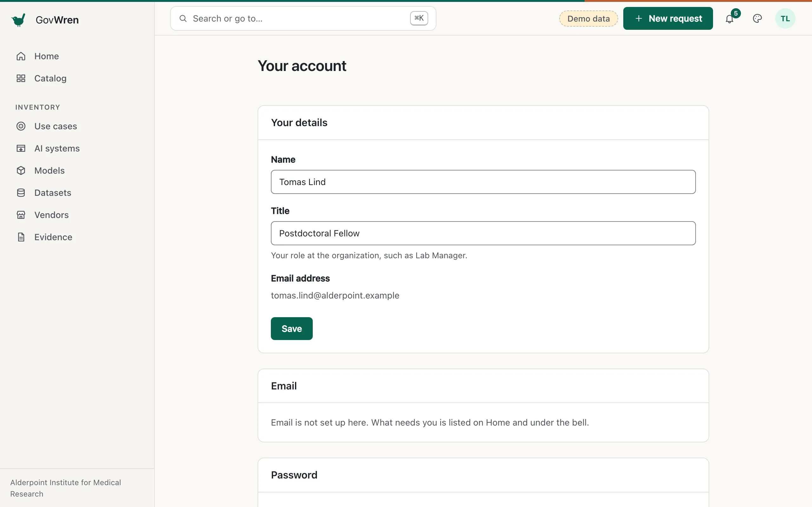

# Email

GovWren can send its notices by email: a request that needs triage, a review task, a question from a reviewer, a decision, an answer about a tool someone asked for. Each person chooses whether to get them as they happen, once a day as a summary, or not at all.

Email is optional. Without it, everything that needs a person is on their Home page and under the bell, exactly as before.

## Set it up

In `govwren.toml`:

```toml
[server]
base_url = "https://govwren.example.org"

[mail]
host = "smtp.example.org"
port = 587
security = "starttls"
username = "govwren"
from_address = "govwren@example.org"
```

Put the password in the environment of the GovWren server, never in the file:

```bash
export GOVWREN_MAIL_PASSWORD='the password'
```

Then check and restart:

```bash
uv run govwren doctor
uv run govwren mail test you@example.org
```

`doctor` connects to the mail server and signs in, and sends nothing. `mail test` sends one message to the address of an existing account and says whether the server accepted it. An administrator can do the same from **Admin → Email**, which also shows how many messages are waiting, sent, and given up on, and the most recent problem.

Set `base_url`. Without it, messages cannot link back to GovWren, and `doctor` says so.

## Settings

| Key in `[mail]` | Default | Meaning |
|---|---|---|
| `host` | `""` | The mail server. Empty sends no email |
| `port` | `587` | Its port |
| `security` | `"starttls"` | `"starttls"` for port 587, `"tls"` for port 465, or `"none"` for a relay on this machine or a trusted network |
| `username` | `""` | The name to sign in with. Empty if the server needs none |
| `password_env` | `"GOVWREN_MAIL_PASSWORD"` | The name of the environment variable that holds the password |
| `from_address` | `""` | The address email comes from |
| `from_name` | `""` | The name shown beside it. The product's name if empty |
| `digest_hour` | `7` | The hour, in UTC, after which daily summaries are put together |

`host` and `from_address` go together: set both, or neither.

## What people receive

Each person chooses under **Your account → Email**:

| Choice | They receive |
|---|---|
| As things happen | One message for each notice, within about a minute |
| Once a day, as a summary | One message a day listing what arrived since the last, leaving out anything they have already read in the app |
| Never | Nothing. Home and the bell still show everything |

New accounts start with **As things happen**.

A message says what happened in one line and links to the place in GovWren where it can be dealt with. It carries your product name and organization name. It never carries the content of a request, a reviewer's notes, or a file: to read those, the person signs in.



## How sending works

Nothing is sent straight from the click that caused it. A notice is written to the database with the change that caused it. The mailer, which runs inside the server, picks notices up, writes each message to an outbox in the same database, and sends from there. So:

- a restart loses nothing;
- a mail server that is down is tried again after 5 minutes, then 10, 20, 40, and 80, and given up on after six attempts, with the reason kept;
- several server processes never send the same message twice, because each message is claimed before it is sent.

If you prefer to send from a scheduled job, or the server is not running, send what is waiting with:

```bash
uv run govwren mail run
```

It exits with 1 if anything could not be sent.

Notices from before email was set up are not sent when you turn it on.

## When email does not arrive

| What you see | What to check |
|---|---|
| `doctor` says the mail server cannot be used | The host, port, and `security` setting; that the server process can reach it; the user name and the password in the environment |
| **Admin → Email** shows messages waiting and a recent problem | The problem is the mail server's own words. A refusal that mentions the sender means `from_address` is not one the server will send for |
| A test message is accepted and never arrives | The receiving side. Look in spam, and check that your domain's sender records allow this mail server to send for `from_address` |
| Messages arrive with no links | `base_url` under `[server]` is empty |
