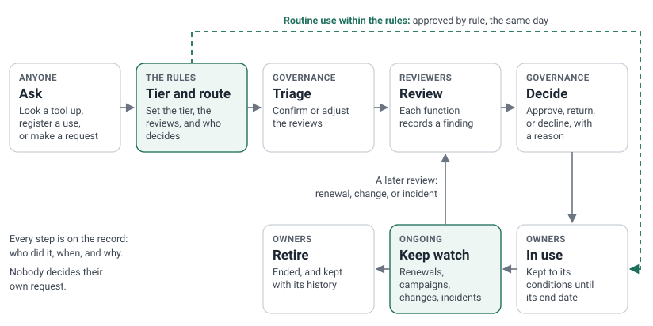
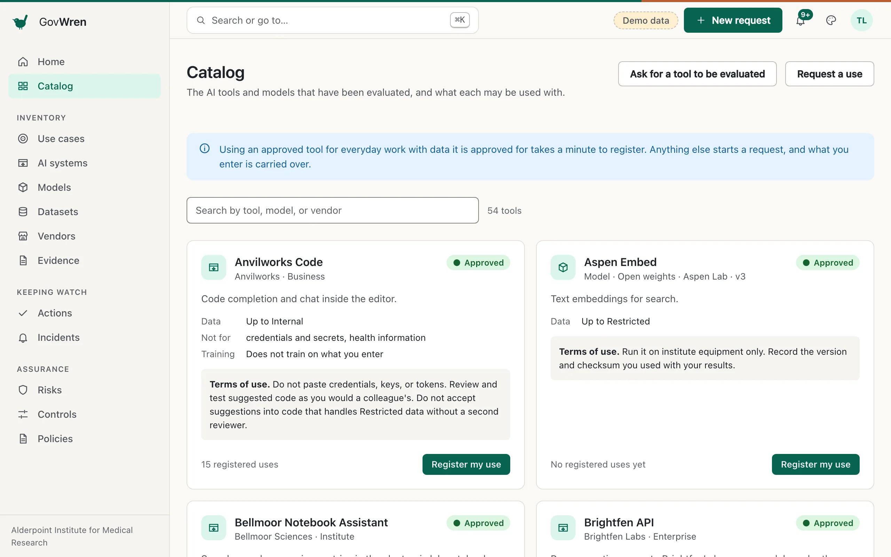
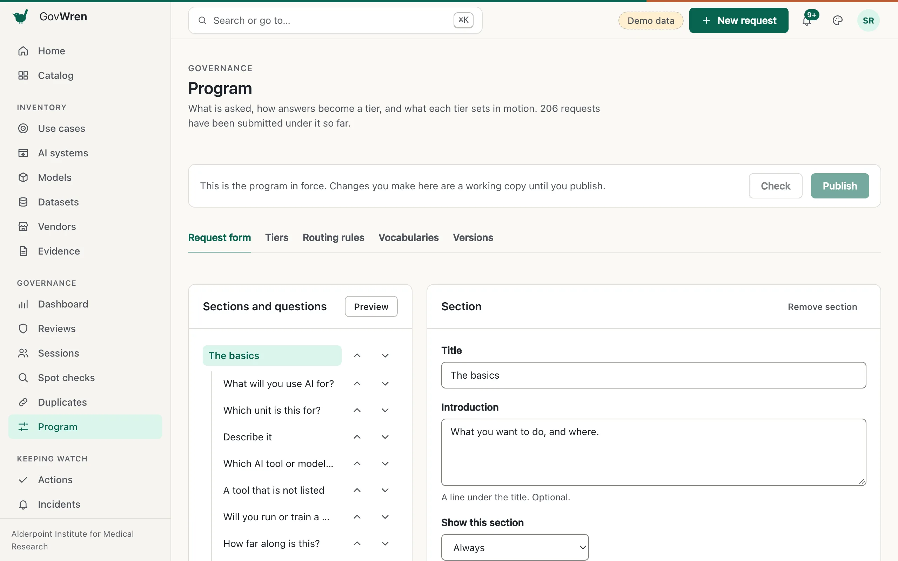
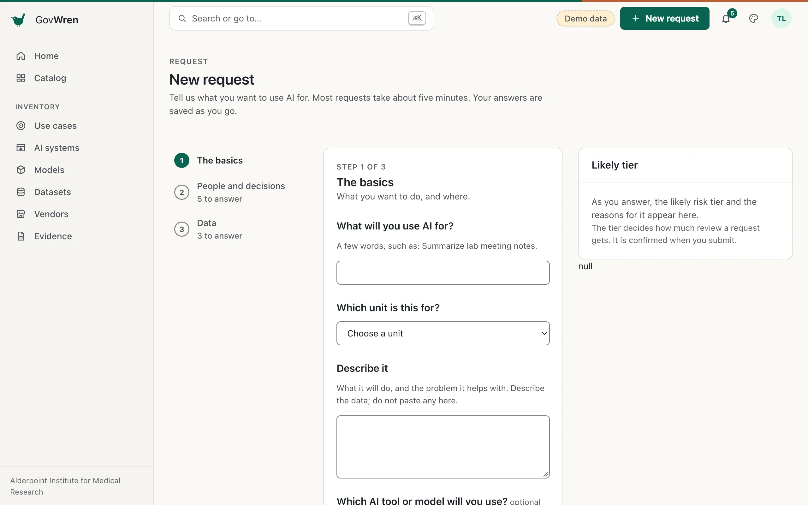
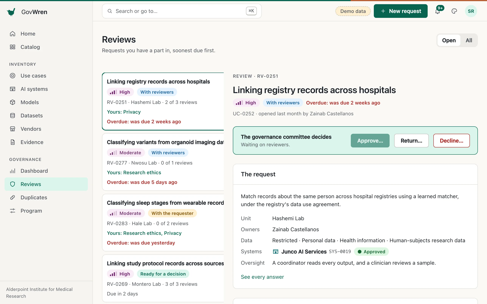
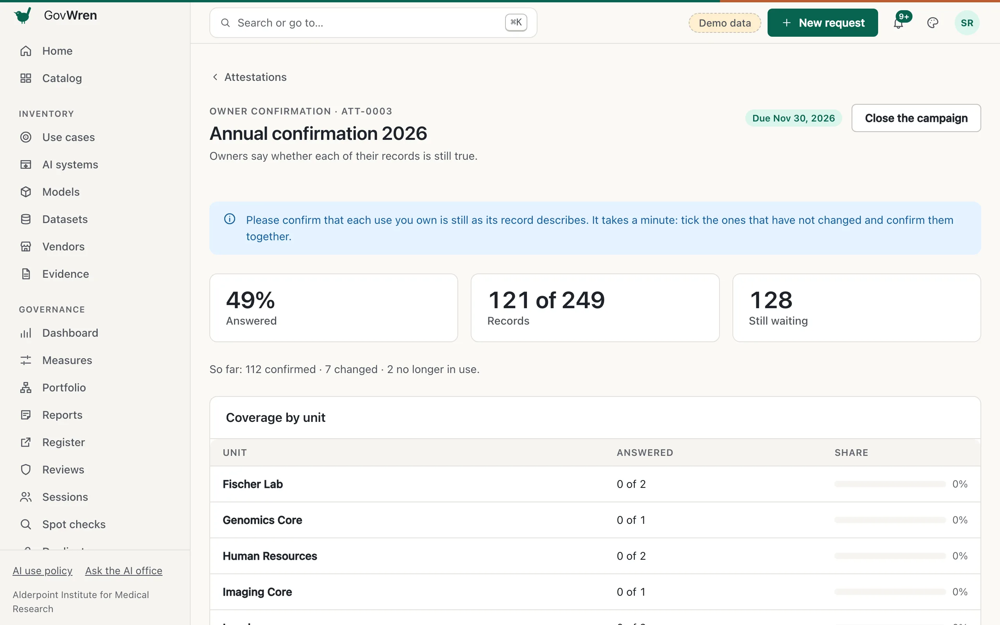
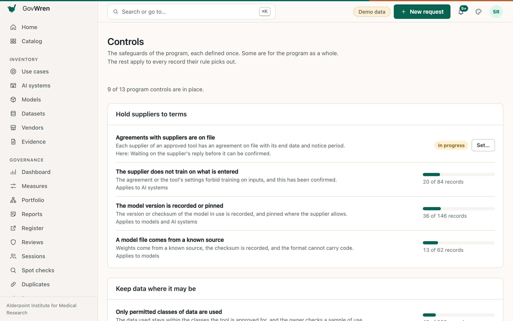
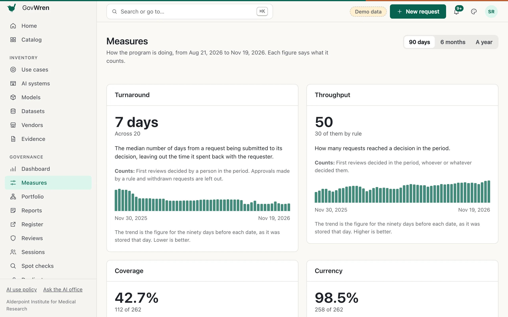

# The governance handbook

This handbook is for the team that runs an organization's AI governance program: the person who leads it, the people who review requests, and whoever sits on the committee. It explains how to run that program with GovWren at its center, from the first decisions to the yearly rhythm.

Read it straight through once. Each part answers one question, and each ends with where to go for the details:

| Part | The question it answers |
|---|---|
| [1. How GovWren runs a program](#1-how-govwren-runs-a-program) | What is it, what does it keep, and who does what? |
| [2. Decide before you set up](#2-decide-before-you-set-up) | What must the organization settle first? |
| [3. Set it up](#3-set-it-up) | How does an empty installation become yours? |
| [4. Shape the program](#4-shape-the-program) | How do you make the rules your own? |
| [5. The life of a request](#5-the-life-of-a-request) | What happens, step by step, when someone asks? |
| [6. Keep the inventory true](#6-keep-the-inventory-true) | How does a decision stay right after the day it is made? |
| [7. Show that it works](#7-show-that-it-works) | How do you assure the program to auditors and leadership? |
| [8. Report on the program](#8-report-on-the-program) | How do you see and report how it is doing? |
| [9. Connect it to the organization](#9-connect-it-to-the-organization) | How do other processes rely on it? |
| [10. The rhythm of the program](#10-the-rhythm-of-the-program) | What does the team do each week, month, quarter, and year? |
| [11. Questions governance teams ask](#11-questions-governance-teams-ask) | The answers people want before they commit |

The examples come from the demo organization, the Alderpoint Institute for Medical Research, a made-up research institute with thirty months of history. Everything shown here can be tried in it: see [Explore the demo organization](getting-started.md#explore-the-demo-organization).

## 1. How GovWren runs a program

### What GovWren is

GovWren is the system of record for AI governance. It is where people ask whether they may use AI, where the organization decides, and where what was decided is kept and kept current.

It does four jobs:

| Job | What it means in practice |
|---|---|
| **The front door** | One place to ask "may I use this AI tool?" Most people get an answer in a minute from the catalog. Everyone else makes a short request |
| **The process** | Your rules work out how much review each request needs, send it to the right reviewers, and record who decided what, and why |
| **The inventory** | Every approved use, and the tools, models, datasets, and vendors behind it, connected so that you can see what depends on what |
| **The evidence** | Risks, controls, policies, assessments, and reports, so that you can show the program works, not only that it exists |

It is **passive by design**. GovWren knows what people tell it. It does not scan networks, read logs, sit in the path of an AI tool, or test models. Its design is to make telling it the easiest path, and to give other processes, such as purchasing and ethics review, a reference they can ask for and check.

### The life of a use, in one picture



Every use of AI in the inventory moves through these steps. The rules handle the routine, so that people spend their time on what needs judgment. A use that is routine and within the rules is approved by rule the same day. Anything else gets the review its risk calls for, and a person decides it.

### What it keeps

GovWren keeps five kinds of record, each with a permanent reference such as `UC-0051`:

| Record | What it is | Example |
|---|---|---|
| **Use case** | One use of AI for one purpose, by one unit. This is what gets approved | "Drafting grant summaries," by the Hale Lab |
| **AI system** | A tool people use, in one edition | A chat assistant, enterprise plan |
| **Model** | What a tool is built on, or a model you run yourselves | An open-weight language model on your own servers |
| **Dataset** | Data a model was trained on or a use works with | A cohort's sleep recordings |
| **Vendor** | A supplier, with its agreements | The company behind the chat assistant |

Around them sit the records of the process: reviews, decisions, conditions, exceptions, incidents, risks, controls, evidence, and policies. Every change to any of them is written to a **history** that cannot be altered: each entry is chained to the one before by a hash, and `govwren verify` checks the whole chain.

### Who does what

GovWren has six roles. A person can hold several.

| Role | Who usually holds it | What they do in GovWren |
|---|---|---|
| **Governance** | The AI governance lead and their team | Keep the catalog, triage requests, decide, run campaigns, decide exceptions, triage incidents, shape the program |
| **Reviewer** | The privacy officer, security, legal, ethics, research integrity, clinical safety, data stewardship, architecture | Record a finding on requests that need their function |
| **Steward** | A head of department, a lab manager, a unit's research administrator | Look after their unit's list, and attest that it is complete |
| **Auditor** | Internal audit, compliance | Read everything, change nothing |
| **Admin** | Whoever runs the installation | People, units, appearance, single sign-on, email |
| **Member** | Everyone who can sign in | Look tools up, register uses, make requests, keep to their conditions |

Two rules always hold, whatever anyone's role:

- **Nobody triages, reviews, or decides their own request.** Someone else with the role must act.
- **What reviewers say among themselves is never shown to the requester.** Findings and reviewers' notes stay on the reviewing side. The requester sees where each review stands, messages addressed to them, the decision, its reason, and the conditions.

A committee is not a role. When the rules say "the committee decides," a person with the governance role records the decision on the committee's behalf, in a [committee session](#committee-sessions).

### What runs by itself, and what people decide

GovWren automates the work that follows from rules you have written, and leaves judgment to people.

| GovWren does it by itself | People decide or do it |
|---|---|
| Works out the risk tier of every request, and shows its working | Whether a request that needs review is approved, returned, or declined |
| Sends each request to the reviews its answers call for | The finding of each review |
| Approves what your rules say is routine, and nothing else | What counts as routine: that is a rule you write and can change |
| Approves a use of a catalog tool within its permitted data | Which tools are in the catalog, and with what data |
| Opens a periodic review sixty days before an approval ends, and marks it lapsed if nobody renews it | Whether a renewal that needs review is approved |
| Ends exceptions on their end date | Whether to grant an exception |
| Reminds people of what is nearly due, and tells the next person up when it is late | Whether a risk is accepted, and by whom |
| Draws a sample of automatic approvals for a person to check | Whether the rule got it right |
| Shows each record the incidents and exceptions on what it relies on | Whether to suspend an approval |
| Works out which controls apply to which records, and how ready the program is against a framework | Whether a control is in place, and what evidence shows it |
| Stores the program's measures each day | What the figures mean, and what to do about them |

Nothing changes standing silently. When a job marks an approval as lapsed or ends an exception, the history says so, and the people affected are told.

**Where to read more:** [Requesting](requesting.md) and [Reviewing](reviewing.md) show the same process from each side. [What GovWren does by itself](keeping-watch.md#what-govwren-does-by-itself) lists the scheduled jobs.

## 2. Decide before you set up

GovWren records decisions; it cannot make an organization want to make them. Settle these on paper before anyone installs anything. Each becomes a setting in GovWren, and each is far easier to get right now than to change later.

| Decision | Why it matters | Where it goes in GovWren |
|---|---|---|
| **Who owns the program**, and who stands in for them | Someone must be answerable. They get the governance role | Roles |
| **What is in scope** | Which uses of AI must be registered: generative tools, models you build, AI inside other products, agents | Your policy, and the request form's questions |
| **Your units**, as a tree | Every record belongs to a unit, and stewards answer for a unit's list. Go as deep as people actually make decisions | Units |
| **Your data classes** | The single most important setting. Use your organization's own classification and its own words | The data classes vocabulary |
| **Who reviews what** | Which review functions you will use, and one or two named people for each. Four or five functions is usual | Review functions and the reviewer role |
| **Who decides at each level of risk** | Governance alone, a committee, or a committee with an executive accepting the risk | Routing rules |
| **What is routine** | What can be approved by rule the same day. If nothing is, the front door becomes a queue | Routing rules |
| **What is never allowed** | Uses that cannot be approved at all, such as restricted data in a tool that trains on it | Stops in the scoring model |
| **How long an approval lasts** at each level | Sets the pace of renewals | Routing rules |
| **The tools you have already decided about** | They become the catalog, and the catalog decides whether people use GovWren | The catalog |
| **Where people will be told to go** | The intranet, the research office, the new-starter checklist | Your announcement, and GovWren's footer links |

If you have a committee, find out when it meets. Its calendar sets the pace of your slowest decisions, and a committee that meets monthly will make high-risk requests wait a month unless the rules give some of them to governance.

**Where to read more:** [Adopting GovWren](adopting.md) is a week-by-week plan from this point to the first attestation campaign.

## 3. Set it up

Setting up takes days, not weeks. Most of the time goes on the decisions above and on the catalog.

### Install and connect

Whoever runs the server installs GovWren, connects it to your identity provider, and sets up email. These steps are in [Getting started](getting-started.md), [Deployment](deployment.md), [Single sign-on](single-sign-on.md), and [Email](email.md).

Start from the program closest to yours. GovWren comes with three starters, each the default program as one kind of organization would first change it:

| Starter | For |
|---|---|
| `starter-research-institute` | Independent institutes: divisions, cores, and labs; data received under agreements |
| `starter-university` | Universities: schools and departments, teaching, students and applicants |
| `starter-academic-medical-center` | Clinics beside labs: clinical safety review for anything near care, the patient record, the legal basis for using health information |

```bash
uv run govwren init --program starter-academic-medical-center
```

Do single sign-on **before** inviting people. Accounts made by single sign-on carry the organization's identity; people who start with passwords and move later leave you merging accounts.

### Describe the organization

Under **Admin → Units**, build the tree: the organization, its divisions, departments, and labs. Give each a short permanent code, such as `HALE`. Under **Admin → People**, add the people who will run the program and give out the roles. Both can be imported from a spreadsheet.

With single sign-on, map your directory's groups to roles and to stewardship of units. When someone changes job, GovWren follows without anyone remembering to tell it.

An administrator is not governance. Give the governance role to whoever runs the program, and the reviewer role to at least one person for every review function your rules use. Otherwise every review of that function falls to governance, who can record a finding for any function.

### Make it look like yours

Under **Admin → Appearance**, set the product name, your organization's name, logos, colors, a message on the sign-in page, links to your policy and help desk, and your own words for GovWren's: *lab* for unit, *supplier* for vendor. Every color is checked for readability before it can be saved.

An organization that needs its brand reproduced exactly can fix it in the configuration file instead, with every color by day and after dark, the official logo files, and its typefaces. See [`[branding]`](configuration.md#branding).

### Build the catalog

The catalog answers "may I use this?" before anyone has to ask a person. It is the single thing that most decides whether people use GovWren.

1. Under **Vendors**, add each supplier you have already decided about.
2. Under **AI systems**, add each tool, one entry per **edition**. A free plan and an enterprise plan are different systems, because their terms and data handling differ.
3. On each system, set its **catalog standing**, the most sensitive **data class** it may be used with, any kinds of data it must **never** be used with, and its **terms of use**.

| Standing | What people see | Can a use be registered? |
|---|---|---|
| Approved | Yes | Yes |
| Approved with restrictions | Yes | Yes, within the restrictions |
| Under evaluation | "Not for use yet" | No |
| Not approved | So that people get an answer | No |

The permitted data class is a decision made once, on behalf of every later use. If the ten tools people actually use are in the catalog with a clear answer, most people never need to make a request.



### Bring in what you already have

Somewhere there is a spreadsheet of tools people have asked about and a list of vendors with agreements. Bring them in under **AI systems**, **Models**, **Datasets**, and **Vendors** with **Import**, which checks the file in a dry run first and changes nothing until you confirm. Uses already in progress are best registered by their owners, through the catalog, during the pilot and the first campaign: that way each has an owner who knows it.

### The setup checklist

| | Step | Who | Guide |
|---|---|---|---|
| ☐ | Install and run `govwren doctor` | Whoever runs the server | [Getting started](getting-started.md) |
| ☐ | Connect single sign-on and email | Whoever runs the server | [Single sign-on](single-sign-on.md), [Email](email.md) |
| ☐ | Units, people, and roles | An administrator | [Running the program](running-the-program.md#roles-and-scopes) |
| ☐ | Appearance and your own words | An administrator | [Set the appearance](running-the-program.md#set-the-appearance) |
| ☐ | The program read through and made yours | Governance | [Part 4](#4-shape-the-program) |
| ☐ | The catalog: the tools people actually use | Governance | [Build the catalog](running-the-program.md#build-the-catalog) |
| ☐ | Your policy, published in GovWren | Governance | [Policies](assurance.md#policies) |
| ☐ | A backup scheduled, and one restore tried | Whoever runs the server | [Operations](operations.md) |
| ☐ | `govwren doctor --production` clean | Whoever runs the server | [Deployment](deployment.md#check-before-people-depend-on-it) |

## 4. Shape the program

### What "the program" is

In GovWren, the **program** is the set of rules that turns a request into a decision. It has five parts, and all of them are yours to change:

| Part | What it decides | Example |
|---|---|---|
| **The request form** | What people are asked, and when each question is shown | Ask for an ethics protocol number only when human-subjects data is involved |
| **The scoring model** | How answers become a risk tier: the factors, the points, the tiers, floors, and stops | Restricted data makes "data sensitivity" score 3 |
| **The routing rules** | What each tier and answer sets in motion: reviews, who decides, the target, how long an approval lasts, conditions, approval by rule | Patients affected adds clinical safety review |
| **The standard conditions** | The sentences approved uses carry | "Check every output for accuracy before relying on it or passing it on." |
| **The vocabularies** | Every list people choose from: data classes, kinds of data, units' kinds, review functions, and the rest | Your four data classes, with your examples |

GovWren comes with a complete default program. It works on the first day. It is not yours until the people who will live with it have read it.

### How a request gets its tier

The default scoring model has six factors. Each scores from 0 to 3, taking the highest level any answer gives it:

| Factor | Scores 0 when | Scores 3 when |
|---|---|---|
| Impact on people | Nobody outside the team is affected | It could affect health, safety, legal rights, or livelihood |
| Decision role | It is background or exploratory | It decides or acts without a person reviewing each case |
| Autonomy | It only produces output | It acts with effects that are hard to undo |
| Data sensitivity | The data is public | The data is restricted |
| Data exposure | The data stays on your own equipment | It goes to a supplier with no covering agreement, or one that may train on it |
| Reach | One person or team | The whole organization, or the public |

The points add up to a tier:

| Tier | Points | Reviews required | Who decides | Target | Approval runs |
|---|---|---|---|---|---|
| Minimal | 0–4 | None | Approved by rule | The same day | 36 months |
| Moderate | 5–8 | None | Governance | 5 working days | 24 months |
| High | 9–12 | Privacy, security | The governance committee | 15 working days | 12 months |
| Critical | 13 and above | Privacy, security, legal | The committee, with an executive accepting the risk | 30 working days | 6 months |

Two kinds of rule override the points. **Floors** set the least a tier can be: a request that could seriously harm a person is at least High, however few points it scores. **Stops** mark a prohibited use, such as restricted data entered into a tool that trains on it: a stopped request can never be approved.

Routing rules then add reviews for particular answers, whatever the tier: human-subjects data adds research ethics, health information adds privacy, patients affected adds clinical safety, use in publications adds research integrity, and so on. A request is approved by rule only when a rule approves it, no rule requires a review, and nothing about it is a stop. So a minimal request that involves health information still goes to a privacy reviewer.

Every request shows its working: each factor's level, the answer behind it, and any floor or stop. Requesters see it as they fill in the form, so the tier is never a surprise.

### Make it yours in the app

Open **Program**, under Governance. You work on a copy: nothing you change is in force until you publish it.



Go through it with the core team, in this order:

1. **The data classes** (on the **Vocabularies** tab). Use your own classification, with its own names and examples. People pick the right class only when they recognize their own data in it.
2. **The request form.** Read every question aloud. Cut any whose answer would never change a decision. Requesters forgive a form that is short.
3. **The tiers.** Take five real uses you already know, some trivial and some serious, and try them in **Preview**. If a tier surprises you, change the scoring until it does not.
4. **The routing rules.** For each tier, check who reviews, who decides, how long they have, and how long an approval lasts. Make sure the low tier is approved by rule.
5. **The standard conditions.** Make them conditions you would be willing to enforce.

Then choose **Check**. It finds mistakes, such as a rule about a question that no longer exists, and it runs every request already submitted through your copy and tells you what would have come out differently: how many would have had a higher or lower tier, needed other reviews, or moved between approval by rule and review by people. Only then choose **Publish**.

Publishing never changes what was decided. A request keeps the form, tiers, and rules it was decided under; the new version applies from the next request. Every published version is kept under **Versions**, with who published it and when.

### A worked example: a new rule

Suppose your data stewards want to see every request that involves genetic data, and you want every such approval to carry a condition about the data's terms.

**In the app:**

1. Open **Program → Routing rules**. Under the standard conditions, choose **Add a condition**: "Keep to the consent and data use terms of the genetic data, and record which terms apply." Make it *ongoing*.
2. Choose **Add a rule**. Name it "Genetic data." Under **When**, choose the question *Does it involve any of these kinds of data?*, then *includes*, then *Genetic data*.
3. Under what it sets in motion, require the **Data stewardship** review and attach the new condition.
4. Choose **Check**. The check lists the past requests that would now have needed data stewardship review. Read two or three to be sure the rule catches what you meant.
5. Choose **Publish**.

**As a file**, the same rule in the program pack reads:

```json
{
  "key": "genetic-data",
  "name": "Genetic data",
  "when": { "field": "answers.data_categories", "op": "contains", "value": "genetic" },
  "then": {
    "require": ["data_stewardship"],
    "conditions": ["genetic_data_terms"]
  }
}
```

### Keep the program as a file

The whole program can be exported as one file, a **program pack**, edited, checked, and loaded again:

```bash
uv run govwren program export --out program.json
uv run govwren program import --check program.json
uv run govwren program import program.json
```

A pack is checked whole before anything is loaded; if anything is wrong, every problem is listed and nothing changes. Whatever differs from the published program becomes a new version.

Keeping the pack under version control gives the program what any other policy has: a reviewed change, a record of who changed what, and a way to carry the same program to a second installation, such as a test server. Treat a change to the pack as a change to policy: review it before it is loaded.

**Content packs** add risk statements and controls for a kind of work: `content-research` for research, and `content-health` for work near patient care. Loading one adds to the libraries and removes nothing.

### Fields of your own

Your organization will have a few things to record that GovWren does not: a cost center, a contract number, the date a grant ends. Add them under **Fields**, for each kind of record. They appear on the record under **More details**, are kept in its history and its dossier, and are for your own bookkeeping: tiers and rules do not read them.

### Who sees approved uses

One setting decides how much of an approved use the rest of the organization sees: everything (`open`), a summary with full detail for the use's own unit (`summary`, the default), or only their own units' uses (`unit`). Drafts and restricted records stay private whatever the setting. In this release it is changed through the API, by governance or an administrator: see [`PUT /api/v1/admin/inventory`](api.md#inventory).

**Where to read more:** [Change the program](running-the-program.md#change-the-program), [Move the program as a file](running-the-program.md#move-the-program-as-a-file), and [Begin from a starter](running-the-program.md#begin-from-a-starter). The pack format is in [spec/content-packs.md](../spec/content-packs.md).

## 5. The life of a request

This part follows one request from the moment someone asks to the day it is in use.

### Step 1: Someone asks

People start on **Home**, with a box that asks "May I use this AI tool?" Looking a tool up takes them to the catalog. From there, one of four things happens:

| What they find | What they do | What happens |
|---|---|---|
| The tool is approved, and their use is everyday | **Register my use**: a purpose, a unit, the most sensitive data, the kinds of data, and whether a person checks every output | Approved at once, if it fits what the tool is approved for. Otherwise it becomes a request, with what they typed carried over |
| The tool is under evaluation or not approved | Read the answer | They get an answer without asking anyone |
| The tool is not in the catalog | **Ask for a tool to be evaluated** | It is added to AI systems, outside the catalog, and governance is told. Requests for the same tool are gathered together |
| Their use is not everyday, or is not about one tool | **Request a use** | The request form |

The **request form** asks only what each request needs: questions about personal data appear only when personal data is involved, questions about a model only when they run or train one. As they answer, a panel shows the **likely tier** and why, so nobody is surprised. They can save a draft and come back.



### Step 2: GovWren tiers and routes it

When the request is submitted, GovWren works out its tier and applies the routing rules. The outcome is one of two:

- **Approved by rule.** No rule requires a review, a rule approves it, and nothing about it is a stop. The requester has an approval, with its conditions and an end date, the same day. A share of these is later [spot-checked](#spot-checks).
- **A review opens**, with a reference such as `RV-0087`, the reviews the rules require, who decides, and a target date.

### Step 3: Triage

Governance confirms or adjusts the reviews the rules asked for. Each review shows the rule that required it; untick one that is not needed here, or add one the rules did not ask for, with a reason that stays on the record. Then **Confirm and start**. If no review is needed, the request goes straight to a decision.

Triage is a human check on the rules, not a second form. Most triage takes a minute.

### Step 4: Review

Each required function gets a task. Reviewers work in parallel. Each records a **finding**: *no concerns*, *acceptable with conditions*, or *objection*, with notes and any conditions they recommend. They can attach what they relied on as evidence, and raise a risk on the use.



Everything about the request is on one screen, the **packet**: the request, why it has its tier, each review, and the discussion. A reviewer sees the whole request, whatever unit it belongs to.

### Step 5: Questions, when needed

Reviewers talk among themselves in the discussion, marked **Reviewers only**, and the requester never sees it. When they need something from the requester, they send a message to them; a question **stops the clock** until the requester answers, so a request is never counted late while it waits on them.

### Step 6: Decide

When every review is finished, the review is **Ready for a decision**. Who decides comes from the rules:

| The rules say | How it is decided |
|---|---|
| Governance decides | A person with the governance role decides in the packet |
| The committee decides | The request goes on the agenda of a [committee session](#committee-sessions), and the decision is recorded as made there |
| The committee decides, and an executive accepts the risk | Before it can be approved, a named person, such as a division head, reads the packet and accepts the risk in their own words. An impact assessment from the owner is needed too |

Three decisions are possible, and each needs a reason that the requester reads:

- **Approve**, with conditions. The conditions the rules attach and those reviewers recommended are already ticked. If a reviewer objected, you can still approve, but the record shows the decision was made over an objection, and your reason must answer it.
- **Return**, with a question. The request goes back to the requester and the clock stops.
- **Decline**, with the reason.

Some requests cannot be approved at all, and GovWren says why before anyone tries: a **prohibited use**, a request whose required **impact assessment** has not been submitted, one waiting on a **risk acceptance**, and one that would send health information to a supplier's tool that no **agreement covering health information** names.

A decision is never edited afterwards. A different decision is a new review.

### Step 7: Conditions

A condition is something the requester must do or keep to. Each has an owner and one of three kinds:

| Kind | Effect |
|---|---|
| **Before use** | The approval is not in effect until it is met. The use shows "Not in effect yet" |
| **By a date** | Shown as overdue once the date passes |
| **Ongoing** | A standing obligation for as long as the use continues |

Owners mark a condition **met**, with a note saying how. Only governance can **waive** one, with a reason.

### Step 8: In use

The approved request is now a **use case** in the inventory: an approval with an end date, named owners, its conditions, the AI systems it uses, and its whole history. It appears in its unit's list, and, as far as the visibility setting allows, to the rest of the organization. From here, [part 6](#6-keep-the-inventory-true) keeps it true.

### The request at a glance

| Step | Who | Where in GovWren | Usually takes |
|---|---|---|---|
| Ask | Anyone | Home, Catalog, New request | Minutes |
| Tier and route | GovWren | Automatic | At once |
| Triage | Governance | Reviews | A day |
| Review | Reviewers | Reviews | Days |
| Questions | Reviewers, requester | The discussion | Clock stopped |
| Decide | Governance, or the committee | Reviews, Sessions | The target for the tier |
| Conditions | Owners | The use case | Before use, by a date, or for as long as it runs |

**Where to read more:** [Requesting](requesting.md) for the requester's view, and [Reviewing](reviewing.md) for triage, findings, and decisions in full.

## 6. Keep the inventory true

An approval describes a use as it was on the day it was decided. Tools change, people leave, approvals run out, and things go wrong. This part is what keeps the inventory worth trusting.

### Renewals and lapses

Every approval has an end date. Sixty days before it, GovWren opens a **periodic review**, which starts with the owner. They confirm the answers given last time, correcting any that are no longer true. If the rules say no review is needed, the use is approved again at once, with a new end date. If a review is needed, it goes through triage and review like a first request.

If nobody confirms, the owner is reminded, and when the end date passes the approval is marked **lapsed** and the unit's steward is told. A lapse is not a decision against the use. Confirming the answers brings it back.

### Attestation campaigns

A campaign asks the people closest to the work whether the inventory is still true. Governance starts one under **Attestations**.

| Kind | Who is asked | What they say |
|---|---|---|
| **Unit completeness** | The stewards of each unit | That the unit's list is complete, after adding what is missing |
| **Owner confirmation** | The owners of each record | Still accurate, changed, or no longer in use |

The first unit completeness campaign is the most important thing the program does in its first quarter. It turns a list of what people remembered to tell you into an inventory with a name against each unit's list. Give it four weeks, call the stewards who have not answered, and make it an amnesty: a use found now is simply added.



### Changes

An approval covers the use as it was described. When an owner changes it, they **declare a change**, correcting the answers that differ. The rules judge whether it is material: a higher tier, a review not needed before, or a change to something the approval rested on, such as the tool, the data, or who is affected. A change that is not material is recorded. A material change opens a **change review**, which shows reviewers each answer as it was and as it is now. The approval stands while it is reviewed.

### Incidents and actions

Anyone can **report an incident**: something that went wrong with a use of AI, or nearly did. Near misses count. Governance triages it, links the records involved, and can **suspend** an approval or open an **incident review**. An incident on a model is shown on every system built on it and every use of those systems, so the people who rely on it learn of it.

Everything someone must do by a date, whether an action from an incident, a condition, or a control's check, is in one list under **Actions**, with owners and due dates.

### Exceptions

An **exception** is an approved, time-limited departure from a requirement, when it cannot be met for now and something else keeps the risk down meanwhile. It says which requirement, why, what is done instead, and when it ends. It always ends, and lasts a year at most. GovWren ends it on the day; asking for more time is a new request, decided afresh, so the register shows how long a departure has really lasted.

### Retirement

When a use has ended, or a tool, model, or dataset is no longer used, its owner **retires** it, with a reason. A retired record keeps its whole history. The owners of everything that relied on it are told.

### Committee sessions

A **session** records a committee meeting: its agenda, the decisions made in it, who attended, and the minutes. When you plan one, the requests ready for a committee decision are already ticked for its agenda. A closed session is a fixed record.

### Spot checks

Rules approve many requests with no person involved. Once a day GovWren draws about one automatic approval in ten for a person in governance to check. They **agree**, or **disagree** and say what the rule got wrong, which opens a review of that use. The share agreed is a measure of the rules: if it falls, change them.

**Where to read more:** [Keeping watch](keeping-watch.md) covers each of these in full.

## 7. Show that it works

Deciding requests and keeping the inventory true is most of governance. Assurance is the part that lets you show it: to an auditor, a funder, a regulator, or your own leadership.

### Risks

The **risk register** holds risks on a use, a tool, or the organization as a whole, each scored for how likely and how bad, before and after what is done about it, with an owner and a date to look again. GovWren ships a library of about forty risk statements written for research and health settings, so a reviewer can raise a risk in a few words. A risk can be treated, accepted as it stands by governance, or closed.

### Controls and evidence

A **control** is a safeguard: something the program does, or something that must be true of a use, a tool, or a model. GovWren ships a library of nearly fifty, and each applies either to the program as a whole or to the records its rule picks out. "The use has a named, accountable owner," for example, applies to every use case, and "A person checks outputs before they are used" to every use above the Minimal tier.



Each control has a standing, an owner, a date it is next checked, and **evidence**: a document, a link, or a note, with a date it is good until. Owners are told before evidence expires, and a control whose evidence has run out appears in someone's actions. Nothing is copied per record: which controls apply is worked out from the record each time, so a new rule reaches every record at once.

### Policies

Your AI policies live in GovWren with their versions, their owner, the date each is next reviewed, and the controls that carry them out. Governance can **ask people to acknowledge** a policy, by unit or everyone, and see who has, by unit.

### Assessments

| Assessment | On | When |
|---|---|---|
| **Impact assessment** | A use | Required by rule before approval at the highest tier. Who could be affected, how, and what is done about it |
| **Vendor due diligence** | A vendor | What the supplier does with what is entered, how long it keeps it, its security assurance, and how it gives notice of change |
| **Agent assessment** | An AI system that is an agent | What it can reach, whose identity it uses, what it reads, what it can do, and how it is stopped |

Each is answered by those responsible for the record and reviewed by someone in governance who did not write it.

### Vendors and agreements

A vendor's **agreements** are kept with their dates, notice periods, and who looks after them, and the dashboard warns when one is ending. An agreement names the AI systems it covers and the edition or configuration it applies to, because an agreement for one product says nothing about another.

For health information, this becomes a rule. Every AI system shows whether health information may go to it: covered by an agreement, runs on your own equipment, or not covered. A use that involves health information cannot be approved while a tool it uses is not covered, unless the data is de-identified first or an exception to this rule is in force. Only governance records these agreements, and once a tool is in the catalog only governance changes where it runs or who supplies it, so the rule cannot be undone by the people it binds. The rule is a switch on the **Catalog** page.

### Agents

An AI agent acts, not just answers. Its record says what it can change, whose identity it uses, where it runs commands, whether it reads content from outside, whether it works with other agents, and how a person stops it. Five controls apply to every agent, whatever the risk tier of the uses that rely on it: the least access its task needs, an identity of its own, outside content treated as untrusted, code and commands contained, and a way to stop it that has been tried.

### Frameworks

An outside framework is optional: the controls stand on their own. When someone asks how you answer one, load it under **Frameworks**. GovWren comes with the NIST AI Risk Management Framework, ISO/IEC 42001, HIPAA as it bears on AI, and the OWASP Top 10 for Agentic Applications. Each requirement then shows as covered, partly covered, a gap, or answered by no control, worked out from how your controls stand, not typed in. The **statement of applicability** exports it as a spreadsheet, with your reasons for anything that does not apply.

**Where to read more:** [Assurance](assurance.md) for each of these in full, and [Standards alignment](standards.md) for what GovWren does, holds evidence for, and leaves to you under each framework.

## 8. Report on the program

GovWren keeps a record of every request, decision, review, and change. Reading it back as a whole tells you how the program is doing.

| Where | What it shows | Who it is for |
|---|---|---|
| **Dashboard** | The totals, what needs attention today, open reviews and how long they have waited, and recent decisions | The governance team, every morning |
| **Measures** | Five figures, each with the sentence that defines it and a trend: turnaround, throughput, coverage, currency, and completeness | The governance lead, monthly |
| **Portfolio** | Approved uses grouped by unit, tier, area of work, data class, or supplier, where every figure opens the records it counts | Planning and leadership questions |
| **Unit report** | One unit's uses, reviews, conditions, and gaps on a page | Stewards, and conversations with a unit |
| **Reports** | A report to leadership, worked out once and frozen, so it reopens exactly as it was made | Leadership, quarterly |
| **As of a date** | A record, or the whole inventory, as it stood on a day in the past | Audits and investigations |
| **Dossier** | Everything about one record on a page to print, and as a package with its evidence that can be verified | Auditors, ethics boards, partners |
| **Register** | Chosen approved uses published as plain web pages | The public, when you are ready to say how you use AI |



Read turnaround and throughput together: a falling turnaround is good only if throughput holds. Coverage rises when a campaign runs and falls as the year passes. Currency falls when approvals lapse.

Make your first report to leadership on the day the first campaign closes. It is the baseline every later report is read against.

**Where to read more:** [Insight](insight.md).

## 9. Connect it to the organization

GovWren becomes the center of the program when the processes around it ask for its reference. A purchasing form, an ethics application, or a data access request that asks "what is the GovWren reference?" does more for coverage than any announcement.

| Tool | What it does |
|---|---|
| **The checkpoint** | Another system asks whether a reference, such as `UC-0051`, is approved, and for what data, before it proceeds |
| **Webhooks** | GovWren tells another system when something happens: a decision, a change of standing, an incident. Chat channels and ticket queues are common receivers |
| **Signals** | An evaluation harness or a monitor pushes a result onto a record, where it is kept as evidence |
| **API tokens** | Each connected system has its own token, limited to what it needs, and every token ends within a year |
| **A tool server for AI assistants** | A person's own AI assistant can read GovWren and draft a request for them. It cannot submit or decide |
| **The model registry** | If you name one, GovWren reads model details from it once a day and shows them as suggestions for a person to accept |
| **An assistant inside GovWren** | Optional and off by default. It suggests answers on the request form and summarizes a review for the people deciding it. It never decides |

**Where to read more:** [Connecting other systems](connecting.md) has recipes for purchasing, ethics review, data access, tickets, and chat, with example programs.

## 10. The rhythm of the program

A program runs on habits. This is a rhythm to start from; adjust it once you know your own volume.

### Every day

- [ ] Open **Home**. Triage what is waiting, and decide what is ready.
- [ ] Glance at the **Dashboard**: anything under *Needs attention*, and any review well past its target.
- [ ] Triage new **incidents** the day they are reported.

### Every week

- [ ] Look at **Tools people have asked about** in the catalog. Give the most asked-for a standing, even if it is "not approved."
- [ ] Clear **Spot checks**.
- [ ] Read the open reviews by age. A review that has waited a week on one function means that function needs a second reviewer.
- [ ] Decide waiting **exceptions**.

### Every month

- [ ] Read the **Measures**: turnaround, throughput, currency.
- [ ] Look at the **lapsed** approvals and call their owners.
- [ ] Review **Actions** past their date, everyone's.
- [ ] Hold the committee **session**, with its agenda built from what is ready.

### Every quarter

- [ ] Make a **report** to leadership, on the same day each quarter.
- [ ] Run an **attestation campaign**: unit completeness, or owner confirmation, alternately.
- [ ] Read the share of spot checks agreed, and adjust any rule that approves what a person would not.
- [ ] Look at controls whose evidence is expiring, and agreements in their notice period.

### Every year

- [ ] Read the program through with the core team, as on the first day: the data classes, the form, the tiers, the rules, the conditions. **Check** shows what any change would have done to the year's requests.
- [ ] Review each policy on its review date, and ask for acknowledgment of any that changed.
- [ ] Review the control library: owners, evidence, and checks.
- [ ] If a framework applies to you, export the statement of applicability and read the gaps.
- [ ] Decide what to publish in the transparency register.

## 11. Questions governance teams ask

**How much of this is automated?**
The arithmetic and the bookkeeping are automated; the judgments are not. GovWren works out every tier, routes every request, approves what your rules call routine, opens renewals, marks lapses, ends exceptions, chases what is late, and samples its own automatic approvals for a person to check. Every request that is not routine is decided by a named person, with a reason. The rules that decide what is routine are yours, are visible to everyone, and can be tested against past requests before they change. See [What runs by itself, and what people decide](#what-runs-by-itself-and-what-people-decide).

**Can GovWren find AI use we do not know about?**
No. It has no scanners and reads no logs. Coverage comes from three things it does well: a catalog that answers most questions in a minute, references that other processes ask for, and campaigns in which stewards attest that their unit's list is complete.

**What if someone uses a tool without asking?**
When it comes to light, register it. In the first campaign, treat it as an amnesty. Afterwards, the record shows when the use began and when it was registered, and your policy says what follows. GovWren records; it does not enforce outside itself.

**Does GovWren replace our policy?**
No. It holds your policy's text and versions, records who has acknowledged it, and applies the rules you write. The policy is still yours to write and approve.

**Should sensitive data ever be entered into GovWren?**
No. Forms ask people to describe their data, not paste it. GovWren holds descriptions, decisions, and evidence about uses of AI, not the data the AI works on.

**Who can see what?**
Requesters see their own requests, without reviewers' internal notes. Stewards see their units' records in full. Reviewers see the requests they review. Governance, auditors, and administrators see everything. How much of an approved use everyone else sees is your choice of three settings.

**Can a decision be changed?**
A decision is never edited. A different decision is a new review: a change review, an incident review, or a periodic review, each with its own reason on the record.

**Our committee meets monthly. Will high-risk requests wait a month?**
Only those the rules send to the committee. Lower the tier at which the committee decides, or let governance decide some high-tier requests and report them to the committee afterwards. Either is a change to one routing rule.

**How do we show an auditor that the program works?**
Give them the auditor role. They can read every record, review, and decision with its reason, check that the history has not been altered, open the controls and their evidence, and take a dossier of any record. The measures say how the program performs, and frozen reports show what leadership was told and when.

**Can we try a change to the rules safely?**
Yes. Every change is made on a copy, and **Check** runs every past request through it and tells you what would have come out differently before you publish. Publishing never changes past decisions.

**What if a tool's vendor changes its terms?**
Change the system's catalog standing or its permitted data. A use of it that no longer fits can be reviewed again: open its record and see what relies on the tool under **Connections**. If the change ends a covering agreement, every use of health information with that tool shows it.

**Can GovWren run more than one organization?**
Not yet. One installation serves one organization, with as many units as it needs.

## Where to read more

| Guide | Read it for |
|---|---|
| [Getting started](getting-started.md) | Installing, the setup checklist, and the demo organization |
| [Adopting GovWren](adopting.md) | A week-by-week plan from a decision to adopt to the first campaign |
| [Requesting](requesting.md) | What requesters see and do |
| [Reviewing](reviewing.md) | Triage, findings, discussion, decisions, and conditions in full |
| [Running the program](running-the-program.md) | Roles, units, the catalog, the inventory, tiers, routing, changing the program, packs, and the dashboard |
| [Keeping watch](keeping-watch.md) | Renewals, campaigns, changes, retirement, exceptions, incidents, sessions, risk acceptance, and spot checks |
| [Assurance](assurance.md) | Risks, controls, evidence, policies, assessments, and frameworks |
| [Standards alignment](standards.md) | What GovWren does, holds evidence for, and leaves to you under each framework |
| [Insight](insight.md) | Measures, the portfolio, reports, past dates, dossiers, and the register |
| [Connecting other systems](connecting.md) | The checkpoint, webhooks, tokens, and the optional assistants |
| [Configuration](configuration.md) | The configuration file, including an exact brand |

## Words used in this handbook

| Word | Meaning |
|---|---|
| **Approved by rule** | Approved by a routing rule, with no person deciding, because the rules call the request routine |
| **Attestation** | A steward's statement that a unit's list is complete, or an owner's that a record is still true |
| **Catalog** | The AI tools and models that have been evaluated, with what each may be used with |
| **Condition** | Something an approved use must do or keep to: before use, by a date, or ongoing |
| **Control** | A safeguard the program has in place, with an owner and evidence |
| **Exception** | An approved, time-limited departure from a requirement |
| **Finding** | What one review function concluded about a request |
| **Floor** | A rule that sets the least tier a request can have |
| **Program** | The request form, scoring model, routing rules, standard conditions, and vocabularies |
| **Program pack** | The program as one file, to keep under version control or move between installations |
| **Review function** | An area of expertise that reviews requests, such as privacy or security |
| **Routing rule** | A rule that says what a tier or an answer sets in motion |
| **Steward** | The person who answers for a unit's list of uses |
| **Stop** | A rule that marks a use as prohibited |
| **Tier** | How much risk a request carries: Minimal, Moderate, High, or Critical by default |
| **Triage** | Governance confirming the reviews the rules require |
| **Use case** | One use of AI for one purpose by one unit: what gets approved |
