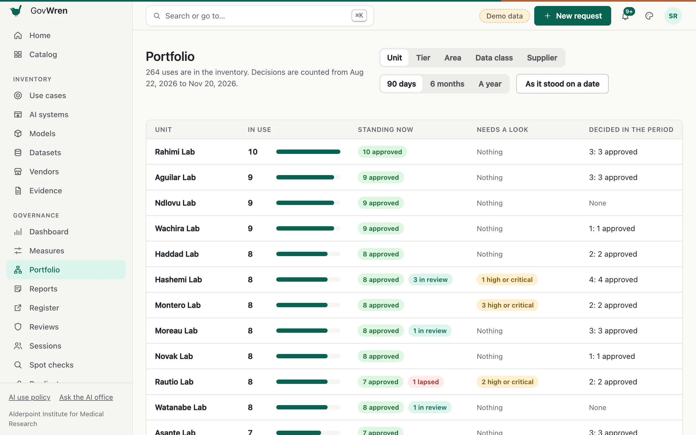
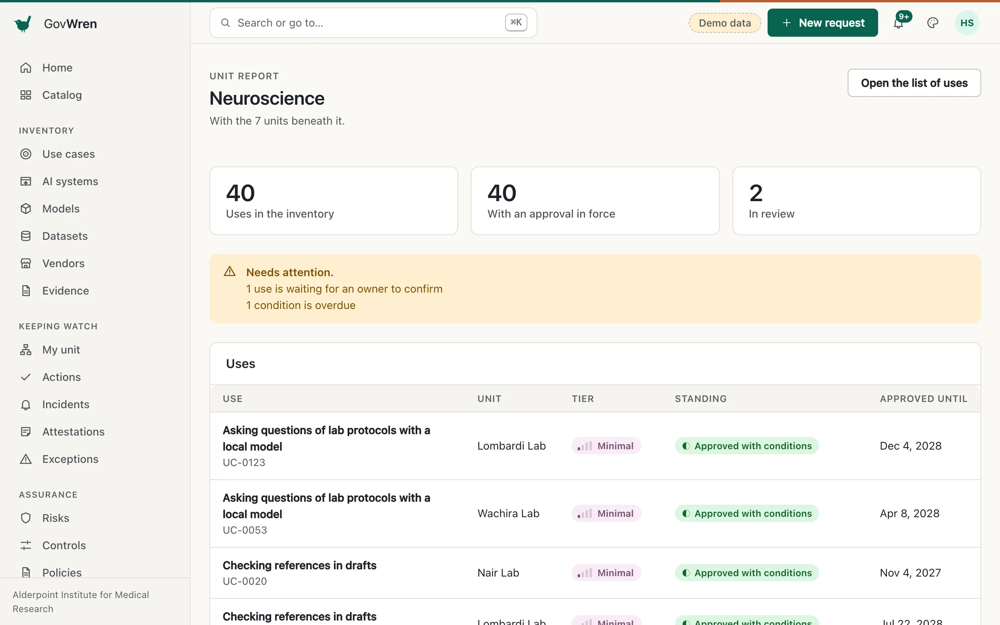
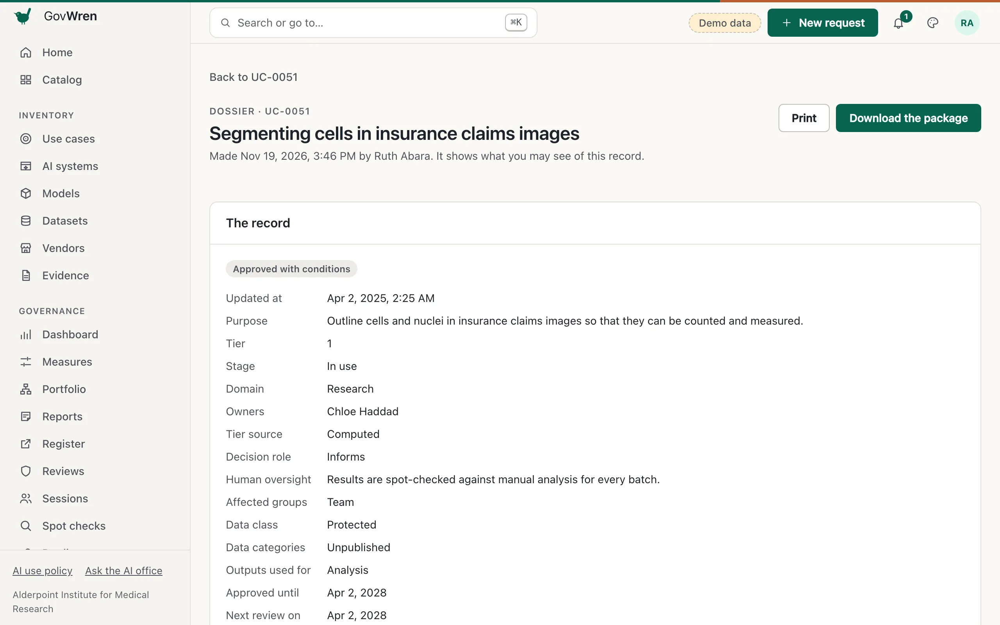

# Insight

GovWren keeps a record of every request, decision, review, and change. This guide covers reading that record back as a whole: how the program is doing, in figures that say what they count.

This guide grows with each release. It covers the measures, the portfolio, and the unit report. The record dossier and the leadership report follow.

Governance, auditors, and administrators see everything in this guide. A steward sees the report for their own unit.

## Measures

**Measures** shows five figures about the program. Each one comes with the sentence that defines it and the cohort it counts, so that nobody has to guess what a number means.


| Measure | What it is | What it counts |
|---|---|---|
| Turnaround | The median number of days from a request being submitted to its decision, leaving out the time it spent back with the requester | First reviews decided by a person in the period. Approvals made by a rule and withdrawn requests are left out |
| Throughput | How many requests reached a decision in the period | First reviews decided in the period, whoever or whatever decided them |
| Coverage | The share of uses in the inventory that an owner has confirmed in the twelve months to the end of the period | Use cases that are approved, lapsed, or suspended. A use counts if an owner answered an attestation campaign about it |
| Currency | The share of uses in the inventory whose approval is in force at the end of the period | Use cases that are approved, lapsed, or suspended. A use counts if it is approved and its approval has not passed its end date |
| Completeness | How complete the records of uses in the inventory are, on average | Use cases that are approved, lapsed, or suspended, each scored by the share of expected fields that are filled in |

### Choose the period

The page shows the last ninety days. Choose six months or a year at the top. Turnaround and throughput count what was decided in the period. Coverage, currency, and completeness describe the inventory as it stands at the end of it.

### Read a trend

Under each figure is its trend. Once a day GovWren stores each measure as it stands, over the ninety days to that date. The trend is those stored values, oldest first.

A stored value is not recomputed. What a measure said last March is what was stored last March, even if records have since been corrected. The job that stores them is listed under [Scheduled work](keeping-watch.md#what-govwren-does-by-itself).

### Use a measure well

- A falling turnaround is good only if throughput holds. Read them together.
- Coverage rises when an [attestation campaign](keeping-watch.md#attestation-campaigns) runs, and falls as the twelve months pass.
- Currency falls when approvals [lapse](keeping-watch.md#if-nobody-confirms). The list of lapsed uses is one filter away under **Use cases**.

The same figures are available from the API at `GET /api/v1/measures`, with `from` and `to`.

## The portfolio

**Portfolio** shows the uses in the inventory grouped one way at a time. Choose how at the top:

| Group by | Shows |
|---|---|
| Unit | Each unit that has uses of its own |
| Tier | Minimal, moderate, high, and critical |
| Area | The area of work each use belongs to |
| Data class | The most sensitive class of data each use involves |
| Supplier | The vendors of the tools each use relies on |



For each group the table shows:

- **In use:** how many of its uses are in the inventory, approved, lapsed, or suspended.
- **Standing now:** how those uses stand today, and how many more are in review.
- **Needs a look:** how many are at the high or critical tier, and how many serious risks are open on them.
- **Decided in the period:** how many decisions were made for the group in the period chosen, and how they went.

Each name opens the list of uses it counts, so no figure has to be taken on trust. A supplier's name opens the supplier.

A use that relies on tools from two suppliers is counted under both. Under every other grouping each use is counted once.

Standing is always as of today. Only the last column changes with the period.

## The unit report

A unit report puts one unit on a page: the unit and every unit beneath it.

Stewards open theirs with **My unit**. Governance, auditors, and administrators can open the report for any unit.



It shows:

- How many uses the unit has in the inventory, how many have an approval in force, and how many are in review.
- What needs attention: uses waiting for an owner to confirm, overdue conditions, approvals that end within sixty days, approvals that have lapsed, and open incidents.
- Every use, with its unit, tier, standing, and the date its approval ends.
- Exceptions asked for or in force, and open incidents that involve a use in the unit.

It is the page to open before a meeting with a head of unit, and the page a steward checks before [attesting that their list is complete](keeping-watch.md#attest-that-a-units-list-is-complete).

## The dossier

A dossier is everything the record holds about one thing, in one place. Open any record you can see in full and choose **Dossier**.



It holds, in order:

- The record as it stands.
- For a use case, the answers given on the request form, with the version of the form.
- Every review, with each review function's finding, and every decision with its reason.
- Conditions, findings of its own and inherited, risks, the controls that apply, exceptions, incidents, and assessments.
- What it is connected to, and its evidence, with the SHA-256 of each file.
- Its history, oldest first.

A dossier shows what the person who made it may see. A requester's dossier leaves out what reviewers said among themselves, exactly as the record's own pages do.

### Print it

**Print** sends the page to your printer, or to a PDF, without the menus.

### Take the package

**Download the package** gives a zip to hand to an auditor. It contains:

| File | What it is |
|---|---|
| `dossier.html` | The dossier as one page that opens in any browser, with nothing else needed |
| `dossier.json` | The same content as data |
| `evidence/` | Each evidence file, named by its reference |
| `manifest.json` | Every file with its SHA-256 and size, and the event the history ended at when the package was made |

From the command line, `govwren dossier make UC-0042` writes the same package with everything in it.

### Check a package

Anyone holding a package can check that it is whole. This needs GovWren installed, but no installation of it:

```bash
uv run govwren dossier verify UC-0042-dossier.zip
```

It recomputes the SHA-256 of every file and compares it with the manifest. It exits with 1 and names the file if one was altered, added, or removed, or if the manifest itself was changed.

To also check that the package came from your installation, add `--history`. GovWren then looks up the event the manifest names in its own history and compares the hash:

```bash
uv run govwren dossier verify UC-0042-dossier.zip --history
```

If an evidence file was not in the file store when the package was made, the manifest lists it as missing and the check says so.
