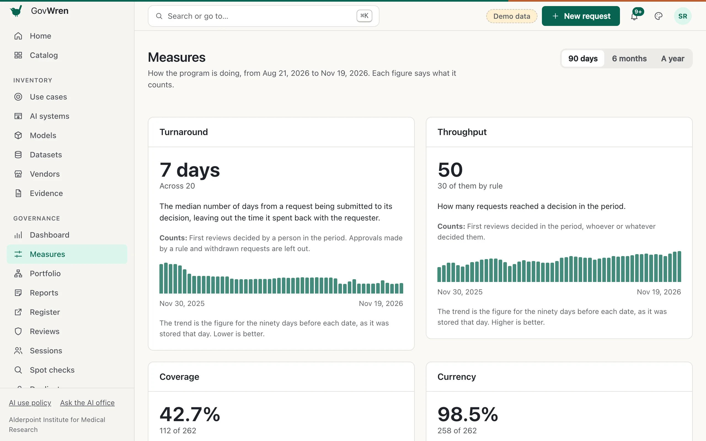

# Insight

GovWren keeps a record of every request, decision, review, and change. This guide covers reading that record back as a whole: how the program is doing, in figures that say what they count.

This guide grows with each release. It covers the measures. Portfolio views, the record dossier, and the leadership report follow.

Governance, auditors, and administrators see everything in this guide.

## Measures

**Measures** shows five figures about the program. Each one comes with the sentence that defines it and the cohort it counts, so that nobody has to guess what a number means.

| Measure | What it is | What it counts |
|---|---|---|
| Turnaround | The median number of days from a request being submitted to its decision, leaving out the time it spent back with the requester | First reviews decided by a person in the period. Approvals made by a rule and withdrawn requests are left out |
| Throughput | How many requests reached a decision in the period | First reviews decided in the period, whoever or whatever decided them |
| Coverage | The share of uses in the inventory that an owner has confirmed in the twelve months to the end of the period | Use cases that are approved, lapsed, or suspended. A use counts if an owner answered an attestation campaign about it |
| Currency | The share of uses in the inventory whose approval is in force at the end of the period | Use cases that are approved, lapsed, or suspended. A use counts if it is approved and its approval has not passed its end date |
| Completeness | How complete the records of uses in the inventory are, on average | Use cases that are approved, lapsed, or suspended, each scored by the share of expected fields that are filled in |

### Choose the period

The page shows the last ninety days. Choose six months or a year at the top. Turnaround and throughput count what was decided in the period. Coverage, currency, and completeness describe the inventory as it stands at the end of it.

### Read a trend

Under each figure is its trend. Once a day GovWren stores each measure as it stands, over the ninety days to that date. The trend is those stored values, oldest first.

A stored value is not recomputed. What a measure said last March is what was stored last March, even if records have since been corrected. The job that stores them is listed under [Scheduled work](keeping-watch.md#what-govwren-does-by-itself).

### Use a measure well

- A falling turnaround is good only if throughput holds. Read them together.
- Coverage rises when an [attestation campaign](keeping-watch.md#attestation-campaigns) runs, and falls as the twelve months pass.
- Currency falls when approvals [lapse](keeping-watch.md#if-nobody-confirms). The list of lapsed uses is one filter away under **Use cases**.

The same figures are available from the API at `GET /api/v1/measures`, with `from` and `to`.
