# Keeping watch

An approval describes a use as it was on the day it was decided. Tools change, people leave, approvals run out, and things go wrong. This guide covers what GovWren does to keep the inventory true afterwards, and what it asks of owners, stewards, and governance.

For how a request is made and decided in the first place, see [Requesting](requesting.md) and [Reviewing](reviewing.md).

Who does what:

| Task | Who |
|---|---|
| Confirm the answers at a periodic review | The owners of the use |
| Answer an attestation campaign | Owners, for their records. Stewards, for their unit's list |
| Declare a change, retire a record, ask for an exception | Whoever is responsible for the record: its owners, its unit's stewards, or governance |
| Report an incident | Anyone |
| Start a campaign, decide an exception, triage an incident, set an action | Governance |
| Plan a session, ask for a risk acceptance, check a sample of automatic approvals | Governance |
| Accept a risk | The person governance names |

## What GovWren does by itself

Some work happens on a schedule, without anyone starting it. An administrator sees it under **Admin**, **Scheduled work**.

| Job | What it does | How often |
|---|---|---|
| Periodic reviews | Opens a review sixty days before an approval ends | Every hour |
| Lapsed approvals | Marks an approval as lapsed when its end date passes without renewal | Every hour |
| Exceptions | Ends an exception when its end date passes | Every hour |
| Reminders | Reminds people of work that is nearly due, and tells the next person up when it is late | Every hour |
| Spot checks | Draws about one automatic approval in ten for a person to check | Every day |
| Email | Queues notices and daily summaries, and sends what is waiting | Every minute |
| Housekeeping | Removes records of job runs older than ninety days | Every day |

Each job runs when it is due and can be run again safely: nothing is opened, lapsed, or reminded twice. An administrator can run a job at once, or pause it.

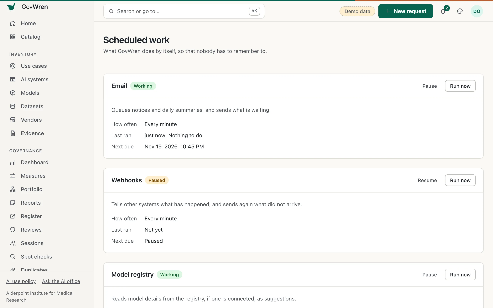

The server runs the jobs while it is up. Before a job runs it is claimed in the database, so several server processes never run the same job at the same moment. To run them from a scheduled task when the server is not up, use [`govwren jobs run`](cli.md#govwren-jobs).

Nothing changes standing silently. When a job marks an approval as lapsed or ends an exception, the record's history says so, with the reason and the date, and the people it affects are told.

## Periodic reviews

Every approval has an end date. It comes from the tier: the routing rules give each tier a number of months. In the default program a minimal-tier approval runs for three years and a critical one for six months.

Sixty days before the end date, GovWren opens a periodic review. It starts with the owner.

### Confirm your answers

If you own the use, you are told, and **Home** lists it under **Waiting on you**. Open it and choose **Confirm for periodic review**.

You see the request form with the answers given last time already filled in. Go through them. Correct any that are no longer true, then choose **Confirm and submit**.

What happens next depends on the answers as they now stand:

| The rules say | What happens |
|---|---|
| No review is required, and a rule approves it | It is approved again at once, with a new end date |
| A review is required | It goes to governance for triage, then to reviewers, as a first request does |

The use keeps its standing while this happens. Standard conditions that still stand are not set a second time.

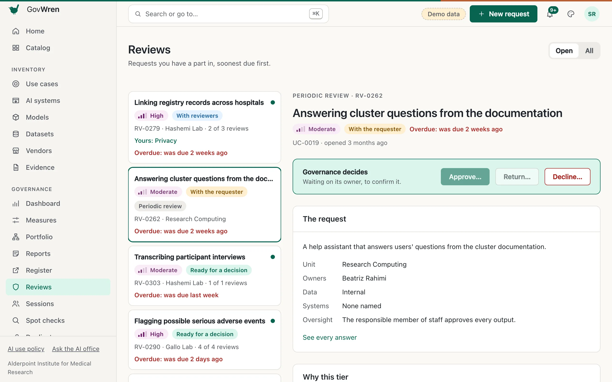

### If nobody confirms

You are reminded fourteen days before the end date. When the date passes, two things happen: the approval is marked **Lapsed**, and the unit's steward is told that the review is overdue.

A lapsed approval shows as lapsed everywhere the use appears, and on everything that relies on it. It is not a decision against the use. Confirming the answers brings it back: when the periodic review approves, the use is approved again.

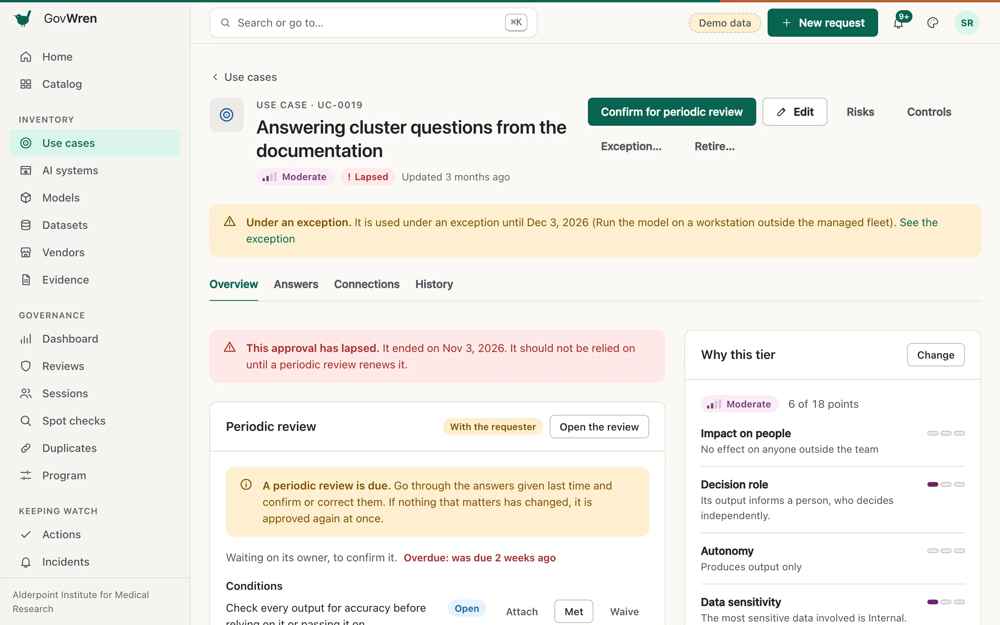

Governance can decline a periodic review. That ends the approval.

## Attestation campaigns

A campaign asks the people closest to the work whether the inventory is still true. Governance starts one under **Attestations**.

There are two kinds:

| Kind | Who is asked | What they say |
|---|---|---|
| Owner confirmation | The owners of each record in scope | Still accurate, changed, or no longer in use |
| Unit completeness | The stewards of each unit in scope | That the unit's list is complete |

### Start a campaign

Choose **Start a campaign**. Give it a name, choose what it asks, which part of the organization it covers, and the date answers are wanted by. For an owner confirmation, choose which kinds of record to include: use cases, AI systems, models, or datasets.

Everyone it asks is told at once, with how many answers are wanted of them. They are reminded seven days before the date. After the date, an owner's silence is also reported to their unit's steward.

A record with no active owner left goes to its unit's steward.

### Confirm your records

Open the campaign from **Home** or from the notice. **Your records** lists what is yours to answer.

- Tick the records that are still as described, and choose **Confirm**. Several can be confirmed together.
- For one that has changed, choose **Changed…** and say what is different. For a use case this starts a [change declaration](#declare-a-change), and you are taken to the answers to correct them.
- For one that has ended, choose **No longer in use…** and say why. The record is [retired](#retire-a-record).

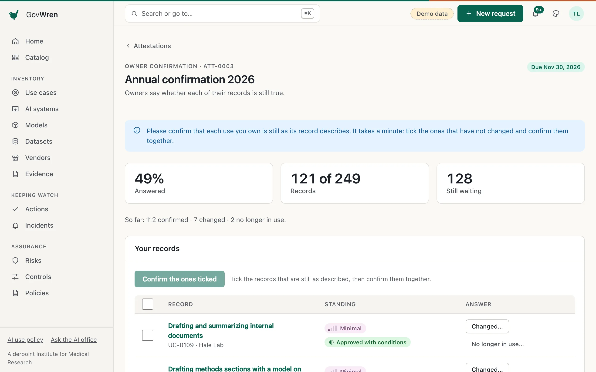

Each answer is recorded in the history of the record it is about.

### Attest that a unit's list is complete

In a unit completeness campaign, a steward sees one card for each unit they steward, with what the unit holds. Look at the unit's use cases. If the group uses AI for something that is not there, add it. Then choose **Attest that the list is complete**.

What the unit held at that moment is kept with the attestation.

### Read coverage

Governance, auditors, and administrators see the whole campaign: the share answered, coverage by unit with the least-answered first, and every record with who it is waiting on.

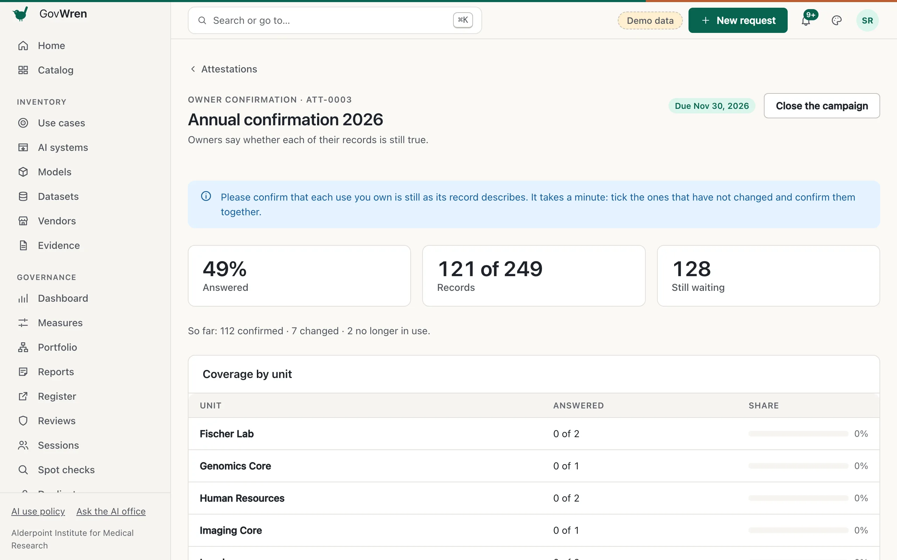

Choose **Close the campaign** when it has run its course. A closed campaign takes no more answers. What was not answered stays counted as not answered.

## Declare a change

An approval covers the use as it was described. When that changes, say so before the change, or as soon as you know.

On the use case, choose **Declare a change** and say in a sentence what is changing. You are taken to the request form, with the answers given last time filled in. Correct the ones that are different and choose **Submit the change**.

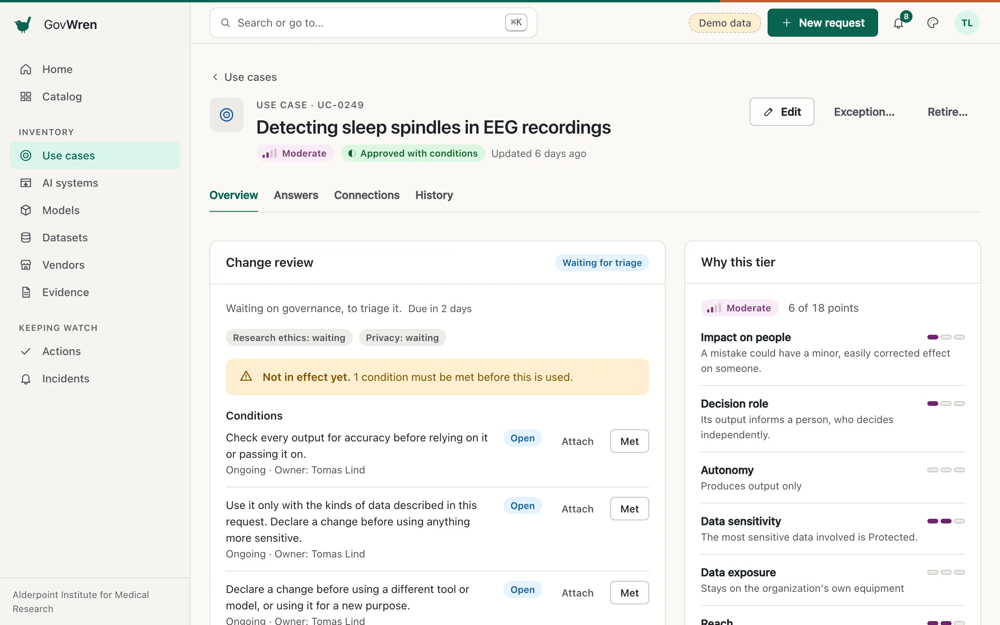

The rules then judge whether the change is material. It is material if any of these is true:

- The risk tier is higher than the one approved.
- The routing rules now require a review that was not required before.
- An answer that the approval rested on has changed: the purpose, the tool, the data, who is affected, how outputs are used, how much it does by itself, or where the data goes.

| The change is | What happens |
|---|---|
| Not material | It is recorded, and the approval stands with the same end date |
| Material | A change review opens. The approval stands while it is reviewed |

A change review shows reviewers each answer that differs, as it was and as it is now. If the change brings in a review that was not needed before, only that review is asked for. A change review does not restart the approval period.

Until you submit the corrected answers, **Drop this change** on the use case abandons it, and nothing is recorded as changed.

A rule set can name its own list of answers that count as material, under `material_changes`. See [Move the program as a file](running-the-program.md#move-the-program-as-a-file).

## Retire a record

When a use has ended, or a tool, model, or dataset is no longer used, retire it. On the record, choose **Retire…** and say why.

A retired record stays in the inventory with its whole history, marked as retired. Any review of it that was in progress is cancelled, and nothing more falls due for it.

The owners of the records that rely on it are told. A use case that uses a retired system, for example, shows that on its own page.

## Findings are inherited

A record shows what is known about everything it relies on. A use case built on a system that is built on a model inherits what is known about both.

These are findings:

| On a record | Shown as |
|---|---|
| An approval that has lapsed, is suspended, or was declined | A finding on the use case |
| A tool or model that is not approved, or has been retired | A finding on it |
| An open incident | A finding on every record the incident involves |
| An exception in force | A finding on its record |

Inherited findings appear at the top of the record, marked **Inherited from**, with the record they come from. Findings on records you may not see are not shown to you.

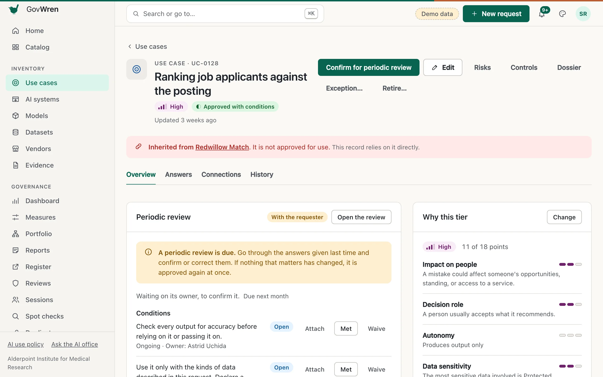

## Exceptions

An exception is an approved, time-limited departure from a requirement. Use one when a requirement cannot be met for now and there is a good reason, and something else keeps the risk down meanwhile.

### Ask for an exception

On the record it applies to, choose **Exception…**. Say:

- Which requirement cannot be met.
- Why it cannot be met for now.
- What is done instead.
- When it ends. An exception always ends, and runs for a year at most.

Governance is told. Nobody decides an exception they asked for.

### Decide an exception

Under **Exceptions**, open the request and choose **Approve…** or **Decline…**, with the reason. When approving you may bring the end date forward.

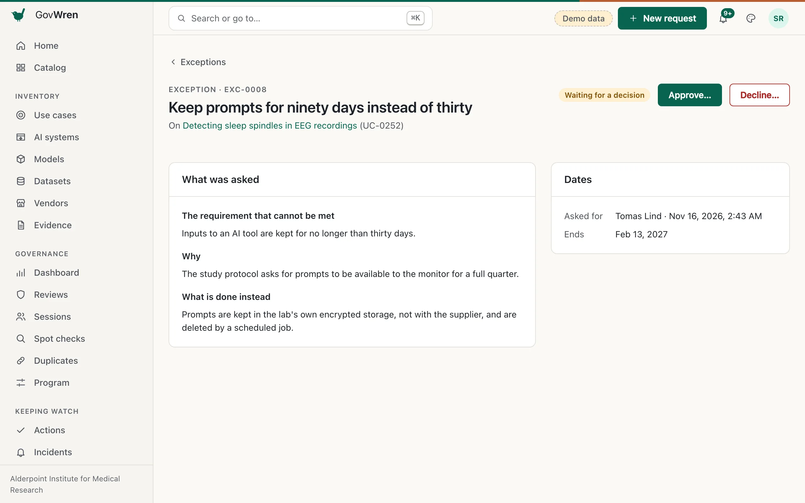

An exception in force is shown on its record and on everything that relies on that record. Governance can revoke it, with a reason.

### When it ends

Whoever asked is reminded three weeks before the end date. On the day after the end date the exception ends by itself, and they and governance are told.

If more time is needed, choose **Ask for more time…**. A renewal is a new request, decided afresh, that points to the exception it renews. The register therefore shows how long a departure has really lasted.

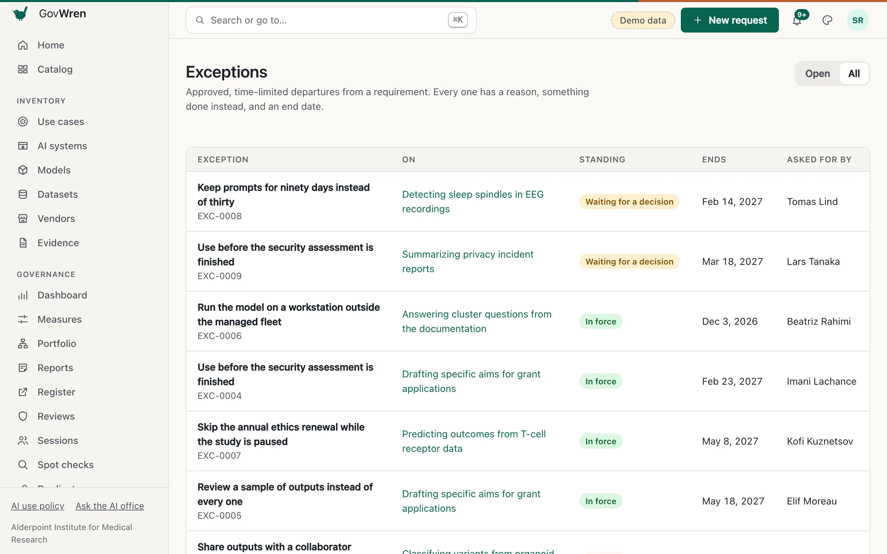

## Incidents

An incident is something that went wrong with an AI use, or nearly did. Near misses count: they are how a program learns without anyone being harmed.

### Report an incident

Anyone can report. Under **Incidents**, choose **Report an incident**. Say what happened, when, and which records it involves if you know. Describe it; do not paste sensitive data into the report.

Governance is told at once. You can follow the incident you reported.

### Triage

Governance opens the report and chooses **Triage…**: what kind of incident it is, how serious, and the records it involves. A report that turns out not to be an incident is closed with **Not an incident…** and the reason, which the reporter sees.

Link the record the problem is in. An incident on a model is then shown on every system built on that model and every use of those systems.

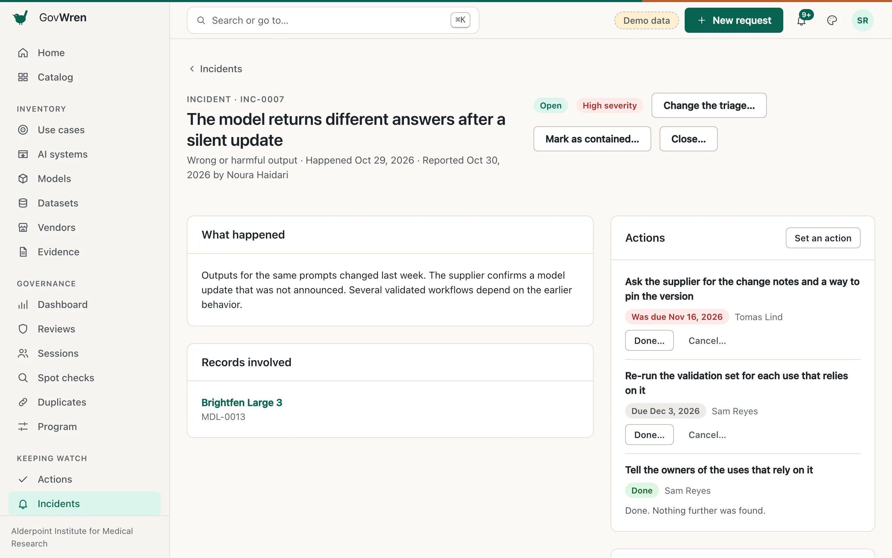

Who sees an incident: governance, auditors, and administrators; whoever reported it; and whoever is responsible for a record it involves.

### Suspend an approval, or open a review

For a use case the incident involves, governance can:

- **Suspend…** its approval, with the reason. The use shows as suspended, and its owners are told.
- **Lift the suspension…** when the cause is dealt with. The use goes back to the standing it had.
- **Open a review…** of it. An incident review goes to triage with the reviews the rules require. Approving it lifts any suspension. Declining it ends the approval.

Neither a suspension nor an incident review restarts the approval period.

### Contain and close

Choose **Mark as contained…** and say what was done to stop it. Choose **Close…** and record the cause and what will be done differently.

An incident cannot be closed while an approval it suspended is still suspended.

## Actions

Everything someone must do, by a date, is in one list under **Actions**:

- Actions that governance sets on an incident, each with an owner and a due date.
- Conditions of a decision that have a date, or that must be met before use.

**Mine** shows what is yours. Governance, auditors, and administrators can also see **Everyone's**.

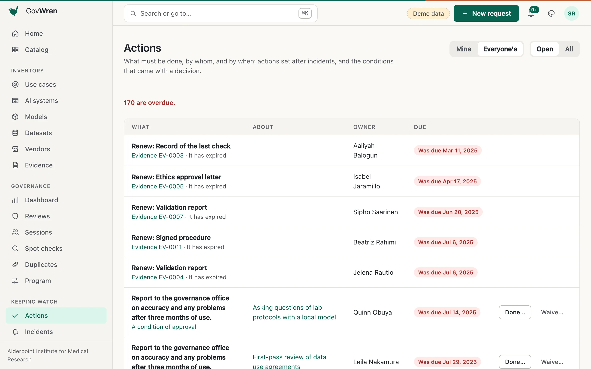

When you have done one, choose **Done…** and say what was done. The owner is reminded a week before the date. When the date passes, governance is told as well.

## Committee sessions

When the rules send a request to a committee, the decision is made in a meeting. A session records that meeting.

Under **Sessions**, choose **Plan a session**. Give it a name and a date, and tick the reviews to put on its agenda. Reviews that are ready for a committee decision are ticked for you.

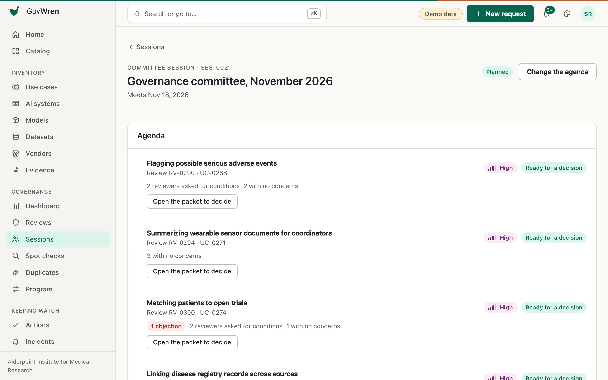

The agenda shows, for each review, the tier, how many reviewers objected or asked for conditions, and whether a risk acceptance is still needed. Open the packet to decide. The decision form offers **Decided at** the session, already ticked, so the decision is recorded as made there.

After the meeting, write who attended and the minutes, and choose **Close the session**. A closed session is a fixed record: its agenda, decisions, and minutes cannot be changed, and nothing more can be decided in it. An item with no decision stays open for a later session.

## Risk acceptance

For the highest tier, the default rules say the committee decides and a named person accepts the risk. Such a request cannot be approved until that has happened.

In the packet, under **Risk acceptance**, governance chooses **Ask someone to accept it…** and picks the person accountable, such as the head of the division. It cannot be someone who made or owns the request.

That person is told, and **Home** lists it. They can read the whole packet, including what reviewers found. They choose **Accept the risk…** or **Decline…** and say, in their own words, what they accept or why they do not.

The statement is kept with the review, with their name and the date. If they decline, governance can ask someone else, or decline the request.

## Spot checks

Many requests are approved by a rule, with no person involved. A spot check is a second look at a sample of them, to know that the rules decide what a person would.

The scheduler draws about one automatic approval in ten. Governance can draw more at any time under **Spot checks**, with **Draw five more**.

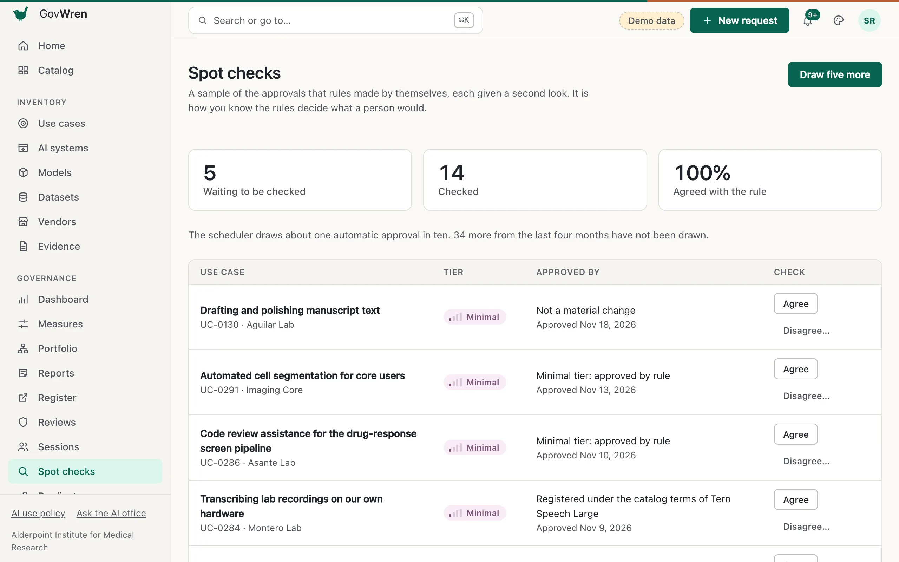

For each one, open the use case, then choose:

- **Agree**, if the approval is one you would have made.
- **Disagree…**, and say what the rule got wrong. A review of the use opens. Its approval stands until that review is decided.

Nobody checks the approval of their own request. The share agreed is a measure of the rules. If it falls, look at which rules approve and [change them](running-the-program.md#the-routing-rules).
