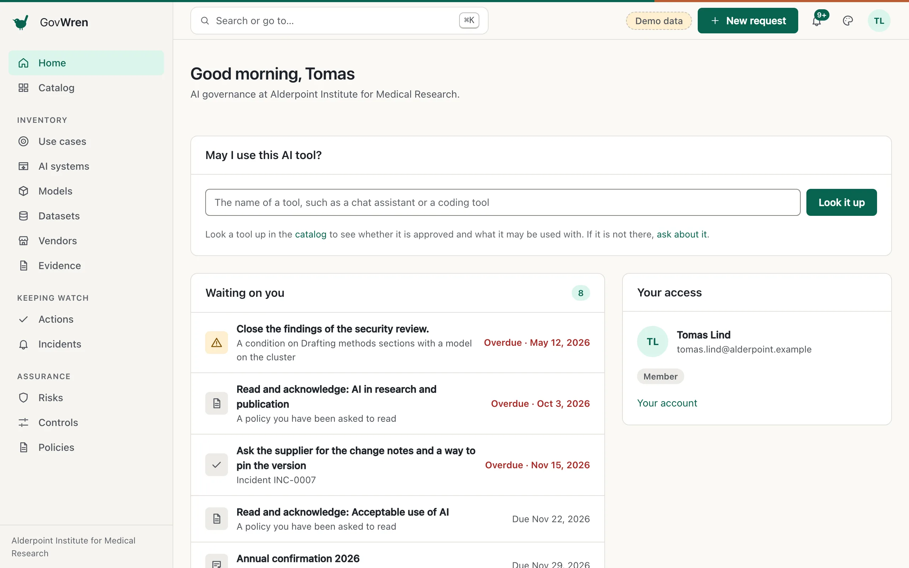
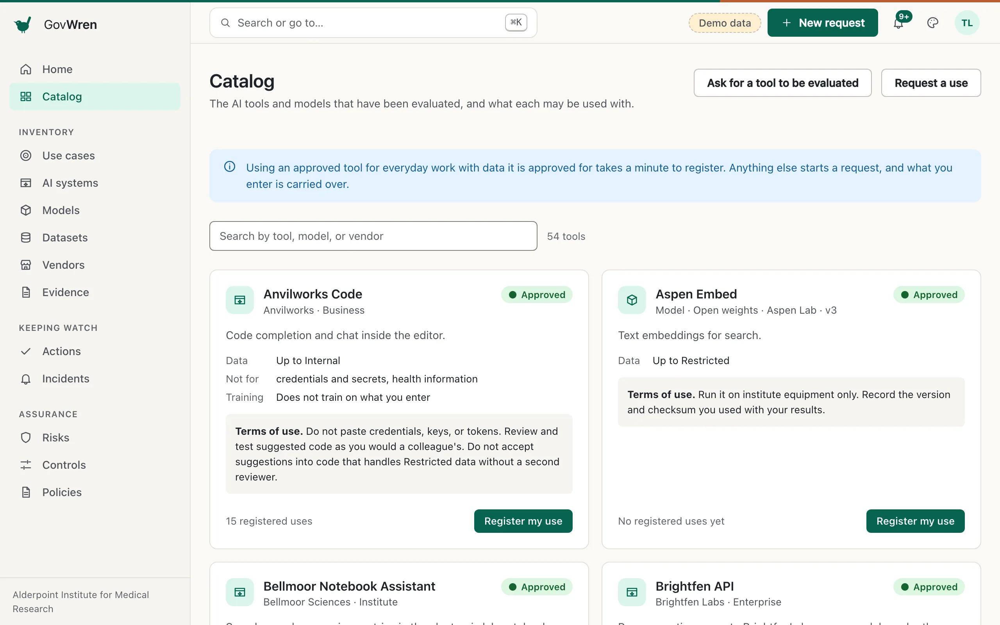
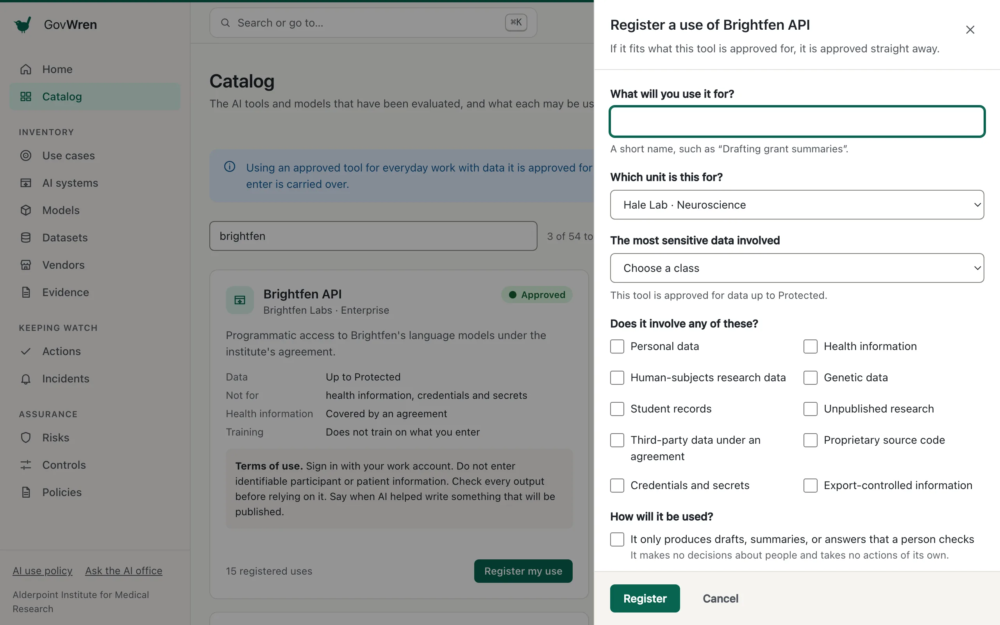
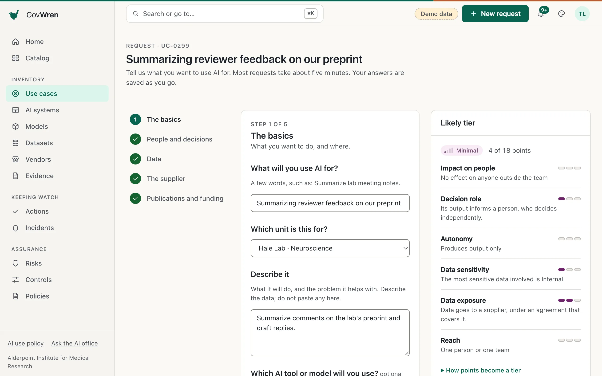
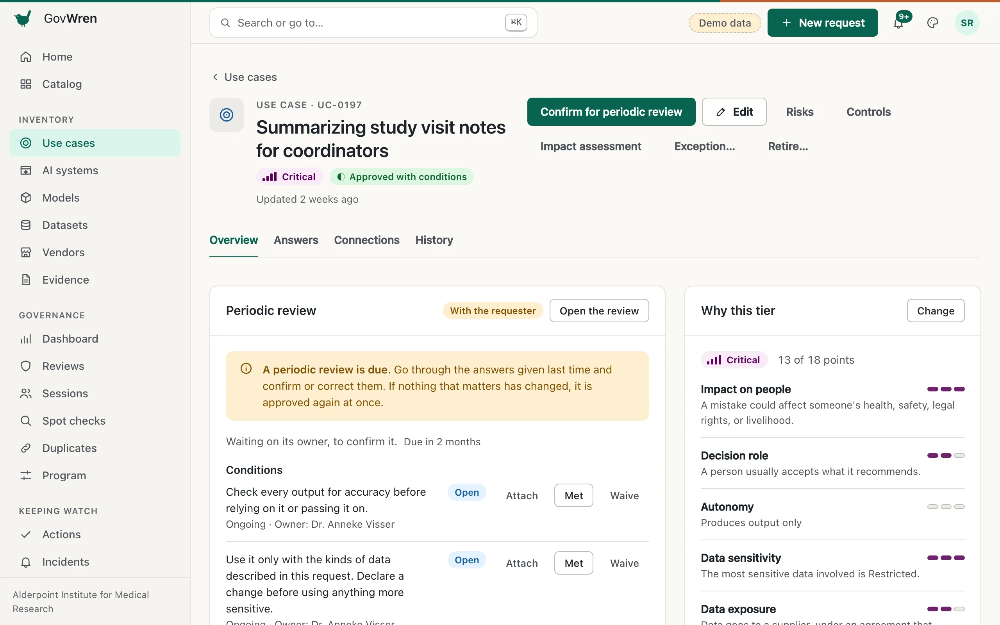

# Requesting

This guide is for researchers and staff who want to use an AI tool. It covers looking a tool up, registering an everyday use, making a request, and what happens afterwards.

The short version:

1. Look the tool up in the catalog.
2. If it is approved and your use is an everyday one, register it. That takes about a minute and is approved at once.
3. If not, make a request. A short form works out a risk tier, and the tier decides how much review the request gets.

## Ask "May I use this AI tool?"

Home has a card with that question. Type the name of a tool and choose **Look it up**. You land in the catalog, filtered to what you typed.

Home also lists what is **Waiting on you**: requests you have not finished, questions from reviewers, and conditions you own, with anything overdue first. The bell in the top bar holds your notices.

## Read the catalog

The **Catalog** lists the AI tools your organization has evaluated. Search it by tool or vendor name. Each entry shows:

| On the entry | What it means |
|---|---|
| Standing | **Approved**, **Approved with restrictions**, **Under evaluation**, or **Not approved** |
| Data | The most sensitive class of data the tool may be used with, such as "Up to Internal" |
| Not for | Kinds of data it must never be used with |
| Training | Whether the supplier trains on what you enter, where that is known |
| Terms of use | The conditions that apply to everyone who uses it |

A standing applies to one edition of a product. A free edition and an enterprise edition of the same tool are separate entries and can have different standings, so check the edition under the name.

Tools under evaluation or not approved are listed so that you get an answer, but they cannot be registered.

If the tool is not in the catalog, it has not been evaluated yet. Choose **Ask about a tool** or **Ask about something else** to start a request.

The catalog also lists **models** the organization has evaluated, such as open-weight models it runs on its own equipment. A model's card says "Model" under its name. You register a use of an approved model exactly as you do a tool.

If the tool you want is not in the catalog at all, choose **Ask for a tool to be evaluated**. Say which tool and what you want it for. Governance looks at it, and you are told the answer. This asks about the tool; to ask about a particular use, make a request instead.

## Register a use of an approved tool

On an approved tool, choose **Register my use**. The form asks:

| Field | What to enter |
|---|---|
| What will you use it for? | A short name, such as "Drafting grant summaries" |
| Which unit is this for? | Your lab, department, or office |
| The most sensitive data involved | One data class. The form reminds you what the tool is approved for |
| Does it involve any of these? | Tick any kinds of data that apply |
| How will it be used? | Tick the box if it only produces drafts, summaries, or answers that a person checks |

Choose **Register**. One of two things happens.

**It is registered and approved at once** when all of these are true:

- the data class is no more sensitive than the tool is approved for;
- none of the kinds of data you ticked is excluded for the tool;
- you ticked the box saying a person checks its output, so it makes no decisions about people and takes no actions of its own.

A use case is created with you as its accountable owner. It has the Minimal tier and carries the standard conditions, along with the tool's terms of use if it has any.

**It falls through to a request** when any of those is not true. GovWren says why, starts a request, and carries over what you entered, so you type nothing twice. You land on the request form.

## Make a request

Choose **New request** in the top bar. The default form is called "Request to use AI" and takes about five minutes. Your organization may have changed its questions.

### Fill in the form

The form is in sections, listed on the left. The first three are always there:

| Section | Asks about |
|---|---|
| The basics | What you will use AI for, which unit, a description, the tool, how far along it is |
| People and decisions | Who is affected, how serious a mistake could be, how the output is used, whether it acts by itself, who checks it |
| Data | The most sensitive class of data, kinds of data, where the data goes, how widely it will be used |

More sections appear only when your answers call for them:

| Section | Appears when |
|---|---|
| Data about people | You tick personal, health, human-subjects, genetic, or student data |
| The supplier | The data goes to an outside supplier |
| Actions it can take | The tool can take actions by itself |
| Publications and funding | Its output will be used for publications, grant applications, or peer review |

If your organization has switched on the assistant, the form opens with a box, **Start from a description**. Write a few sentences about what you want to do: with which tool, what kind of data, who is affected, and who checks what it produces. Choose **Suggest answers**. An AI assistant fills in the questions your words answer or plainly imply, and leaves the rest. Every answer it gives is marked **Suggested by the assistant** where it is, the notice above the form lists them under their steps, and the steps on the left say how many each holds. A short description gets few answers; add more and ask again. Read every suggested answer and correct it: you submit the request, not the assistant.

Some tips:

- Describe the data. Do not paste any of it into the form.
- If your tool is not listed under "Which AI tool or model will you use?", leave that empty and name it under "A tool that is not listed".
- For the data class, each choice has a definition and an **Examples** list. If several kinds of data are involved, choose the most sensitive.
- Questions marked *optional* can be left empty.
- "Will you run or train a model yourselves?" is for work where nobody else answers for the model: open weights you run on equipment you control, a model you fine-tune with your own data, or one you train from nothing. Answer yes and a short section asks where the weights come from, where the model will run, what data it will be trained on, and who it will be shared with. A model can reproduce what it was trained on, so training on Protected or Restricted data raises the tier.

### Watch the likely tier

Beside the form, **Likely tier** shows the risk tier your answers point to, once you have answered a few questions. It lists each of the six factors with its level and the answer that set it, and updates as you change answers. A factor whose questions you have not reached yet says **Not answered yet**: it counts as nothing so far, and the tier can rise when you answer it.

Below it, **What happens next** says what will follow if you submit now: approval on the spot, or which reviews are needed, who decides, and the usual number of working days.

The tier is confirmed when you submit. The preview and the recorded tier use the same rules.

### Save a draft and come back

There is no save button. Once you have said what the request is for and which unit it belongs to, your answers are saved as you go, and the form shows **Saved as** with the request's reference, such as `UC-0142`.

To pick a draft up later, on any device, open **Finish your request** under Waiting on you on Home, or find it under **Use cases** with the **Mine** filter and choose **Continue the request**. A draft is seen only by you and by the people who may read every record.

### Submit

**Submit request** is on the last section. If required questions are unanswered, the form takes you to the first one.

When you submit, GovWren records your answers, works out the tier, and applies the routing rules. The answers are now part of the record. You can read them on the use case under the **Answers** tab, along with the version of the form you answered.

## What the tier means

Each of six factors scores from 0 to 3: impact on people, decision role, autonomy, data sensitivity, data exposure, and reach. The total gives the tier. With the default program:

| Tier | What it is | What happens |
|---|---|---|
| Minimal | Everyday use with little that can go wrong | Approved on submission, by rule, with standard conditions, unless an answer calls for a review |
| Moderate | Some sensitivity | Governance decides, usually within 5 working days |
| High | Real potential for harm | Privacy and security review; the governance committee decides, usually within 15 working days |
| Critical | Serious potential for harm | Privacy, security, and legal review; the committee decides and an executive accepts the risk, usually within 30 working days |

Your answers can add other reviews at any tier. For example, human-subjects data adds a research ethics review, and use in publications adds a research integrity review.

Two things can override the points:

- A **floor** sets a minimum tier for a serious case, whatever the total. For example, anything that could seriously affect a person is reviewed as at least High. The panel says when a floor applied and why.
- A **stop** marks a prohibited use, such as entering Restricted data into a tool whose supplier may train on it. You can still submit, but it cannot be approved as it stands. The panel shows the reason in red.

The use case page shows **Why this tier** with the same detail. A reviewer or governance can change a tier, and must write a reason, which is shown beside it.

## Follow your request

Open the use case from **Use cases** or from a notice. Its standing is shown under the name:

| Standing | Meaning |
|---|---|
| Draft | Not submitted yet |
| In review | Submitted; with governance or reviewers |
| With requester | Waiting on you |
| Approved | Approved, with no conditions |
| Approved with conditions | Approved, with conditions to keep to |
| Declined | Not approved; the reason is on the record |
| Withdrawn | You took it back |

The **Review** card says who it is waiting on, the target date, and which reviews are waiting or done. You see where each review stands. You do not see reviewers' findings or the notes they write among themselves.

### Answer a reviewer's question

When reviewers need something from you, the request moves to **With requester**, you get a notice, and Home shows **Answer a question**. The review clock is stopped while it waits on you.

On the use case, under **Discussion**, you can do either of these:

- Write a reply and choose **Send reply**. The request goes back to the reviewers.
- Choose **Update your answers** to reopen the form, change what needs changing, and submit again. The tier is worked out again from the new answers.

You can also write in the discussion at any time while the review is open. Everything you write there is seen by the reviewers.

## Read the decision

When the request is decided you get a notice, and the card on the use case becomes **Decision**. It shows the outcome, the reason, who decided and when. A decision is never edited afterwards. An approval that was made by rule says so.

An approval runs until the **Approved until** date shown on the use case. With the default program that is 36 months for Minimal, 24 for Moderate, 12 for High, and 6 for Critical.

If a request is declined, the reason says why. You can make a new request, for example with an approved tool.

## Keep to the conditions

Approvals usually carry conditions. Each has an owner, by default the accountable owner of the use case, and one of three kinds:

| Kind | Meaning |
|---|---|
| Before use | Must be met before you start. Until then the approval is **Not in effect yet** |
| By a date | Must be met by the date shown |
| Ongoing | Something to keep to for as long as you use the tool |

To mark a condition as met, open the use case, find it under **Conditions**, and choose **Met**. Say how it was met; the note is kept on the record. Owners of the use case, stewards of its unit, and governance can do this. Only governance can waive a condition.

To show how a condition was met, choose **Attach** beside it before you mark it as met, and add a file, an address, or a note. The evidence stays with the condition.

Before-use and by-date conditions that you own appear under Waiting on you until they are closed.

## After the approval

An approval has an end date, and it covers the use as you described it.

- Before the end date you are asked to confirm your answers. See [Confirm your answers](keeping-watch.md#confirm-your-answers).
- If what you do changes, say so. See [Declare a change](keeping-watch.md#declare-a-change).
- If the use ends, retire it. See [Retire a record](keeping-watch.md#retire-a-record).
- If something goes wrong, or nearly does, report it. See [Report an incident](keeping-watch.md#report-an-incident).

## Withdraw a request

You can take a request back while its review is open. Open the use case and choose **Withdraw this request** at the foot of its Review card. The review is closed and the use case is marked Withdrawn. You can make a new request later.

## Who can see your request

- A draft is seen only by you and by the people who may read every record: governance, auditors, and administrators.
- A request in review is also seen by its owners, the stewards and members of its unit, and the reviewers whose review it needs.
- Once approved, how much the rest of the organization sees is a setting. By default, everyone sees a summary and your own unit sees it in full.
