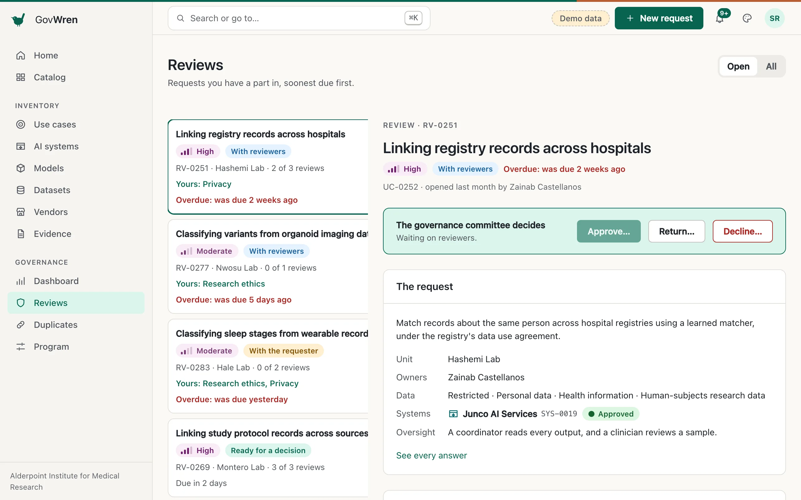
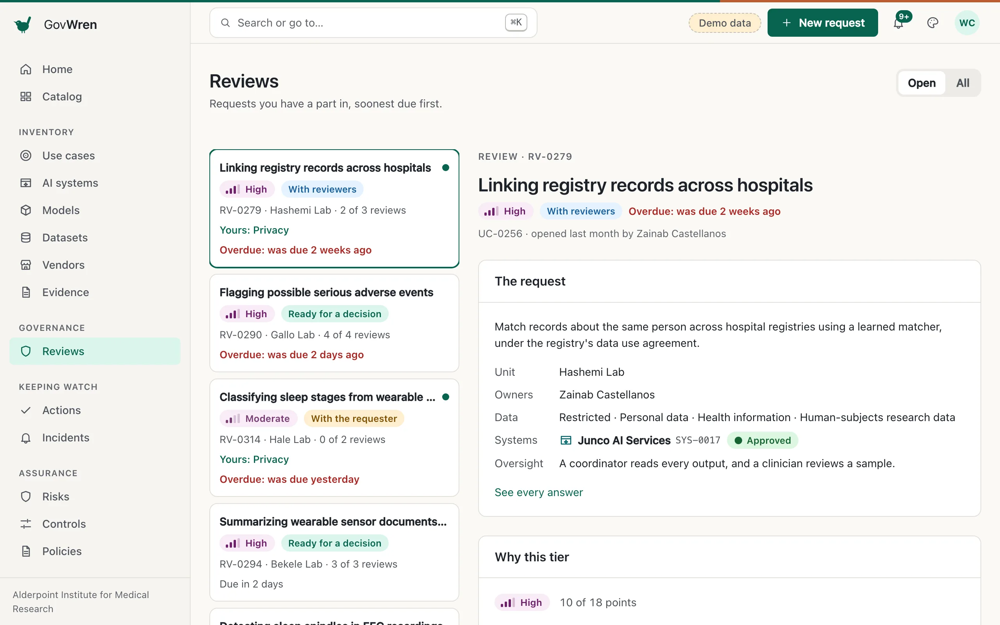
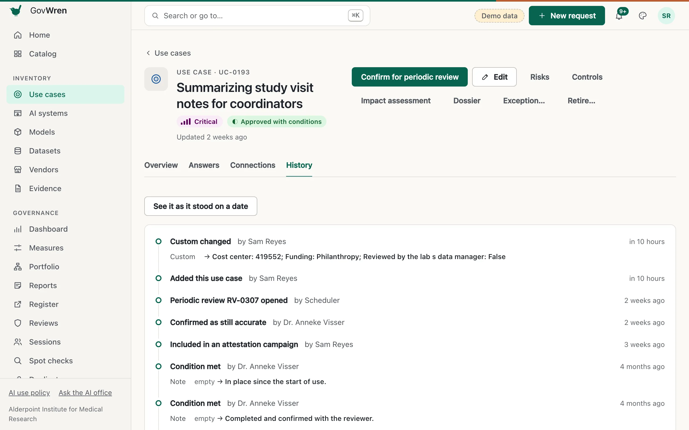

# Reviewing

This guide is for the people on the reviewing side of a request: governance, who triage and decide; reviewers, who record findings for their function; and auditors, who read.

For how a request is made, see [Requesting](requesting.md). For how tiers and routing rules are set, see [Running the program](running-the-program.md).

## How a review moves

When a request is submitted, GovWren works out its tier and applies the routing rules. If no rule requires a review and one approves it, the request is approved on the spot and never reaches the queue. Otherwise a review is opened, with a reference such as `RV-0087`, and moves through these states:

| State | Waiting on | What happens |
|---|---|---|
| Waiting for triage | Governance | Governance confirms or adjusts the reviews the rules require |
| With reviewers | Reviewers | Each required review function records a finding. They work in parallel |
| With the requester | The requester | Someone asked a question, or the request was returned |
| Ready for a decision | Governance | Every review is finished |
| Decided | Nobody | Approved, declined, or withdrawn |

Who does what:

| Action | Who may |
|---|---|
| Triage | Governance |
| Take a task and record a finding | A reviewer for that function, or governance |
| Write in the discussion | Reviewers on the review, governance, and the requester |
| Change a tier | A reviewer or governance |
| Approve, return, or decline | Governance |
| Waive a condition | Governance |

You are told when something needs you. The bell in the top bar holds your notices, and Home lists what is **Waiting on you**, overdue first: requests to triage, reviews to do, and requests ready to decide.

## Work the review queue

Open **Reviews**. The list on the left holds the reviews you have a part in, soonest due first. The one you select opens on the right.

Each item in the list shows the request's name, its tier, the state of the review, its reference and unit, how many reviews are finished, and when it is due. A dot marks the ones waiting on you, and **Yours:** names the review tasks that are yours to do. The page opens on the first one that needs you.

- Press `J` or the down arrow for the next review, and `K` or the up arrow for the previous one. The keys do nothing while you are typing in a field or have a dialog open.
- **Open** shows reviews still in progress. **All** adds the ones already decided.
- The address changes as you move, so you can send someone a link to a particular review.

### Read the packet

Everything about a request is on one screen:

| Part | What it holds |
|---|---|
| Header | The request's name, tier, state, target date, and who opened it and when |
| The request | Its description, unit, owners, data class and kinds of data, the AI systems it uses with their catalog standing, and the oversight described. **See every answer** opens the full form |
| Why this tier | Each factor's level and the answer that set it, the points, any floor that raised the tier, and any stop |
| Reviews | One task for each required review function: who has it, and what they found |
| Discussion | Notes among reviewers, and messages to and from the requester |

A reviewer sees the whole request, whatever unit it belongs to. A line at the foot shows how many days the request has spent with reviewers and with the requester.

If the request is a prohibited use, a red notice at the top says so and gives the reason. It cannot be approved.

## Triage a request

Triage is for governance. A request waiting for triage shows a **Triage** card.

1. Read the request and why it has its tier.
2. Under **Required by the rules**, each review is ticked and names the rule that required it. Untick one that is not needed here.
3. Open **Require another review** to add a function the rules did not ask for.
4. If you changed anything, write a **Reason for the change**. It is kept on the record.
5. Choose **Confirm and start**.

The reviewers for each function are notified, and the review moves to With reviewers. If no review is required, it goes straight to Ready for a decision.

A review is triaged once. A review that was removed at triage is shown as **Not required**, with your reason.

## Do a review task

Under **Reviews**, find the task for your function.

1. Choose **Take it** to put your name on the task, so others know it is in hand. This is optional; recording a finding also puts your name on it.
2. Choose **Record finding** and pick one:

| Finding | Meaning | What you must add |
|---|---|---|
| No concerns | Nothing in your area stands in the way | Nothing |
| Acceptable with conditions | Acceptable if the conditions you name are attached | The conditions, and notes explaining them |
| Objection | It should not go ahead as proposed | Notes explaining why |

3. For conditions, tick any under **More standard conditions**, or choose **Write another condition** and say what is required and when.
4. Write your **Notes**, then choose **Record finding**.

Your notes and finding are seen by governance and the other reviewers, never by the requester. The requester sees only that your review is done.

When every task is finished, the review becomes Ready for a decision and governance is notified. A reviewer holds the role for particular functions, or for every function. Governance can record a finding for any function.

### Attach what you relied on

Choose **Attach** on your task to add a file, an address, or a note to your review: a supplier's report you read, a test you ran. It is kept with the task and shown to the people who can read reviewers' notes, never to the requester.

## Use the discussion

The **Discussion** has two audiences. Choose one before you write:

| Choice | Who sees it |
|---|---|
| Reviewers only | Governance, the reviewers on this review, auditors, and administrators. Never the requester |
| To the requester | Everyone on the review, including the requester, who gets a notice |

**Reviewers only** is selected to begin with. Messages for reviewers only are marked as such in the thread.

### Ask a question that stops the clock

To ask the requester for something, choose **To the requester**, tick **Ask the requester, and pause the clock until they reply**, write the question, and choose **Add**.

- The review moves to With the requester, and the requester is notified.
- The time it spends there is counted separately. It is left out of the figure for time with reviewers and out of the dashboard's median time to a decision. The target date itself does not move.
- The review returns to where it was when the requester replies, or updates their answers and submits again. If they update their answers, the tier is worked out again and a note in the discussion gives the new tier.

Reviewers can still record findings while a request is with its requester.

## Change a tier

The tier is worked out from the answers, but the answers do not always tell the whole story. A reviewer or governance can change it.

1. Open the use case, for example from the request's name at the top of the packet.
2. On the **Why this tier** card, choose **Change**.
3. Pick the tier and write a **Reason**: why the worked-out tier is wrong for this request.
4. Choose **Change tier**.

The reason is required and is shown beside the tier from then on, with your name. The tier that was worked out is kept, so the record shows both. A tier can be raised or lowered.

Changing a tier does not re-route a review that is already open. The reviews it needs are the ones set by the rules when it was submitted, as adjusted at triage.

## Decide

Deciding is for governance. Once a request has been triaged, a bar above the packet shows who decides and what the review is waiting on, with three buttons.

| Button | When you can use it | Result |
|---|---|---|
| **Approve…** | Only when the review is Ready for a decision | Approved, or Approved with conditions |
| **Return…** | Any time, unless it is already with the requester | Goes back to the requester with your question. The review stays open |
| **Decline…** | Any time | Declined. The review is closed |

Every decision needs a reason. It is shown to the requester and kept on the record. A decision is never edited afterwards.

The bar says on whose authority the decision is made: governance, the governance committee, or the committee with an executive accepting the risk. That comes from the routing rules. In this release the decision is always recorded by someone with the governance role, who enters it on the committee's behalf where the rules name one.

### Approve

1. Choose **Approve…** and write the **Reason for the decision**.
2. Under **Conditions**, the ones the rules attach and the ones reviewers recommended are already ticked, each marked with where it came from. Untick any that should not apply.
3. Open **More standard conditions** to add others, or choose **Write another condition**.
4. Choose **Approve**.

If a reviewer objected, the form warns you. You can still approve, but say in your reason how the objection is answered. The record will show the decision was **Made over an objection**.

The approval runs for the number of months the rules give the tier, shown as **Approved until**. A prohibited use cannot be approved.

### Return

Choose **Return…** and say what you need from the requester. Your words are sent to them as a question, and the clock stops until they reply. Use this when the request cannot be decided as written, but could be with changes.

### Decline

Choose **Decline…** and give the reason. Be specific: the requester reads it, and it is the record of why.

## Set conditions

A condition is something the requester must do or keep to. Each has an owner and one of three kinds.

| Kind | Use it for | Effect |
|---|---|---|
| Before use | Something that must be true before the tool is used at all | The approval is held: the use case shows **Not in effect yet** until every before-use condition is met or waived |
| By a date | A task with a deadline | Shown as overdue once the date passes. A date is required |
| Ongoing | A rule to keep to for as long as the use continues | Stays open as a standing obligation |

The owner is the accountable owner of the use case unless you say otherwise. Before-use and by-date conditions appear on their owner's Home until closed.

Conditions are closed on the use case page, under **Conditions**:

- **Met** can be chosen by the use case's owners, the stewards of its unit, and governance. It needs a note saying how the condition was met.
- **Waive** can be chosen only by governance. It needs a note saying why.

The dashboard counts conditions past their due date and approvals not yet in effect.

## The two rules that always hold

**Nobody triages, reviews, or decides their own request.** If you made a request, or are one of its owners, you cannot triage it, take or complete a review task on it, change its tier, or decide it. Your role makes no difference: this holds for governance too. Someone else with the role must act. The same check stops a review task being assigned to one of the request's owners.

**What reviewers say among themselves is never shown to the requester.** Findings, reviewers' notes, recommended conditions, and messages marked Reviewers only are left out of everything the requester sees: the use case page, the review, and the history. This also holds whatever the requester's role. A governance lead who makes a request sees it as any requester would.

What the requester does see: where each review stands, messages addressed to them, the decision and its reason, and the conditions.

## What auditors can and cannot do

The auditor role is for reading.

An auditor can:

- open every use case, AI system, and vendor in full, including drafts and restricted records;
- open **Reviews** and read every review, including findings, reviewers' notes, and the whole discussion;
- read the History tab of any record;
- open the **Dashboard** and follow its totals and bars to their records;
- see every account, with its roles and units.

An auditor cannot:

- triage, take a task, record a finding, or decide;
- write in a discussion;
- change a tier, or close or waive a condition;
- edit any record, unless they are also one of its owners.

The one exception to reading everything is the second rule above. An auditor who makes a request does not see the reviewers' notes on it.

