# Running the program

This guide is for governance leads and administrators. It covers who can do what, how to describe your organization, how to build the catalog, how tiers and routing work, how to change them, and how to read the dashboard and the history.

Two roles share this work. **Administrators** manage people, units, and appearance. **Governance** runs the program: the catalog, triage, and decisions. One person can hold both.

## Roles and scopes

Everyone who can sign in is a member. The other five roles are granted under **Admin → People**.

| Role | Scope | What it allows |
|---|---|---|
| Admin | Whole organization | Manage accounts, roles, units, and appearance. Read and edit every record, including catalog standing |
| Governance | Whole organization | Triage, decide, waive conditions, change tiers, edit any record, set catalog standing, see the dashboard |
| Reviewer | One or more review functions, or every function | Take review tasks for those functions, record findings, write in discussions, change tiers |
| Auditor | Whole organization | Read every record, review, and history, and the dashboard. Change nothing |
| Steward | A unit and every unit beneath it | See and edit that unit's records, and mark their conditions as met |
| Member | Their own records | Browse the catalog, register uses, make requests, manage what they own |

Things worth knowing:

- An administrator who is not also governance cannot triage, review, or decide.
- Nobody triages, reviews, or decides their own request, whatever their role.
- The last active administrator cannot be disabled or lose the role. You cannot disable your own account.
- A person's **Works in** units set which unit their requests default to, and whose records they see in full.

The default review functions and their keys, used when granting the reviewer role from the command line or a CSV file:

| Function | Key | Function | Key |
|---|---|---|---|
| Privacy | `privacy` | Research integrity | `integrity` |
| Information security | `security` | Clinical safety | `clinical_safety` |
| Legal and contracts | `legal` | Data stewardship | `data_stewardship` |
| Research ethics | `ethics` | Architecture | `architecture` |

### Manage people

Under **Admin → People**, open a person to change their name, title, units, and roles, to **Reset password**, or to **Disable** them. A disabled person is signed out and cannot sign in. Their records and everything they did stay in the history.

The same can be done from the command line, which is how you get back in when nobody can sign in:

```bash
uv run govwren users add wei.chen@alderpoint.example --name "Wei Chen" --role reviewer=function:privacy
uv run govwren users roles priya.nair@alderpoint.example --set steward=unit:HALE
uv run govwren users list
```

See the [command reference](cli.md#govwren-users) for every option.

## Units

Every use case belongs to a unit, and stewards look after a unit and everything beneath it. Units are managed under **Admin → Units**.

- There is one top unit, the organization itself. Every other unit sits within another.
- A unit has a name, a kind (such as division, department, or lab), and an optional code.
- A unit can be renamed or moved. It cannot be moved beneath itself.
- A unit is never deleted. Set its status to **Closed**: it keeps its records and history and can no longer be chosen.

### Import units and people from CSV

Both **Units** and **People** have an **Import** button. Save your spreadsheet as CSV in UTF-8, with a header row.

1. Choose the file, then **Check the file**. Nothing is changed.
2. Read the report: how many rows would be added, changed, or left as they are, and every problem with its row number.
3. Fix the file until there are no problems, then choose **Import**.

Nothing is imported unless every row is good. A file can hold up to 20,000 rows and 5 MB.

**Units.** Matched by code, so importing again updates them.

| Column | Required | Meaning |
|---|---|---|
| `code` | Yes | The unit's short, permanent code |
| `name` | Yes | Its name |
| `kind` | Yes | Such as `organization`, `division`, `department`, `center`, `core`, `lab`, `office` |
| `parent_code` | No | The code of the unit it sits within. Empty for the organization itself |

```text
code,name,kind,parent_code
ALD,Alderpoint Institute,organization,
NEURO,Neuroscience,division,ALD
HALE,Hale Lab,lab,NEURO
```

A parent may come before or after its children. Exactly one unit has no parent.

**People.** Matched by email address. New people are added as invited: they can be named on records at once, and sign in once you set a password for them.

| Column | Required | Meaning |
|---|---|---|
| `email` | Yes | The address they sign in with |
| `name` | Yes | Their name |
| `title` | No | Their job title |
| `unit_codes` | No | The units they work in, separated by semicolons |
| `roles` | No | Roles, separated by semicolons: `admin`, `governance`, `auditor`, `reviewer`, `reviewer=function:KEY`, `steward=unit:CODE` |

```text
email,name,title,unit_codes,roles
priya.nair@alderpoint.example,Priya Nair,Lab Manager,HALE,steward=unit:HALE
wei.chen@alderpoint.example,Wei Chen,Privacy Analyst,ALD,reviewer=function:privacy
```

For someone who already has an account, units and roles are replaced only where the column has a value. An empty cell leaves them as they are.

## Build the catalog

The catalog is what answers "may I use this?". It is drawn from the inventory: an AI system appears in the catalog once governance gives it a standing.

### Add vendors and AI systems

Anyone signed in can add a vendor or an AI system, so people can record what they find. A new system is **Not in the catalog** and a new vendor is **Prospective** until governance says otherwise.

1. Under **Vendors**, choose **Add a vendor**. Add the supplier first, so systems can name it.
2. Under **AI systems**, choose **Add an AI system**. Give its name, kind, vendor, and **Edition**: the exact plan or license tier. A different edition is a different system, because the terms and the data handling differ.
3. Under **How it handles data**, record whether the supplier trains on what is entered, how long inputs are kept, and where data is processed.

### Set a system's standing

Governance and administrators see a **Catalog** section on the system's form.

| Field | Meaning |
|---|---|
| Catalog standing | See the table below |
| May be used with data up to | The most sensitive data class it is permitted for. Required for an approved system |
| Never to be used with | Kinds of data that are excluded even within that class |
| Terms of use | The conditions that apply to everyone who uses it. Shown in the catalog and attached to every registered use |

| Standing | In the catalog | Can a use be registered? |
|---|---|---|
| Not in the catalog | No | No |
| Under evaluation | Yes, marked "Not for use yet" | No |
| Approved | Yes | Yes |
| Approved with restrictions | Yes | Yes |
| Not approved | Yes, so that people get an answer | No |
| Retired | No | No |

A registered use is approved at once only when its data class is within the permitted class, none of its kinds of data is excluded, and the person confirms it only produces output that a person checks. Anything else becomes a request. So the permitted class and the exclusions are the decision you are making once, on behalf of every later use.

A vendor's **Standing** (Prospective, Active, Offboarding, Former) and **Due diligence** (Not started, In progress, Complete) are also set by governance or an administrator.

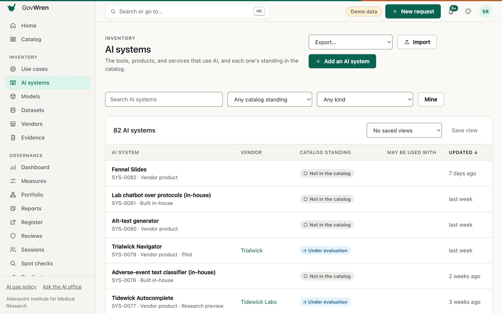

## Models and datasets

A tool is what people use. A **model** is what the tool is built on, and a **dataset** is what a model was trained on or what a use case works with. Recording them lets you answer "what depends on this?" when a model is withdrawn or a dataset's terms change.

### Record a model

Under **Models**, choose **Add a model**. Say what kind it is and where it comes from:

| Where it comes from | Means | What else to record |
|---|---|---|
| A supplier's service | Reached through an API. The weights stay with the supplier | The vendor, family, and version |
| Open weights | Published weights the organization runs itself | Where the weights were obtained, their checksum and format, the license and what it limits, where it runs |
| Fine-tuned in-house | An existing model adapted with your own data | The same, and how it was tuned |
| Built in-house | Trained from your own data | The same |

Record the checksum for any model you run yourselves: it says exactly which file is in use. Note the format too. A pickle or framework checkpoint can run code when it is loaded, so load one only from a source you trust.

The **Model card** fields (intended use, out-of-scope use, training data, evaluation, known limitations) follow the usual public conventions, so a published card can be copied in.

Anyone can add a model. Only governance sets its **catalog standing**, the data it may be used with, and its terms of use. An approved model appears in the catalog beside the approved tools.

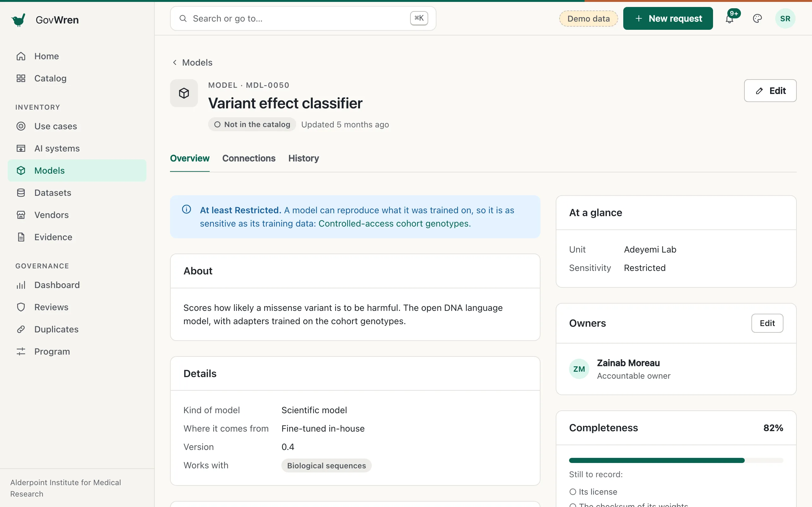

### Record a dataset

Under **Datasets**, choose **Add a dataset**. A dataset record is a description: its data class, the kinds of data in it, who it is about, whether people can be identified, where it came from, and what it may and may not be used for. GovWren never holds the data.

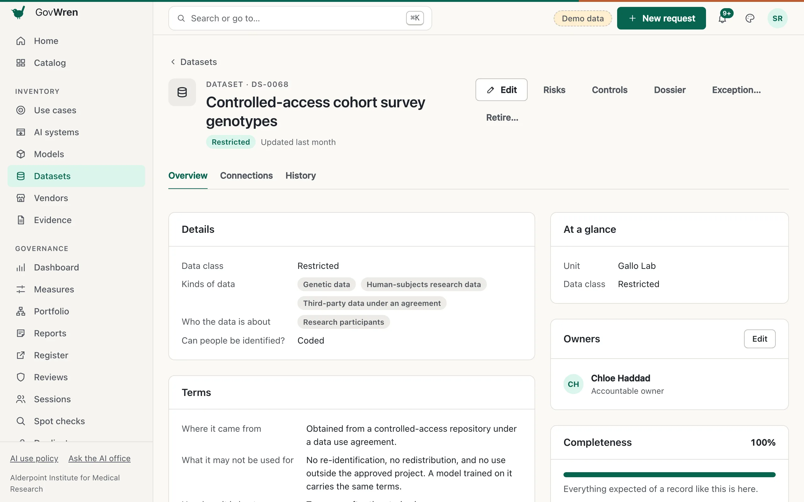

### Link records together

On any record, the **Connected to** card lists what it relies on and what relies on it. Choose **Add** to link it to another record. Each kind of link joins only the kinds of record it makes sense for:

| Link | From | To |
|---|---|---|
| Uses | Use case | AI system, model |
| Processes | Use case, AI system | Dataset |
| Built on | AI system | Model |
| Derived from | Model | Model |
| Trained on, Evaluated on | Model | Dataset |
| Embedded in, Depends on | AI system | AI system |
| Replaces | Any record | A record of the same kind |

You can link from a record you can edit. A link that would make a loop is refused. Once a request has been submitted, what its use case uses is part of what was reviewed. Its owners change it by [declaring a change](keeping-watch.md#declare-a-change); governance can also change it directly.

### See what depends on what

Every record has a **Connections** tab. It follows the links outward in both directions: on the left, everything that relies on the record; on the right, everything it relies on. Choose how many steps to follow. The same records are listed under the picture, each with how it is connected and how many steps away it is, so nothing is shown only as a drawing.

Use it when something changes. When a supplier withdraws a model, open the model's Connections tab to see every AI system built on it and every use case that uses those systems. A model with a withdrawal date shows a notice that leads there.

Records you may not see are counted and not shown, and nothing beyond them is followed.

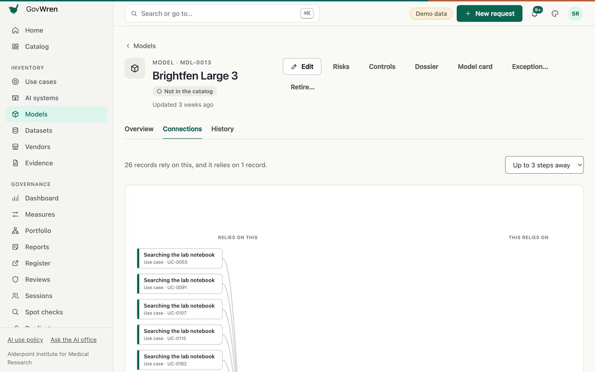

### A model is as sensitive as its training data

A model can reproduce what it was trained on. When you link a model to a dataset with **Trained on**, the model's sensitivity is raised to the dataset's data class if it was lower. The same follows through **Derived from**: a model fine-tuned from another is at least as sensitive as everything in its line. The model's page says which datasets set the level, and nobody can set it lower.

### Describe an agent

An AI system whose kind is **Agent** has a card, **What it can do by itself**: how much it does without a person, what it can change and where, the tools it is connected to, the account it acts as, whether its actions can be undone, how a person stops it, what it remembers, and its limits. An agent with none of this recorded shows a warning.

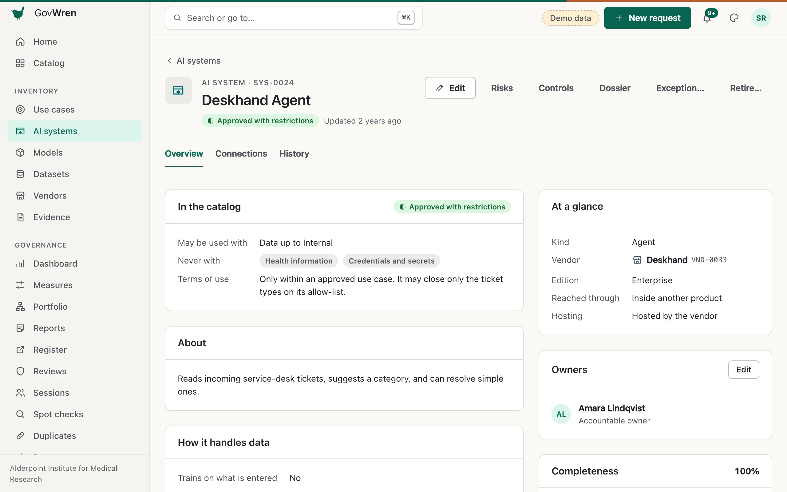

### Keep vendor agreements

A vendor's page lists its **Agreements**: the kind, a title, your reference, the dates it runs between, the notice it needs, whether it renews by itself, and who looks after it. Each shows where it stands today:

| Shown as | Means |
|---|---|
| Current | In force, with time to spare |
| Ends soon | Ends within 90 days |
| In its notice period | The last day to give notice has passed or is today |
| Ended | Past its end date and does not renew by itself |

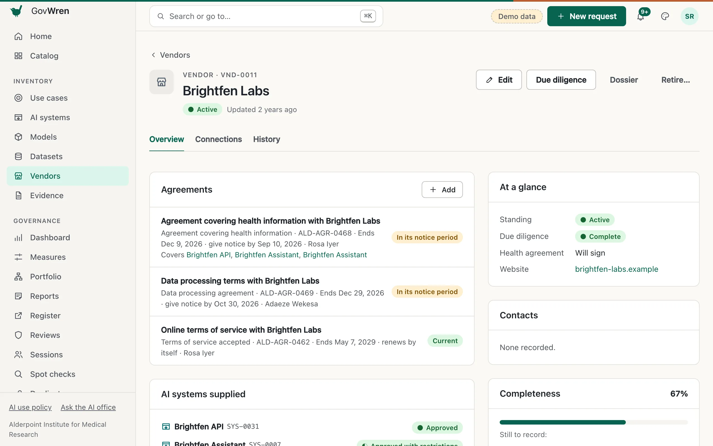

### Keep evidence

Evidence is whatever shows that a thing is so: an approval letter, a signed agreement, a supplier's assurance report, a test result. Every record has an **Evidence** card, and so does every condition and every review task. Choose **Attach** and give:

| Field | Meaning |
|---|---|
| What is it? | A short title |
| Kind | Document, approval, signed agreement, assessment, test result, supplier's assurance report, record, or other |
| A file | PDF, images, office documents, plain text, CSV, or JSON, up to 25 MB |
| Or an address | Where it lives, if it is kept in another system |
| Note | What it shows |
| Its date, and Good until | When it was issued, and when it goes stale. Leave **Good until** empty for things that do not |

A piece of evidence needs at least one of a file, an address, or a note. Whoever attaches it looks after it.

Files are judged by their content, not their name, and anything a browser could run is refused. Each file is stored once, under the SHA-256 of its content; attaching the same file twice keeps one copy. A file is only ever handed back as a download. The checksum is recorded in the history, so it is always possible to say exactly which document a decision rested on.

**Evidence**, in the menu, lists it all for those who read everything, soonest to expire first, and for everyone else the evidence they look after. Evidence past its **Good until** date is marked Expired, and evidence within 60 days of it is marked Expires soon; the dashboard counts both.

Evidence is never deleted. Withdraw a piece that was attached by mistake or is no longer true, and it stays on the record, struck through.

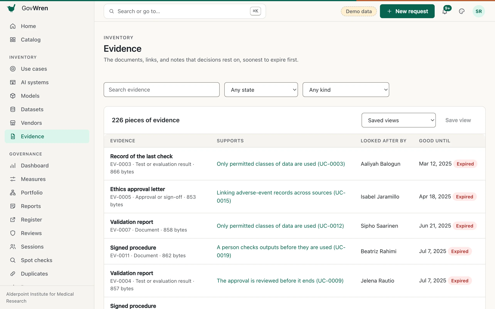

### Point to other systems

Every record has an **In other systems** card for the protocol, grant, agreement, purchase, ticket, or repository it belongs to: a kind, the number or name used there, and optionally a label and an address. GovWren stores the pointer and nothing else.

## Find things and keep the inventory tidy

### Search everything

Press <kbd>⌘K</kbd> or <kbd>Ctrl K</kbd>, or choose the search box at the top, and type. Records of every kind that match are listed as you type, with pages and actions beneath them: use cases, AI systems, models, datasets, vendors, and evidence. Type a whole reference, such as `MDL-0048`, and that record comes first. You are shown only what you may see.

### Save a view

Every list keeps its filters and sort in its address, so a filtered list can be bookmarked or sent to a colleague. To keep one for yourself, set the filters you want and choose **Save view**. Your views are in the **Saved views** menu on that list. Choose one to apply it; when the list matches a view, **Remove view** appears. Views are your own: nobody else sees them.

### See what a record is missing

Every record's page has a **Completeness** card: a percentage, and a plain list of what is still to record. What is expected depends on the record. A model you run yourselves is expected to say where its weights came from and what their checksum is; an agent is expected to say how a person stops it; a vendor you are a customer of is expected to have an agreement on file.

The dashboard shows the average for each kind of record. It leaves out drafts and retired records.

### Merge duplicates

**Duplicates**, under Governance, lists records that look like the same thing entered twice, by how alike their names are. Two editions of one product are different systems, and two versions of one model are different models; neither is listed.

To merge a pair, choose **Keep this one** on the record that should stay. Everything that pointed to the other record now points to the one you kept: links, evidence, references, and the people named as technical owners or contacts. For a vendor, its AI systems, models, and agreements move too. The other record is kept, marked as retired, with a notice that leads to the one that took its place, so its reference still works wherever it was written down. A merge cannot be undone, and it is in both records' histories.

Governance merges. Auditors and administrators can see the list.

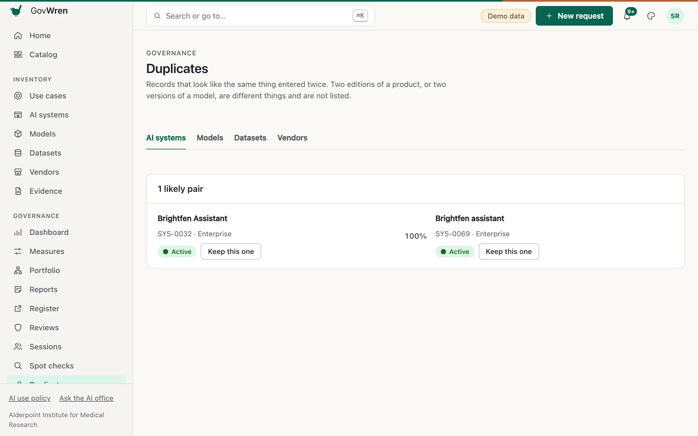

## Bring existing records in, and take lists out

### Import from a spreadsheet

If you already keep a list of AI tools, vendors, models, or datasets, import it. On the list for that kind of record, choose **Import** (governance only).

1. Save the spreadsheet as CSV, with a header row.
2. Choose the file. GovWren reads the header and guesses which column is which field.
3. Correct the guesses under **Which column is which?** Set a column to **Leave out** to ignore it. One column must be the Name.
4. Choose **Check the file**. Every row is tried and nothing is kept. The report says how many records would be added and changed, and lists every problem with its row.
5. Fix the file and check again until there are no problems, then choose **Import**.

How cells are read:

| Field | What to write |
|---|---|
| A choice, such as Kind or Hosting | The value as GovWren shows it, or its key. Capital letters do not matter |
| Several choices, such as Not to be used with | Values separated by semicolons |
| Unit | The unit's code, or its name |
| Vendor | The vendor's name, or its reference. Import vendors first |
| Owner | The person's email address. They become the accountable owner |
| Reference | The record's own reference, such as `SYS-0033`, to change exactly that record |

A row whose name matches a record already here changes that record. For AI systems the edition must match too, and for models the version, because two editions or two versions are different records. Importing the same file twice changes nothing the second time.

Each imported record is checked exactly as if it had been typed in, and its history says it was added by whoever ran the import.

Use cases are not imported. A use case is approved by a review, and an import cannot stand in for one. Register existing uses from the catalog, or submit them as requests.

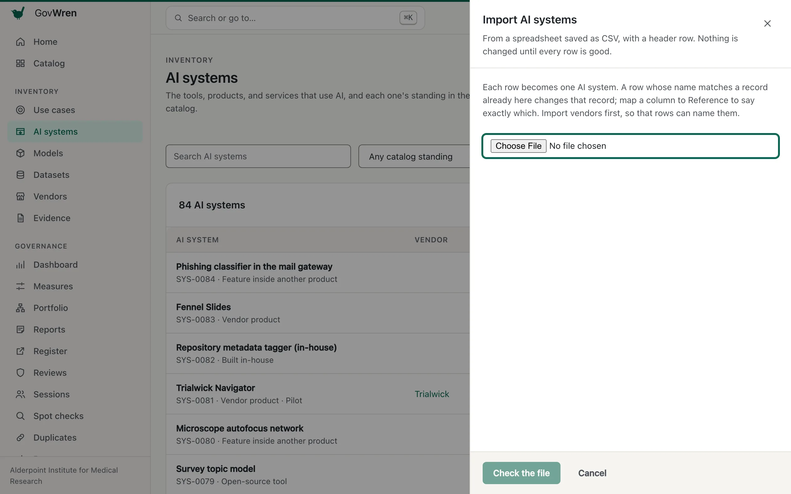

### Export a list

Every list has an **Export…** menu. It downloads the list as it is filtered now, every page of it, as CSV for a spreadsheet or as JSON. The file holds only what you may see.

The first line of a CSV export begins with `#` and says what the file is, when it was made, and the filters that produced it. GovWren's own import skips that line; delete it if another program objects. JSON exports carry the same in their `export` and `filters` fields. Cells that a spreadsheet would run as a formula are written as plain text.

## The data classes

GovWren ships with four data classes, ordered from least to most sensitive. The order matters: catalog permissions compare against it.

| Class | Definition |
|---|---|
| Public | Poses little or no risk if disclosed, and may be shared with anyone |
| Internal | Meant for use inside the organization, by its own people, for its own work. Not to be shared outside without oversight |
| Protected | Could harm people or the organization if seen by the wrong person, inside or out. Access is limited to those who need it for their work |
| Restricted | Governed by specific legal, regulatory, or contractual obligations. Loss or disclosure may require notifying people, partners, or authorities |

Each class carries examples, grouped as Personal, Research, Health, Financial, and Administrative, which people can open wherever they choose a class. The labels, definitions, and examples are yours to change in a [program pack](#move-the-program-as-a-file).

## How a request gets its tier

The default scoring model has six factors. Each scores 0 to 3, and takes the highest level any answer gives it.

| Factor | 0 | 3 |
|---|---|---|
| Impact on people | No effect on anyone outside the team | Could affect health, safety, legal rights, or livelihood |
| Decision role | Background or exploratory | Decides or acts without a person reviewing each case |
| Autonomy | Produces output only | Acts with effects that are hard to undo |
| Data sensitivity | Public data | Restricted data |
| Data exposure | Stays on the organization's own equipment | A supplier with no covering agreement, or one that may train on what is entered |
| Reach | One person or one team | The whole organization, or the public |

The total, from 0 to 18, gives the tier:

| Tier | Points | Review required | Who decides | Target | Approval runs |
|---|---|---|---|---|---|
| Minimal | 0–4 | None | Approved by rule | At once | 36 months |
| Moderate | 5–8 | None | Governance | 5 working days | 24 months |
| High | 9–12 | Privacy, security | The governance committee | 15 working days | 12 months |
| Critical | 13 and above | Privacy, security, legal | The committee, with an executive accepting the risk | 30 working days | 6 months |

**Floors** set a minimum tier whatever the points. By default, a request is at least High when:

- a mistake could seriously affect a person;
- Restricted data would go to a supplier with no covering agreement;
- it can take actions that are hard to undo;
- it decides about people without a person reviewing each case.

**Stops** mark a prohibited use. A stopped request can be submitted, but it is never approved by rule and cannot be approved in review. The defaults are:

- Restricted data entered into a system whose supplier may train on it;
- generative AI used to carry out confidential peer review;
- fully automated decisions about people, such as admission, hiring, or discipline.

Every tier shows its working: each factor's level, the answer behind it, and any floor or stop.

## Routing rules

Routing rules turn a tiered request into a review. Each rule has a condition, on the tier or on answers, and effects. Rules are read in order and their effects add up.

Besides the four tier rules above, the default rules add reviews for particular answers. Two of them concern models people run or train themselves: any such model needs an information security review and must be recorded in the inventory before use, and a model trained on Protected or Restricted data also needs a data stewardship review.

| When | Adds |
|---|---|
| Human-subjects research data is involved | Research ethics review |
| Health information is involved | Privacy review |
| Data goes to a supplier with no covering agreement | Legal review |
| Patients are affected | Clinical safety review |
| It acts by itself, within limits or irreversibly | Security and architecture reviews |
| Output is used in publications or grant applications | Research integrity review, and conditions on disclosure and checking references |
| Only public or internal data is involved | A condition not to enter Restricted data |

Every approved use also gets four standard conditions: check outputs, stay within the data described, declare changes, and report anything that goes wrong.

A request is approved by rule only when a rule says so, no rule requires a review, and nothing about it is a stop. So a Minimal request that involves health information still goes to privacy review.

## Change the program

The request form, the tiers, the routing rules, the standard conditions, and every vocabulary are yours to change. **Program**, under Governance, is where governance and administrators do it.

You work on a copy. Nothing you change is in force until you publish it, and the bar at the top of the page says what you have changed. **Discard changes** throws the copy away.

### The request form

The left side lists the form's sections and their questions. Choose one to edit it on the right. The arrows move it up or down.

For a question you set:

| Setting | Meaning |
|---|---|
| Question, Help text | What the requester reads |
| Kind of answer | A line of text, a paragraph, one choice, several choices, yes or no, a data class, a unit, or AI tools from the inventory |
| Choices come from | A list you write here, or one of the vocabularies |
| Fills in | A field of the use case that the answer is copied to, so that it can be filtered and reported on. The name and the unit must each be filled by a required question |
| An answer is required | Whether the request can be submitted without it |
| Ask this question | Always, or only when earlier answers call for it |

A question keeps the name it was stored under when it was first published, however its wording changes, so that rules and past answers keep working.

**Preview** shows the form as a requester would meet it, with the tier your working copy gives. Nothing you enter there is kept.

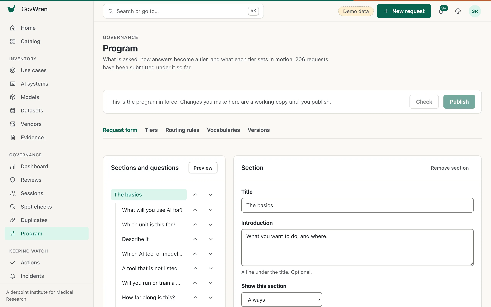

### The tiers

Each factor scores from 0 to 3, the points are added up, and the total decides the tier. On the **Tiers** tab you set:

- what each tier is called and the total it begins at;
- for each factor, the rules that raise it: a score, when it applies, and the reason shown beside the factor;
- **floors**, which set the least a tier can be whatever the points come to;
- **prohibited uses**, which cannot be approved at all.

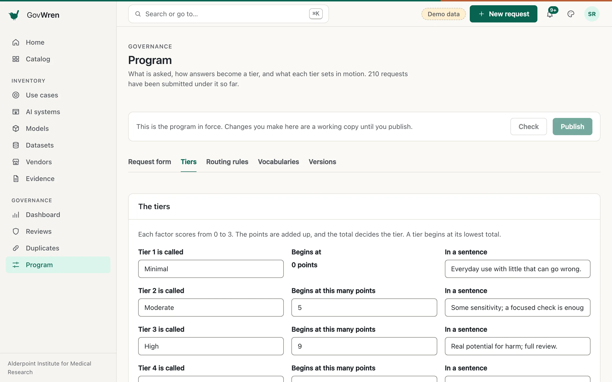

### The routing rules

Every rule that applies to a request adds to what happens to it. On the **Routing rules** tab, each rule has a name, when it applies, the reviews it requires, who decides, the target in working days, how often an approval is looked at again, the standard conditions it attaches, and whether it approves at once when nothing else requires a review.

The **standard conditions** are below the rules: the wording, and whether each is before use, by a date, or ongoing.

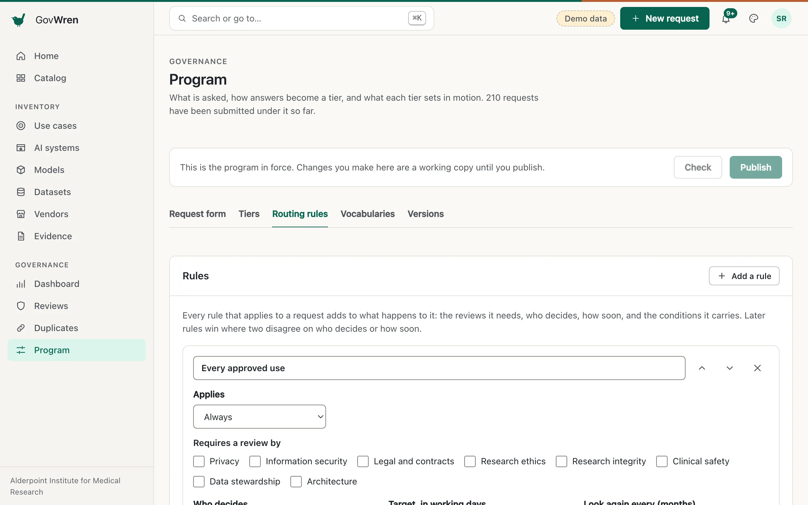

### Conditions, in words

Wherever the program asks "when?", you build the answer as a sentence: choose what it is about (a question in the form, or the tier), how it compares, and the value. Add tests and say whether all of them or any of them must hold.

### The vocabularies

The lists that records and forms choose from. Rename a value freely: records hold its permanent key, so nothing is rewritten. Add values, and put them in order. A value that records may already hold cannot be removed; tick **Retired** and it stays on the records that have it and is no longer offered.

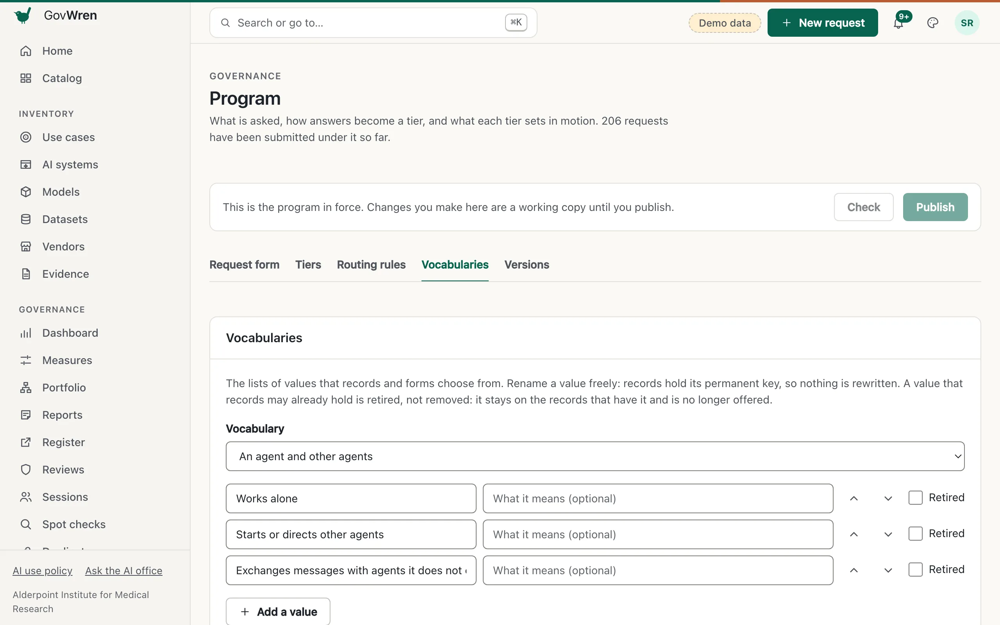

### Check, then publish

**Check** does two things and changes nothing.

1. It checks the whole program for mistakes: a rule about a question that no longer exists, a choice with no label, two questions stored under one name. Every problem is listed.
2. It runs the requests already submitted through your working copy and says what would have come out differently: how many would have had a higher or lower tier, needed different reviews, or moved between approval by rule and review by people, with examples you can open.

**Publish** is offered once a check has passed. Each part you changed becomes a new version. Earlier versions are kept, and the **Versions** tab lists them with who published each and when.

Publishing never changes what was decided. A request already decided keeps the form, the tiers, and the rules it was decided under; the new version applies from the next request.

### People asking for tools

When someone cannot find a tool in the catalog, they can **Ask for a tool to be evaluated**: its name, what they want it for, and its website. The tool is added to AI systems, outside the catalog, and governance is told. If several people ask about the same tool, their requests are gathered under it.

Those who keep the catalog see **Tools people have asked about** at the top of the catalog, most asked-for first. When you set the tool's catalog standing to approved, approved with restrictions, or not approved, everyone who asked is told.

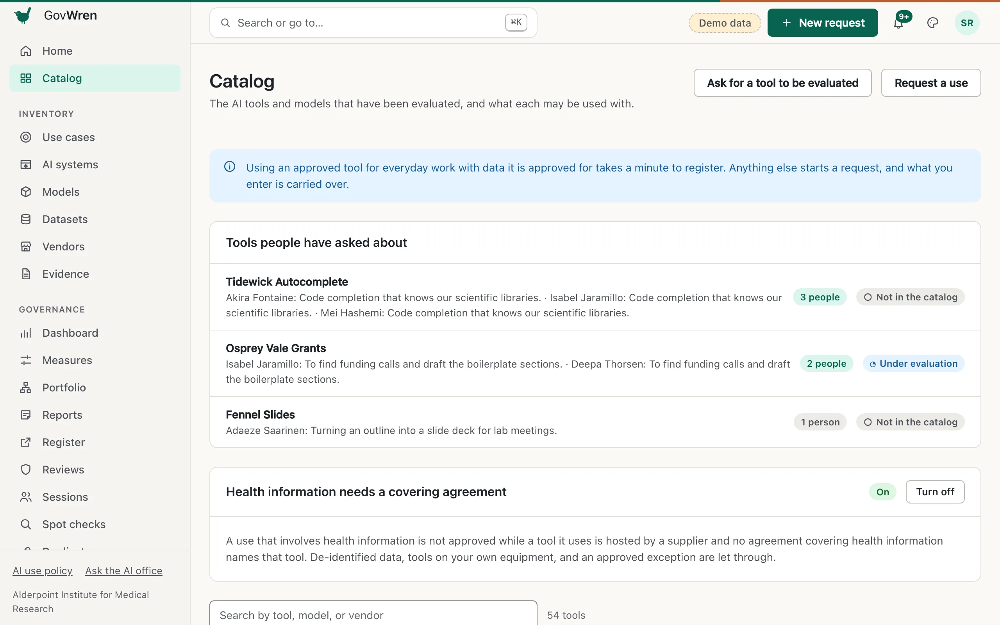

## Move the program as a file

The same program can be exported as one file, a program pack, edited, and loaded again. Use it to keep the program under version control, to move it between installations, or to make a change too large for the editors.

```bash
uv run govwren program export --out program.json     # write the program as it stands
uv run govwren program import --check program.json   # check an edited file; change nothing
uv run govwren program import program.json           # load it
```

A pack is JSON with these parts:

| Part | Holds |
|---|---|
| `pack` | A header: key, kind (`program`), title |
| `vocabularies` | Data classes, kinds of data, domains, stages, review functions, unit kinds, and the rest |
| `forms` | The request form: sections, questions, and when each is shown |
| `scoring_model` | Factors, contributions, tiers, floors, and stops |
| `review` | Standard conditions (`condition_templates`) and routing `rules` |

How loading works:

- The whole file is checked first. If anything is wrong, every problem is listed and nothing is loaded.
- Whatever differs from the published program becomes a new version. Whatever is the same is left alone.
- Earlier versions are kept. A past request still shows the questions it was asked and the rules it was tiered under.
- A vocabulary value can be relabelled, or retired by adding `"retired": true`. It cannot be removed, because records may use it.
- A value your installation has and the pack leaves out is kept and retired for you: records that hold it still show it, and nothing new can choose it.
- Loading a pack is recorded in the history.

Keep the pack under version control and review changes to it like any other policy. The format is described in [spec/content-packs.md](../spec/content-packs.md).

## Begin from a starter

GovWren comes with three starter programs. Each is the default program as one kind of organization would first change it: its own kinds of unit, its areas of work, and a few rules and conditions. Each is a whole program pack that you can read, load, and then edit.

| Starter | What it changes |
|---|---|
| `starter-research-institute` | Divisions, cores, and labs. A rule and a condition for data received under an agreement |
| `starter-university` | Schools and departments, teaching and student services as areas of work, students and applicants as people affected. Rules for student records and for decisions about people |
| `starter-academic-medical-center` | Clinics beside labs, quality and patient safety as an area of work. Clinical safety review for anything near care, and conditions about the patient record and downtime |

See what comes with your version:

```bash
uv run govwren program packs
```

To begin a new installation from one, name it when you set up:

```bash
uv run govwren init --program starter-university
```

To load one over a program you already have, import it by name. It becomes a new version of your form, tiers, and rules, exactly as a file would:

```bash
uv run govwren program import starter-university --check
uv run govwren program import starter-university
```

A starter is a beginning. Open **Program** afterwards and make it yours.

### Add risks and controls for your kind of work

A content pack adds risk statements and controls to the libraries. Loading one retires nothing: what is there stays, and the pack's entries are added or brought up to date.

| Content pack | Adds |
|---|---|
| `content-research` | Six risks and four controls for research: funders' and journals' rules, analyses that must be run again, unpublished work, collaborators, and consent |
| `content-health` | Six risks and five controls for work near patient care: the patient record, local validation, alerts, regulated devices, and downtime |

```bash
uv run govwren program import content-health
```

You can write your own in the same shape. A content pack is a JSON file with a `pack` header of kind `content`, `risk_categories` and `risks`, and `control_categories` and `controls`. A control may carry a `when` rule that says which records it applies to. The packs that come with GovWren are in `src/govwren/resources/packs/` to copy from.

A framework of your own loads the same way. [Frameworks](assurance.md#frameworks) describes the file.

## Add your own fields

The built-in fields are the ones every program needs. Your organization will have a few of its own: a cost center, a contract number, the date a grant ends.

Governance and administrators add them under **Fields**, for each kind of record.

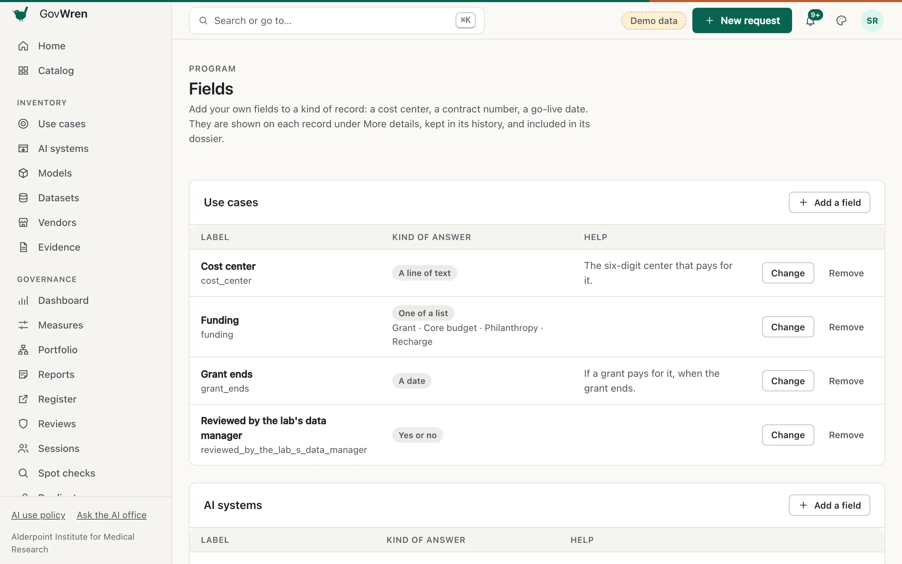

1. Open **Fields** and choose **Add a field** beside the kind of record.
2. Give it a label, and choose the kind of answer: a line of text, a paragraph, one of a list, a date, yes or no, or a number.
3. For a list, give the choices, one to a line.
4. Add a line of help if the label needs one.

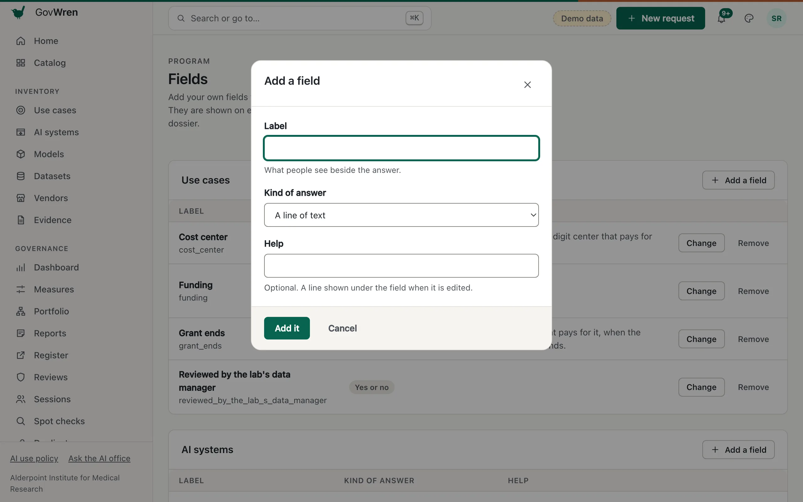

Each record of that kind then shows the fields under **More details**, and anyone who can edit the record can answer them. An owner can answer them on an approved use case without declaring a change.

Added fields are part of the record: changes to them are in its history, and they are in its dossier. They are for your own bookkeeping. Tiers, routing rules, and controls do not read them.

**Remove** takes a field off the page. Answers already given stay on the records and in their history, and return if you add the field again with the same key.

Up to twenty fields can be added to each kind of record.

## Choose who sees approved use cases

One setting decides how much of an approved use case the rest of the organization sees.

| Value | Effect |
|---|---|
| `open` | Everyone sees every approved use case in full |
| `summary` | Everyone sees a summary; a use case's own unit sees it in full. This is the default |
| `unit` | People see only the use cases of their own units |

Drafts and records marked **Restricted** stay private whatever the setting. Owners, stewards of the unit, governance, auditors, and administrators always see a record in full. In this release the setting is changed through the API, by governance or an administrator: see [`PUT /api/v1/admin/inventory`](api.md#inventory).

## Read the dashboard

The **Dashboard** is for governance, auditors, and administrators.

| Figure | What it counts |
|---|---|
| Approved uses of AI | Use cases that are Approved or Approved with conditions |
| Requests in progress | Use cases that are submitted, in review, or back with their requester |
| Systems in the catalog | AI systems that are Approved or Approved with restrictions |
| Vendors | Every vendor recorded |
| Needs attention | Evidence that has expired or is about to; vendor agreements that have ended, are ending, or are in their notice period; reviews past their target date; conditions past their due date; approvals not yet in effect because a before-use condition is open; approvals ending within 60 days. Only counts above zero are listed |
| Approved uses by tier, unit, area, stage | Approved use cases, grouped. Units are rolled up to the level below the organization, and the ten largest are shown |
| Every use case by status | Every use case except drafts |
| Open reviews | Where they are (waiting for triage, with reviewers, with the requester, ready for a decision) and how many days since each was opened |
| Decisions in the last 90 days | Reviews closed in that time, split into decided by rule and decided by people. A request that was only returned is not counted |
| Median days | For requests decided by people in the last 90 days: the middle value of the time from submission to decision, not counting time the request was back with its requester |

The tiles and the bars are links to the records they count. Under Needs attention, the counts for evidence, agreements, and reviews are links; the three about conditions and approvals are counts only. The dashboard also shows, for each kind of record, how complete the records are on average.

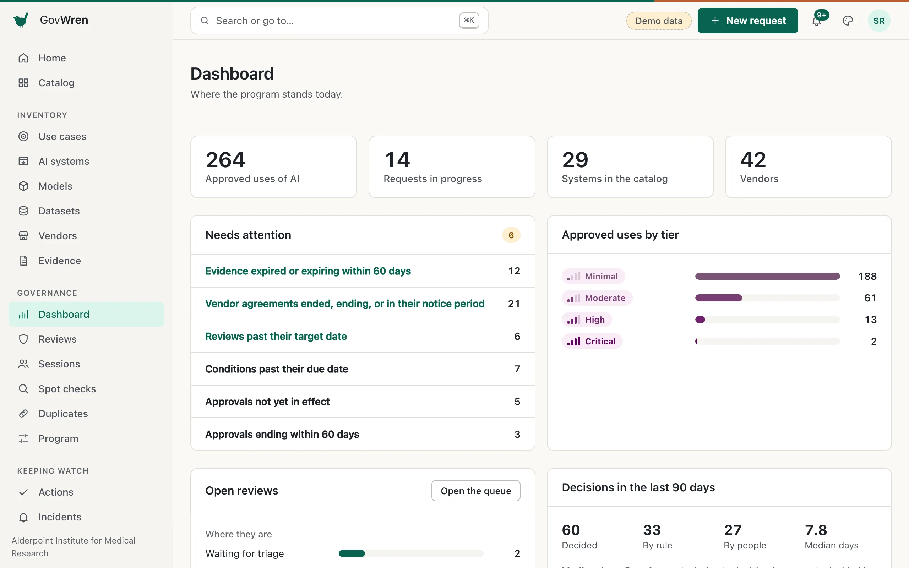

## Trust the history

Every change to a record is written to an append-only history in the same transaction as the change: who, when, and each value before and after. Each record's **History** tab shows it in plain words. Changes made at the command line are recorded as such.

Events are chained by hash, and the database itself refuses updates and deletes on the history. To check the chain:

```bash
uv run govwren verify
```

It reports how many events hold, or the first event that has been altered, removed, or cut from the end, and exits with 1 if the history is broken. `uv run govwren doctor` runs the same check along with the rest.

## Set the appearance

Under **Admin → Appearance**:

| Setting | Notes |
|---|---|
| Product name | Shown in the sidebar and the browser tab |
| Organization | Shown on the sign-in page and on Home |
| Default palette | Wren, Slate, or Garnet. What everyone sees unless they choose another for themselves |
| Accent color | Optional. Your brand color as hex. It is adjusted automatically for dark mode, and refused if text on it could not be read |
| Accent after dark | Optional. Your own lighter shade for dark mode, checked the same way. Leave it empty and one is worked out from the accent |
| Logos and tab icon | A logo for light backgrounds, one for dark, and a browser tab icon. PNG, JPEG, WebP, or SVG, up to 2 MB |
| Sign-in picture | Fills the panel beside the sign-in form, in place of the wren |
| Message on the sign-in page | Up to 600 characters: who to ask for access, or a line about your program |
| Links | Up to five, shown at the foot of the sidebar and of the sign-in page: your AI policy, your help desk. Each address must start with `https://`, `http://`, or `mailto:` |
| Last line of every email | For example your office's name and how to reach it |

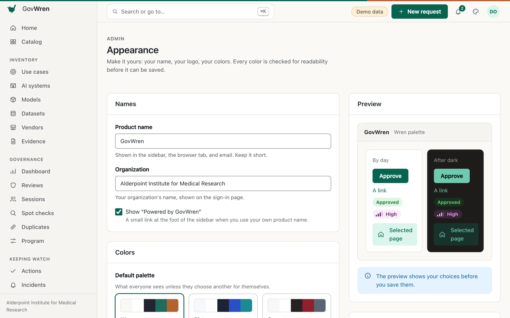

The preview shows your choices by day and after dark before you save. Changes apply for everyone as soon as you save. An uploaded SVG is reduced to its drawing and served so that it cannot run anything.

### Use your own words

If your organization says *lab* where GovWren says *unit*, or *supplier* where it says *vendor*, set that under **Your own words** on the same page. Six words can be replaced, each with its singular and its plural:

| Standard word | An example of your own |
|---|---|
| Use case | AI use |
| AI system | AI tool |
| Model | Model |
| Dataset | Data collection |
| Vendor | Supplier |
| Unit | Lab |

Your words are used in the menu, in page titles, and wherever a kind of record is named. Sentences inside pages, emails, and exported files keep the standard words. Leave a row empty to keep the standard word. Give both the singular and the plural, or neither.
